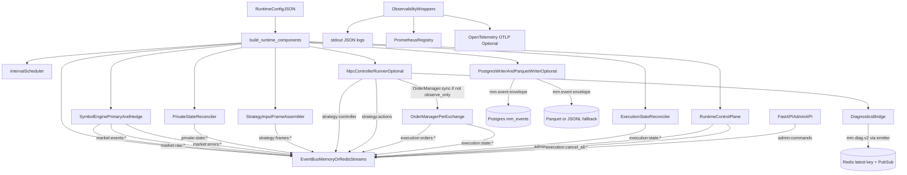

# Current Runtime Wiring (`mm/`)

This document describes the **current** wiring in the async runtime under `mm/`:

- what data exists,
- where each data type is produced,
- where it is published/stored,
- and how to inspect strategy actions.

## 1) High-level wiring



## 2) Data types and where they go

### Market data path

- **Produced by**: exchange market adapters through `SymbolEngine`.
- **Types**:
  - `RawTrade`
  - `RawOrderbook`
  - `MarketEvent`
- **Published topics**:
  - `market:raw:<exchange>:<symbol>:trades`
  - `market:raw:<exchange>:<symbol>:orderbook`
  - `market:events:<exchange>:<symbol>:<interval_ms>`
  - `market:errors:<exchange>:<symbol>`

### Private state path

- **Produced by**: `PrivateStateReconciler` + exchange private adapters.
- **Types**:
  - `PrivateStateSnapshot`
  - `OpenOrder`
  - `OrderUpdate`
  - `Fill`
- **Published topics**:
  - `private:state:<exchange>:snapshot`
  - `private:state:<exchange>:open_orders`
  - `private:state:<exchange>:order_updates`
  - `private:state:<exchange>:fills`

### Strategy input path

- **Produced by**: `StrategyInputFrameAssembler`.
- **Input**:
  - primary `MarketEvent` queue
  - optional hedge `MarketEvent` queue
  - optional private snapshot queues
- **Output type**: `StrategyInputFrame`
- **Published topic**:
  - `strategy:frames:<primary_exchange>:<symbol>:<interval_ms>`

### Controller and action path

- **Produced by**: `MpcControllerRunner` (if enabled).
- **Outputs**:
  - `ControllerDecision` payload (dict) on `strategy:controller`
  - `Action` object on `strategy:actions`
- **Live order side effects**:
  - if `observe_only == false` and warmup completed, calls `OrderManager.sync`.

### Execution path

- **Produced by**: `OrderManager` + `ExecutionStateReconciler`.
- **Topics**:
  - `execution:orders:<exchange>` (requested/accepted place/cancel)
  - `execution:state:<exchange>` (`ExecutionSnapshot`)
- **Cancel all path**:
  - `admin:commands` -> `RuntimeControlPlane` -> `execution:cancel_all:<exchange|all>` -> `ExecutionStateReconciler` -> `OrderManager.cancel_all()`

### Admin command path

- **Produced by**: `mm.api.admin` (FastAPI).
- **Topics**:
  - `admin:commands`
  - `admin:events`
- **State maintained by**: `RuntimeControlPlane`
  - paused actors
  - observe-only state
  - kill-switch state

### Persistence path

- **Envelope format**: all persisted events are wrapped with `mm.event` envelope:
  - `schema`, `version`, `event_id`, `run_id`, `source`, `topic`, `event_type`,
    `exchange`, `symbol`, `actor_id`, `timestamp_ms`, `payload`.
- **Postgres** (`PostgresEventWriter`):
  - append-only `mm_events`
  - latest snapshots in `mm_latest_state`
  - `admin_audit_log` table exists in DDL (write path is for future expansion)
- **Parquet** (`ParquetEventWriter`):
  - partitioned by date/exchange/symbol/event type
  - if `pyarrow` missing, writes JSONL fallback in same partition layout.

## 3) Logs, metrics, traces: source and destination

### Logs

- **Source calls**: `mm.observability.log_event(...)` from frame assembler, controller, order manager, control plane.
- **Backend**: `mm.layers.adapters.observability.jsonlog.emit`.
- **Destination**: stdout JSON lines (enabled by `MM_JSON_LOG` or runtime observability config).
- **Infra shipping**: Docker Compose includes Alloy/Loki path for container logs.

### Metrics

- **Source calls**: `gauge(...)`, `counter_inc(...)`, `latency_metric(...)`.
- **Backend**: in-process `mm.observability_metrics.REGISTRY`.
- **Destination**:
  - exposed at `/metrics` if `MM_METRICS_PORT` is set,
  - scraped by Prometheus/Grafana stack.

### Traces

- **Source**: `span(...)` wrappers in runtime components.
- **Backend**: OpenTelemetry (optional).
- **Destination**: OTLP exporter configured in runtime observability settings, then Tempo/Alloy stack.
- If OTel SDK is unavailable or disabled, spans safely no-op.

### Diagnostics Side Channel

- **Source**: `MpcControllerRunner` decision payload.
- **Bridge**: `mm.diagnostics_bridge.emit_controller_diagnostics`.
- **Backend**: `mm.diagnostics_emitter`.
- **Destination**:
  - Redis latest key (`SET`)
  - Redis Pub/Sub channel
  - optional stdout JSON delta/full payloads
- **Consumer**: optional Redis/stdout consumers. The legacy `mm.layers.viz` service has been removed from the default runtime.

## 4) How to check strategy actions now

## A) Fastest: print action events from runtime

Use:

```bash
python3 -m mm.runtime.print_events --config mm/configs/market_maker.runtime.example.json --events 200
```

This prints JSON lines with topic and summarized payload.  
Look for topic `strategy:actions`.

If you want raw market data too:

```bash
python3 -m mm.runtime.print_events --config mm/configs/market_maker.runtime.example.json --raw --events 300
```

## B) Watch controller decisions

Controller diagnostics are published on `strategy:controller` and include:

- `orders` (the generated order list),
- `order_count`,
- `decision_hash`,
- model params and optimizer outputs.

In practice, run `print_events` and filter lines containing `"topic":"strategy:controller"`.

## C) Inspect execution intent and exchange commands

Monitor:

- `execution:orders:<exchange>`
- `execution:state:<exchange>`

These show what was requested, accepted, and what the live local order view is.

## D) Query persisted actions/events

If persistence is enabled:

- Postgres table `mm_events`: filter by `topic='strategy:actions'` or `topic='strategy:controller'`.
- Parquet partitions: filter by event type/topic for replay and analysis.

## 5) Bus mode impact

- **`memory`**: in-process only; good for local single process.
- **`redis_streams`**: durable fan-out and replay-friendly transport.

Topics are the same; only transport changes.

## 6) Practical checklist before debugging action flow

- Controller enabled in runtime config (`controller.enabled=true`).
- `observe_only` set as intended (true = no live sync calls).
- API tokens configured for exchanges where execution/private state is expected.
- Confirm you see:
  1) `market:events:*`
  2) `strategy:frames:*`
  3) `strategy:controller`
  4) `strategy:actions`
  5) `execution:orders:*` / `execution:state:*` (if live execution path enabled).

## 7) Grafana: order book depth from Postgres

With persistence writing `MarketEvent` rows to `mm_events`, Grafana can plot cumulative bid/ask depth (price on X) using the provisioned dashboard [grafana/dashboards/mm_orderbook_depth_pg.json](../grafana/dashboards/mm_orderbook_depth_pg.json) (folder **Market Maker**). Set dashboard variables `exchange`, `symbol`, and `interval_ms` to match `market:events:{exchange}:{symbol}:{interval_ms}`. Redis Streams are not configured as a Grafana datasource in this repo; use RedisInsight or add a Redis data source plugin for stream-based charts.
