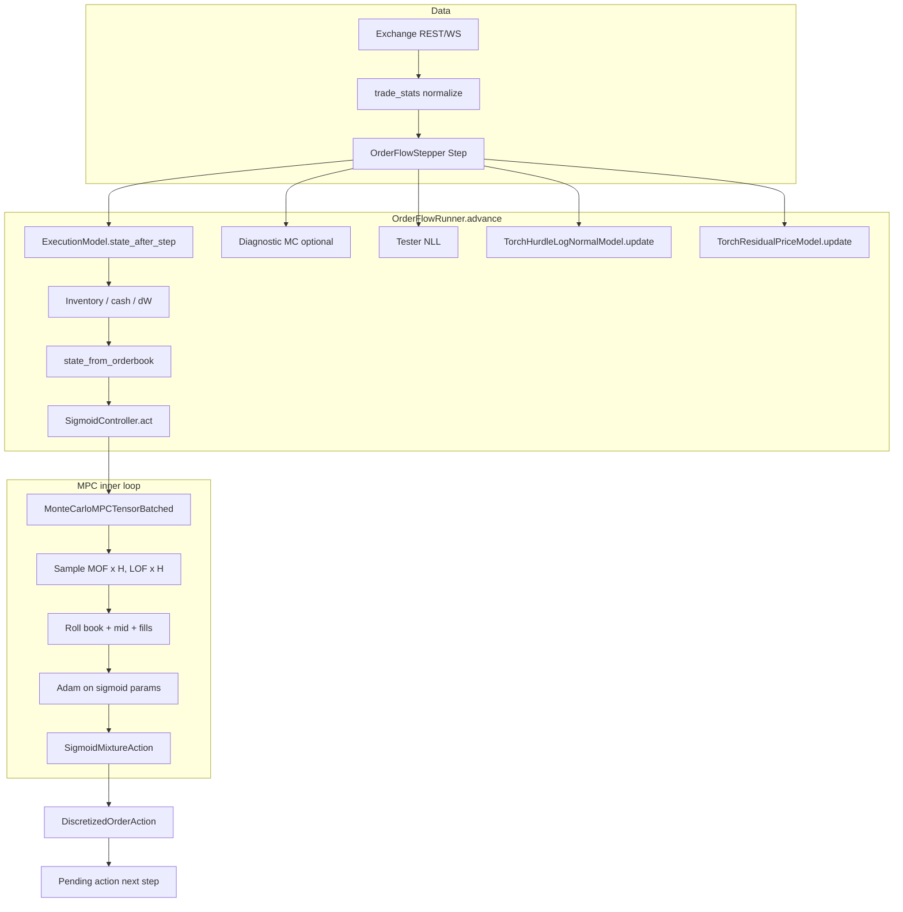

# End-to-End Pipeline: Data, Learning, Monte Carlo, and Control

This document explains how the **market maker codebase** fits together: how market data becomes **steps**, how **models learn online**, where **Monte Carlo** appears (in two different roles), and how the **controller** chooses quotes. For deep detail on the MPC mathematics (sigmoid actions, rewards, gradients), see [MPC_MARKET_MAKER_EXPLANATION.md](./MPC_MARKET_MAKER_EXPLANATION.md).

---

## 1. Repository map (what lives where)

| Area | Main files |
|------|------------|
| **Market data & steps** | `trade_stats.py` (exchange REST, normalization), `order_flow_stepper.py` (time windows, `Step`) |
| **Main loop** | `order_flow_runner.py` (`OrderFlowRunner.advance`) |
| **Pipeline wiring** | `order_flow_pipeline.py` (`build_pipeline`, `create_runner`, `main` → animation) |
| **Online models** | `market_making_controller/models/` — `market_order_flow_torch.py`, `price_torch.py`, `flow_implied.py`, `execution.py` |
| **MPC + control** | `market_making_controller/mpc_tensor_batched.py`, `controller.py`, `reward_tensor.py` |
| **State / actions** | `market_making_controller/state.py` |
| **Diagnostics** | `order_flow_testers.py`, `order_flow_animation.py` |

---

## 2. Data processing: from exchange to one `Step`

### 2.1 Units and normalization

- **`trade_stats`** talks to supported exchanges (REST; optional websockets feed the same normalized shapes).
- Trades and order books are normalized so that **prices are in ticks** and **sizes are in integer lots** (see `normalize_trade_to_tick_lot_units`, `normalize_orderbook_from_raw`). This keeps the rest of the stack dimensionally consistent.

### 2.2 `OrderFlowStepper`: discrete time buckets

`OrderFlowStepper` (`order_flow_stepper.py`) advances in windows of length **`T_ms`** (e.g. 10 seconds).

For each call to **`advance(t_end_ms)`**:

1. **Order book** at `t_end_ms` is fetched from an `OrderbookDataProvider` (REST per step, or websocket-backed buffer that returns the latest snapshot with `t_ms ≤ t_end_ms`).
2. **Trades** in **`[t_end_ms - T_ms, t_end_ms]`** come from a `TradeDataProvider`.
3. **Aggressor side → buy vs sell volume in lots:**
   - `isBuyerMaker == True` → trade counts as **sell** volume (seller was the maker; aggressor sold into the bid).
   - `isBuyerMaker == False` → **buy** volume (aggressor lifted the ask).

The result is a **`Step`**:

```text
Step = (t_end_ms, orderbook, buy_lots, sell_lots)
```

Appended to `stepper.steps` for history. Failed OB fetch returns `None`.

### 2.3 Providers

- **REST**: simple polling each step.
- **Buffered polling**: background thread fills a deque; windows read from memory for exact timing.
- **Websocket mode (`use_websocket_market_data`)**: a single **`WebSocketBufferedMarketDataProvider`** feeds both the order book and **trades** from the exchange websocket only (no REST fallback on trades — empty windows mean no parsed trades in that interval). Without websocket, trades use **`BufferedPollingTradeDataProvider`** (buffered REST polling).

---

## 3. The simulation loop: `OrderFlowRunner.advance`

`OrderFlowRunner` (`order_flow_runner.py`) is the **single orchestration point**. One `advance()` does the following in order:

### 3.1 Apply the *previous* action with the *current* step

Market making is **one step delayed**: the action chosen after the last observation is executed against **this** step’s trade volume and book.

If `execution_model` is set:

- **`state_after_step(prev_state, prev_action, curr_step)`** computes fills, updates **inventory** and **cash**, and sets **`_last_dW`** (wealth change) and optional **`_last_pnl_decomp`** (spread / inventory / cross).
- Wealth is mark-to-market: **W = cash + inventory × mid**.

So the runner always pairs **(state at quote time, action)** with **(next step’s OB and market flow)** to get realized PnL.

#### 3.1.1 Execution model role (what it is responsible for)

The execution model is the **state transition operator** for realized execution:

```text
(prev_state, prev_action, curr_step) -> curr_state
```

It is the only component that turns:

- previously posted quotes (`prev_action`),
- realized market flow in the next bucket (`curr_step.buy_vol`, `curr_step.sell_vol`),
- and the next observed book/mid (`curr_step.orderbook`)

into realized portfolio outcomes (fills, inventory, cash, wealth change).

This makes it the bridge between:

- **control decision** at time `t` (controller output), and
- **realized PnL/state** at time `t+1` (what actually happened in market conditions).

#### 3.1.2 Execution model I/O contract (current implementation)

Current implementation: `DiscretizedExecutionModel.state_after_step(...)` in `market_making_controller/models/execution.py`.

Input:

- `prev_state: State`
  - `mid`, `ob_rel`, `inventory`, `cash`, plus previous-step context.
- `prev_action: DiscretizedOrderAction | Action`
  - quote ladder (or simple bid/ask action) that was pending from the last controller call.
- `curr_step: tuple[int, Orderbook, int, int]`
  - `(t_end_ms, ob_curr, buy_vol, sell_vol)` for the newly arrived bucket.
- `spread_max` (optional)
  - used for `ob_rel` conversion in the returned state.

Output:

- returned `State` (new current state):
  - `mid=mid_curr`, `ob_rel` from current OB, `buy_vol`, `sell_vol`,
  - updated `inventory`, updated `cash`.
- side-channel diagnostics on the model instance:
  - `_last_dW`: realized one-step wealth change
  - `_last_pnl_decomp`: `{spread_pnl, inventory_pnl, cross_pnl}`

Wealth definition remains:

```text
W = cash + inventory * mid
```

and `_last_dW = W_after - W_before`.

#### 3.1.3 Where it sits in `advance()` ordering

Inside `OrderFlowRunner.advance()` the execution transition is applied **before** model updates and before choosing the next action:

1. get `curr_step` from `OrderFlowStepper`
2. apply pending `(prev_state, prev_action)` through `execution_model.state_after_step(...)`
3. write runner state (`inventory`, `cash`) and realized diagnostics (`dW`, pnl decomposition)
4. update estimators/models with `(prev_step, curr_step)`
5. build current state and call controller for next pending action

So yes: in this pipeline, realized **next state** after action is determined by the execution model.

#### 3.1.4 Which plots come from execution output vs other components

Directly from execution-model output (`state_after_step` + runner bookkeeping):

- **Inventory** (`inv_hist`) — from returned `State.inventory`
- **Cash** (`cash_hist`) — from returned `State.cash`
- **Wealth** (`wealth_hist`) — computed from updated inventory/cash and current mid
- **Realized ΔW** (`dW_hist`) — from execution model `_last_dW`
- **Cumulative spread/inventory/cross PnL**
  - `cum_spread_pnl_hist`, `cum_inventory_pnl_hist`, `cum_cross_pnl_hist`
  - from execution model `_last_pnl_decomp`

Not from realized execution output:

- **Expected ΔW (`E_dW_hist`)**
  - comes from MPC optimizer estimate (`optimizer._last_E_dW`) at action time.
- **Expected mid / representative-price diagnostics**
  - from runner diagnostic Monte Carlo and price/flow models.
- **NLL / model parameter plots**
  - from tester/model update paths, not from execution transition.

### 3.2 Diagnostics *before* updating models (predictive Monte Carlo)

If a previous step exists, the runner runs **diagnostic** Monte Carlo (size **`expected_mid_n_samples`**, separate from MPC’s `n_samples`):

- **Expected next mid** (`_estimate_expected_mid_mc`): when `model` and `price_model` exist; samples MOF, builds **mid** from MOF-only book evolution on the previous OB, adds residual sample, averages **mid_next**.
- **Expected representative buy/sell prices** (`_estimate_expected_representative_prices_mc`): samples MOF volumes, applies the same VWAP construction as the residual price model, adds residual noise; means are used for prediction error EWMAs vs realized prices.

These routines **do not** train the optimizer; they feed **plots and calibration checks**.

### 3.3 Model scoring and online learning

Still with `prev_step` and `curr_step`:

1. **`tester.update(prev_step, curr_step, params)`** — `GeneralOrderFlowLogLossTester` scores the **previous** MOF parameters against the **current** window’s `(buy_vol, sell_vol)` using negative log-likelihood (hurdle–LogNormal or Gamma, depending on param keys). This produces EWMA log-loss curves for monitoring.
2. **`model.update(prev_step, curr_step)`** — **`TorchHurdleLogNormalModel`** updates **p0, μ, σ** per side via EWMA on observed integer volumes (hurdle for zeros, log-space moments for positives).
3. **`_expected_mof_volume_mc`** — Monte Carlo mean of **`model.sample()`** to track **E[buy], E[sell]** under current params (diagnostic; matches the generative sampler).
4. **`price_model.update(prev_step, curr_step)`** — **`TorchResidualPriceModel`** updates **residual means and variances** from representative-price errors (EWMA of μ and centered σ² per side when `learn_residual` is True).

If **`limit_order_flow_model`** exists, it is updated here as well (not used in the default `build_pipeline`, which sets LOF to `None`).

### 3.4 New control action

- Build **`State`** from the **current** order book, **current** step’s `buy_vol`/`sell_vol`, and **updated** inventory/cash (`state_from_orderbook` in `state.py`).
- **`SigmoidController.act(state)`**:
  - Calls **`MonteCarloMPCTensorBatched.optimize(state)`** → **`SigmoidMixtureAction`**.
  - Optionally returns **no quotes** if **`zero_action_if_negative_J_mean`** and the optimizer’s **`_last_E_dW`** is negative.
  - Converts the sigmoid mixture to **`DiscretizedOrderAction`** (ladder of `(spread_ticks, qty)` marginal sizes).

The new action is stored as **`_pending_action`** with **`_pending_state`**; it will be evaluated on the **next** `advance()`.

**Important:** MPC uses **`mpc_kwargs["n_samples"]`** (often 128+) and **`horizon`**; animation diagnostics use **`expected_mid_n_samples`** (often smaller). They are intentionally separate knobs.

---

## 4. Model learning (online, not batch training)

There is **no offline dataset training loop**. Models are **streaming estimators**:

| Model | What is observed | What is updated |
|--------|------------------|-----------------|
| **TorchHurdleLogNormalModel** | Integer `buy_lots`, `sell_lots` per window | `p0_*`, `μ_*`, `σ_*` in log-space for the positive branch (EWMA) |
| **TorchResidualPriceModel** | VWAP-based “realized” vs “MOF-only book” representative prices (with internal price EWMA) | `μ_buy`, `μ_sell`, `σ_buy`, `σ_sell` (EWMA mean + EWMA centered variance); **`get_params()`** exposes `mu_mid`, `sigma_mid`, etc. |
| **Execution / pricing for MPC fill math** | N/A at runtime | `DiscretizedExecutionModel` uses **`GaussianPriceModel`** or rules for marking; separate from residual learning |

Parameters are read via **`get_params()`** before each `update` in the runner (tester uses **pre-update** params to score the new observation — predict/update semantics).

---

## 5. Monte Carlo in two roles

### 5.1 Diagnostic Monte Carlo (`expected_mid_n_samples`)

Used in **`OrderFlowRunner`**: cheap sanity checks — expected representative prices, optional flow-implied mid decomposition, E[MOF] from repeated **`sample()`**. **Does not** optimize actions.

### 5.2 MPC Monte Carlo (`n_samples`, batched)

**`MonteCarloMPCTensorBatched`** (`mpc_tensor_batched.py`):

- Draws **`n_samples`** trajectories over **`horizon`** steps (optionally **fixed** across Adam epochs via `fixed_mc_samples` for variance reduction in the gradient estimate).
- Each step: sample **MOF** `(buy_vol, sell_vol)`; pre-draw **`price_model.sample_residual`** per step; evolve **order book** tensors (MOF consumption only); compute **representative** buy/sell refs and **mid_next** from the book; compute **soft fills** from sigmoid-mixture **action** parameters vs book depth; accumulate **ΔW** over the horizon.
- **Adam** minimizes **negative** terminal objective **`J`** (see `reward_tensor.terminal_objective`: mean PnL, mean−λ·std, CARA, etc.).

So **the same learned models** drive both **diagnostics** and **MPC rollouts**, but **only MPC** backpropagates into **quote parameters**.

---

## 6. Controller stack

```
State  →  MonteCarloMPCTensorBatched.optimize  →  SigmoidMixtureAction
                ↑
        (MOF, optional LOF, TorchResidualPriceModel, DiscretizedExecutionModel)

SigmoidController  →  sigmoid_action_to_discretized_action  →  DiscretizedOrderAction
```

- **`SigmoidMixtureAction`**: each side is a mixture of sigmoids **D(δ)** = cumulative depth vs spread; **`n_components`** controls complexity.
- **`DiscretizedOrderAction`**: marginal quantities on a discrete spread grid so **`DiscretizedExecutionModel`** can compute integer fills level by level against **`V_plus` / `V_minus`** (buy/sell market volume in the step).

---

## 7. End-to-end diagram



---

## 8. Entry points

- **`order_flow_pipeline.main()`**: builds components from the inline **`pipeline`** dict, creates **`OrderFlowRunner`**, calls **`order_flow_animation.run_animation`**.
- **`OrderFlowRunner.advance_scheduled`**: wall-clock cadence aligned to **`T_ms`** for live runs.

---

## 9. Related documentation

- [MPC_MARKET_MAKER_EXPLANATION.md](./MPC_MARKET_MAKER_EXPLANATION.md) — MPC objective, sigmoid depth, soft fills, reward modes, gradients.
- [LOF_CONDITIONAL_BSPLINE_MATH.md](./LOF_CONDITIONAL_BSPLINE_MATH.md) — LOF basis math when that model is enabled.
