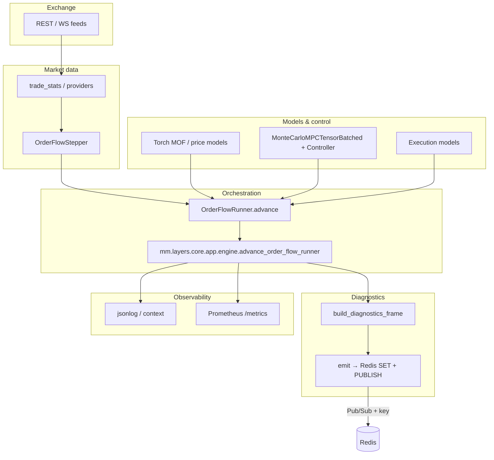

# System architecture (market_maker)

This document describes how the repository’s components fit together at runtime: entrypoints, the trading loop, diagnostics, observability, and supporting infrastructure. For step-by-step trading and learning mechanics (MPC, steps, execution), see [PIPELINE_AND_DATA_FLOW.md](./PIPELINE_AND_DATA_FLOW.md).

---

## 1. High-level picture

The system is a **closed loop**: exchange market data is bucketed into discrete **steps**; learned models and an **MPC controller** choose **quotes**; an **execution model** applies the previous action to the current step to update **inventory, cash, and wealth**; optional **diagnostics** serialize one JSON **frame per step** to Redis and/or stdout.

**Process boundaries:** The market maker usually runs as a **Python process on the host** (or a custom container not defined in the default `docker-compose.yml`). **Redis, Prometheus, Grafana, and Postgres** are separate services, typically started with Docker Compose.

---

## 2. Repository layout (logical packages)

| Layer / area | Role | Notable paths |
|----------------|------|----------------|
| **Architecture** | Target boundaries, phases, unit policy | `docs/ARCHITECTURE_RFC.md` |
| **Runtime shell** | CLI, wiring, integrated runner/stepper, pipeline composition | `mm.layers.runtime/` — `cli.py`, `run.py`, `pipeline.py` (`build_pipeline`, `create_runner`, `main`), `wiring.py` (`create_stepper` → `mm.layers.runtime.order_flow_stepper`); root `order_flow_*.py` are **thin shims** where present |
| **Core** | Orchestration extract, domain types, diagnostics schema | `mm.layers.core/app/engine.py` — one step of `OrderFlowRunner`; `mm.layers.core/diagnostics/diagnostics_frame.py` — `build_diagnostics_frame`; `mm.layers.core/app/parsed_step.py` — tuple → `ParsedStep`; `mm.layers.core/domain/`, `mm.layers.core/ports/`, `mm.layers.core/units/` |
| **Adapters** | I/O and side effects | `mm.layers.adapters/diagnostics/emitter.py` — stdout + Redis; `mm.layers.adapters/observability/` — metrics, JSON log, request context |
| **Controller / models** | PyTorch models, MPC, state, rewards | `market_making_controller/` — `controller.py`, `mpc_tensor_batched.py`, `models/`, `state.py`, `reward_tensor.py` |
| **Trading loop** | Stepper, runner, pipeline, animation | `mm.layers.runtime/pipeline.py`, `order_flow_stepper.py`, `order_flow_runner.py` (shims re-export `mm.layers.runtime`), `order_flow_animation.py`, `trade_stats.py` |

Pipeline assembly is in **`mm.layers.runtime.pipeline`**; per-step logic uses top-level `order_flow_*` shims and **`mm.layers.core.app.engine`** (parse step, execution, MPC, diagnostics emit).

---

## 3. Runtime entrypoints

| Entry | Command / module | Behavior |
|--------|------------------|----------|
| **Primary (documented in practice)** | `python -m mm.layers.runtime` or `python3 -m mm.layers.runtime` | `mm.layers.runtime/cli.py` → `mm.layers.runtime.run.run_order_flow_pipeline()` → `mm.layers.runtime.pipeline.main()` (optional metrics server first) |
| **Legacy direct** | `python order_flow_pipeline.py` | Shim to `mm.layers.runtime.pipeline.main` (no extra CLI metrics unless you set `MM_METRICS_PORT` yourself) |
| **Package** | `mm.layers.runtime/__main__.py` → `cli.main()` | Same as `-m mm.layers.runtime` |

Configuration is typically loaded from **environment** (e.g. `.env` via `python-dotenv` where used) and/or **kwargs** passed into pipeline construction in **`mm.layers.runtime.pipeline`** (or the `order_flow_pipeline` compatibility module).

---

## 4. Trading loop (single step)

The structural sequence is:

1. **`OrderFlowStepper.advance(t_end_ms)`** fetches order book and trades for a time bucket, outputs a **Step** (or `None` on failure).
2. **`OrderFlowRunner`** (driven from `mm.layers.runtime.pipeline` / animation) calls into **`mm.layers.core.app.engine.advance_order_flow_runner`** for the refactored path, which:
   - Parses the step tuple (`mm.layers.core.app.parsed_step.parse_step` → `ParsedStep`), optional **step snapshot** for typed units.
   - Runs **execution** of the *previous* action against the *current* step (inventory, PnL, histories).
   - Runs **testers / diagnostics MC** (e.g. expected mid), **MPC** to choose the **next** action, updates histories (`delta_*`, rewards, J components, etc.).
3. At the end of a successful step, **`build_diagnostics_frame(runner, exchange, symbol, spread_max)`** assembles a large JSON-serializable **DiagnosticsFrame** (runner series, depth, action_depth, price diagnostics, LOF, hedge, loss specs, etc.).
4. **`emit_diagnostics(frame)`** (adapters) may print JSON and/or write to **Redis** (see §6).

For **full narrative** of delayed execution, MPC vs diagnostic sampling, and model roles, see [PIPELINE_AND_DATA_FLOW.md](./PIPELINE_AND_DATA_FLOW.md).

---

## 5. Diagnostics pipeline

### 5.1 Frame builder

- **`mm.layers.core.diagnostics.diagnostics_frame.build_diagnostics_frame`** reads **duck-typed `runner`** state: histories on the runner, model plot hooks (`get_plot_data`, etc.), and embeds everything needed to reproduce desktop-style figures (Figure 1–6 style data).

### 5.2 Emitter (`mm.layers.adapters.diagnostics.emitter`)

Controlled by environment:

| Variable | Purpose |
|----------|---------|
| **`MM_DIAGNOSTICS`** | Must be non-empty (e.g. `1`) to emit anything. |
| **`MM_DIAGNOSTICS_JSON`** | If set (default-friendly), also prints one JSON line per frame to **stdout**. |
| **`MM_DIAGNOSTICS_REDIS_URL`** | Redis URL (e.g. `redis://127.0.0.1:6379/0` on host, `redis://redis:6379/0` inside Compose network). |
| **`MM_DIAGNOSTICS_CHANNEL`** | Pub/Sub channel (default `mm.diagnostics.v1`). |
| **`MM_DIAGNOSTICS_REDIS_LATEST_KEY`** | String key for **`SET`** of last payload (default `mm_diagnostics:latest`) so consumers need not rely on Pub/Sub timing. |

Wire format is **`mm.diag.v2`**: **`SET`** stores a **`kind: full`** envelope (merged frame in **`frame`**). **`PUBLISH`** sends **`kind: full`** or **`kind: delta`** (patch vs previous frame). On each emit: **`SET`** latest key, then **`PUBLISH`** channel. Failures are swallowed (best-effort).

### 5.3 Realtime UI

The legacy `mm.layers.viz` FastAPI/browser UI has been removed from the default code path. Diagnostics frames remain available as stdout JSON or Redis `SET`/PubSub payloads for external tools.

---

## 6. Observability (non-diagnostics)

| Mechanism | Location | Activation |
|-----------|----------|------------|
| **Prometheus metrics** | `mm.observability_metrics.py` | **`MM_METRICS_PORT`** set (e.g. `8000`) exposes **`/metrics`** HTTP in a background thread. |
| **Scrape config** | `docker/prometheus.yml` | Scrapes **`host.docker.internal:8000`** for job `market_maker` (host-run process). |
| **Structured / JSON log** | `mm.observability_jsonlog.py` | Used from engine via **`log_emit`** where wired. |
| **Context** | `mm.observability_context.py` | Correlation / metadata for logs or metrics. |

Grafana/Mimir/Prometheus in **`docker-compose.yml`** form a **metrics stack**; the trading app is **not** required to run inside Compose for metrics if the host exposes `MM_METRICS_PORT`.

---

## 7. Docker Compose topology (repo default)

Services (from `docker-compose.yml`):

| Service | Port(s) | Role |
|---------|---------|------|
| **redis** | 6379 | Diagnostics transport (SET + Pub/Sub). |
| **db** | 5432 | Postgres (application DB if used by future features). |
| **prometheus** | 9090 | Scrapes `/metrics` from host (see `docker/prometheus.yml`). |
| **grafana** | 3000 | Dashboards; provisions from `./grafana/`. |

**Volumes:** persistent data for Redis, Postgres, Prometheus, and Grafana.

---

## 8. Data shapes (conceptual)

- **Step** (time bucket): order book + buy/sell volumes in lots; see pipeline doc.
- **Diagnostics frame**: single JSON object per step, including **`point`** (e.g. `step_counter`), **`runner_series`** (full histories as arrays), **`depth`**, **`action_depth`**, **`price_diag`**, **`lof_*`**, **`hedge_diag`**, etc. The UI **tails** long series (e.g. last 500 points) for performance.

---

## 9. Extension points and migration notes

- **`mm.layers.core.ports.market_data.StepperPort`** / **`mm.layers.runtime.wiring.create_stepper`**: intended to replace direct `OrderFlowStepper` construction with a cleaner factory (currently still returns **`OrderFlowStepper`**).
- **`mm.layers.core.app.engine.advance_order_flow_runner`**: central place to add cross-cutting behavior (metrics, tracing) without editing `order_flow_runner.py` everywhere.
- **Desktop animation**: `order_flow_animation.py` remains the reference for local figure layout when the legacy order-flow path is used.

---

## 10. Related documents

| Document | Content |
|----------|---------|
| [PIPELINE_AND_DATA_FLOW.md](./PIPELINE_AND_DATA_FLOW.md) | Steps, execution delay, MPC vs diagnostic MC, model roles. |
| [MPC_MARKET_MAKER_EXPLANATION.md](./MPC_MARKET_MAKER_EXPLANATION.md) | MPC mathematics (if present). |
| [LOF_CONDITIONAL_BSPLINE_MATH.md](./LOF_CONDITIONAL_BSPLINE_MATH.md) | LOF model math (if present). |

---

## 11. Environment quick reference (diagnostics + viz)

| Variable | Typical value | Notes |
|----------|-----------------|-------|
| `MM_DIAGNOSTICS` | `1` | Enables frame build + emit. |
| `MM_DIAGNOSTICS_REDIS_URL` | `redis://127.0.0.1:6379/0` (host) | Must match where Redis listens. |
| `MM_DIAGNOSTICS_CHANNEL` | `mm.diagnostics.v1` | Redis Pub/Sub channel used by `mm.diagnostics_emitter`. |
| `MM_DIAGNOSTICS_REDIS_LATEST_KEY` | `mm_diagnostics:latest` | GET key for last frame. |
| `MM_METRICS_PORT` | `8000` | Enables Prometheus exporter on that port. |

**`mm.layers.core`** and **`mm.layers.adapters`** provide orchestration, domain typing, and side-effect boundaries; the long-lived trading modules (`order_flow_*`, `trade_stats`, …) remain the integration surface for venues and models.
