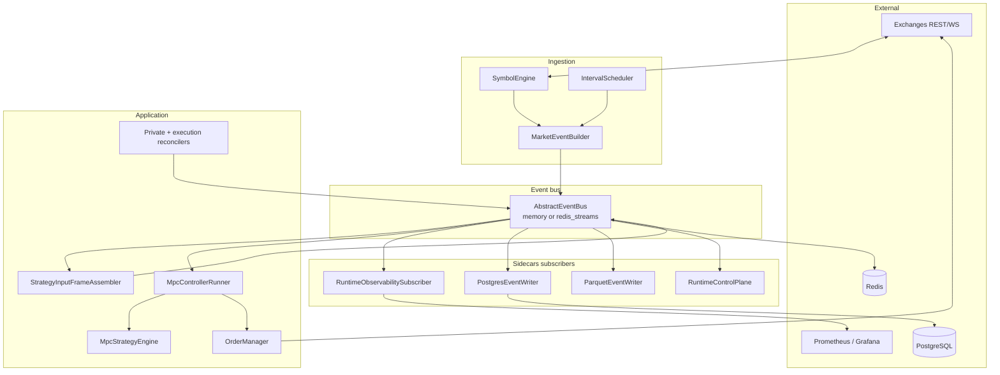

# Architecture overview

The market maker is a **single-process async runtime** (optionally backed by **Redis Streams**) that turns public and private exchange data into **interval `MarketEvent`s**, assembles **strategy input frames**, runs an optional **MPC controller**, and syncs **limit orders** through venue adapters. Business logic communicates only via an **event bus**; metrics, logs, traces, and durable storage are **subscribers**, not inline calls inside the strategy.

## Design principles

1. **One runtime** — `mm.runtime.engine.build_runtime_components` wires ingestion, frames, controller, execution, persistence, and observability. Legacy `mm/layers` and separate diagnostics pipelines are removed.
2. **Bus-first** — Topics are the contract (`market:events:…`, `strategy:frames:…`, `strategy:decisions`, `execution:orders:…`). Multiple consumers can subscribe without changing producers.
3. **Float domain at the strategy boundary** — Mid, spreads, and quantities are floats in strategy and `Order`; exchange adapters handle wire formatting.
4. **Observe by default** — Controller config defaults to `observe_only: true`; live `OrderManager.sync` is explicit.
5. **Envelopes for durability** — Persistence wraps payloads in versioned `EventEnvelope` records (`mm.core.events`).

## Layer diagram

## Package map

| Package | Role |
|---------|------|
| `mm.runtime` | `RuntimeComponents`, `build_runtime_components`, CLI re-export |
| `mm.application` | `StrategyInputFrameAssembler`, thin wrappers to execution |
| `mm.ingestion` | `SymbolEngine` — adapter streams → order book manager + trade buffer |
| `mm.aggregation` | `IntervalScheduler`, `MarketEventBuilder` — tick-aligned `MarketEvent` |
| `mm.bus` | `InMemoryBus`, `RedisStreamsBus` |
| `mm.strategies` | `MpcStrategyEngine`, `MpcControllerRunner` |
| `mm.mpc` | Batched tensor MPC, reward, sigmoid action parameterization |
| `mm.execution` | `OrderManager`, execution reconciler |
| `mm.exchanges` | Per-venue market data, private state, order command adapters |
| `mm.persistence` | Postgres / Parquet event writers, replay reader |
| `mm.observability` | Metrics registry, JSON logs, OTLP traces, bus subscriber |
| `mm.risk` | `RuntimeRiskEngine` (used with `Actor`, not wired in default MPC runtime) |
| `mm.api` | Admin command schema (pause, kill_switch, observe_only, …) |
| `mm.tools.print_events` | Runtime CLI: run, print, or summarize bus events |

## Event bus

Configured in runtime JSON under `bus`:

| `kind` | Behavior |
|--------|----------|
| `memory` | In-process queues; good for tests and single-machine debug |
| `redis_streams` | Durable streams with prefix `stream_prefix` (default `mm`); fan-out for persistence and external tools |

Factory: `mm.bus.factory.build_event_bus`.

Subscribers use `bus.subscribe_queue(topic)` for typed asyncio queues, or `bus.subscribe(topic)` for async iteration (control plane, observability).

## Event envelopes

Durable writers use `EventEnvelope` (`schema: mm.event`, `version: 1`):

- `topic`, `event_type`, `payload` (JSON-serializable)
- `exchange`, `symbol`, `actor_id`, `timestamp_ms`, `run_id`, `event_id`

`event_type` is taken from `payload["type"]` when present (e.g. `StrategyDecision`), else the Python class name (e.g. `MarketEvent`).

## Core domain models

| Model | Purpose |
|-------|---------|
| `MarketEvent` | Interval snapshot: order book, trades, volumes, VWAP, microprice |
| `StrategyInputFrame` | Primary `MarketEvent` + optional hedge + private snapshots + hedge status/lag |
| `StrategyDecision` | Full decision record (diagnostics, orders, models) for persistence/UI |
| `Action` | Executable intent: `orders_to_create`, `orders_to_cancel` |
| `Order` | Float price/qty limit order |
| `PrivateStateSnapshot` | Balances, open orders, fills |

Defined under `mm.core.models`.

## Topic naming

Central helper: `mm.core.topics.RuntimeTopics`.

| Topic pattern | Producer | Typical consumers |
|---------------|----------|-------------------|
| `market:events:{exchange}:{symbol}:{interval_ms}` | `SymbolEngine` | Frame assembler, persistence |
| `market:raw:{exchange}:{symbol}:trades` | SymbolEngine | Debug / replay |
| `market:errors:{exchange}:{symbol}` | SymbolEngine | Observability |
| `strategy:frames:{exchange}:{symbol}:{interval_ms}` | Frame assembler | MPC runner, observability |
| `strategy:decisions` | MPC runner | Persistence, Grafana (Postgres) |
| `strategy:actions` | MPC runner | Persistence |
| `execution:orders:{exchange}` | OrderManager | Observability |
| `execution:state:{exchange}` | OrderManager | Observability, reconciler |
| `private:state:{exchange}:snapshot` | Private reconciler | Frame assembler, persistence |
| `admin:commands` | Admin API | RuntimeControlPlane |
| `admin:events` | Control plane | Operators |
| `risk:events` | `Actor` only | Auditing filtered actions |

## Alternate path: `Actor` + risk engine

`mm.application.actor.Actor` implements an older **market-event → strategy → risk → execution** loop with **own-order subtraction** on the book before strategy. It is **not** started by `build_runtime_components` today; production MPC uses `MpcControllerRunner` directly.

See [Controller & execution](controller-and-execution.md) for the live path vs `RuntimeRiskEngine`.

## Related documents

- [Data flow](data-flow.md) — step-by-step pipeline and timing
- [Controller & execution](controller-and-execution.md) — MPC and order sync
- [Configuration](configuration.md) — JSON and env reference
