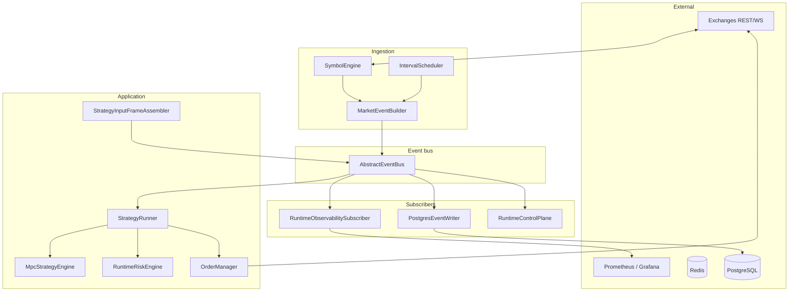

# Architecture overview

The market maker is a **single-process async runtime** (optionally backed by **Redis Streams**) that turns exchange data into **interval `MarketEvent`s**, assembles **strategy input frames**, runs **`StrategyRunner`** (MPC + risk + execution), and syncs orders through venue adapters. Business logic uses an **event bus**; metrics, logs, traces, and persistence are **subscribers**.

## Design principles

1. **One decision pipeline** — `StrategyRunner` owns frame prep → MPC → risk → execution routing.
2. **Bus-first** — Topics are the contract; multiple consumers subscribe without changing producers.
3. **Float domain at the strategy boundary** — Mid, spreads, and quantities are floats until adapters format wire payloads.
4. **Dry-run by default** — `controller.dry_run` defaults to `true`; live sync is explicit.
5. **Envelopes for durability** — Persistence wraps payloads in versioned `EventEnvelope` records.

## Layer diagram

## Package map

| Package | Role |
|---------|------|
| `mm.runtime` | `RuntimeComponents`, `build_runtime_components` |
| `mm.application` | Frame assembler, `StrategyRunner`, frame prep, action routing |
| `mm.ingestion` | `SymbolEngine` |
| `mm.aggregation` | Scheduler + `MarketEventBuilder` |
| `mm.bus` | In-memory or Redis Streams |
| `mm.strategies` | `MpcStrategyEngine` only (runner lives in `application`) |
| `mm.mpc` | Tensor batched optimizer |
| `mm.execution` | `OrderManager`, reconcilers |
| `mm.risk` | `RuntimeRiskEngine`, `build_risk_engine` |
| `mm.exchanges` | Venue adapters |
| `mm.persistence` | Postgres / Parquet writers |
| `mm.observability` | Metrics, logs, traces, bus subscriber |

## Topic naming

See `mm.core.topics.RuntimeTopics`.

| Topic pattern | Producer | Consumers |
|---------------|----------|-----------|
| `market:events:{ex}:{sym}:{interval}` | SymbolEngine | Frame assembler, persistence |
| `strategy:frames:{ex}:{sym}:{interval}` | Frame assembler | StrategyRunner, observability |
| `strategy:decisions` | StrategyRunner | Persistence, Grafana |
| `strategy:actions` | StrategyRunner | Persistence |
| `execution:orders:{exchange}` | OrderManager | Observability |
| `execution:state:{exchange}` | OrderManager | Observability |
| `risk:events` | StrategyRunner | Auditing |
| `admin:commands` | Admin API | RuntimeControlPlane |

## Related documents

- [MPC mathematical formulation](mpc-mathematical-formulation.md)
- [MPC spread grid and depth](mpc-spread-grid-and-depth.md)
- [MPC price and flow models](mpc-price-and-flow-models.md)
- [Data flow](data-flow.md)
- [Runtime mechanisms](mechanisms.md)
- [Controller & execution](controller-and-execution.md)
- [Configuration](configuration.md)
