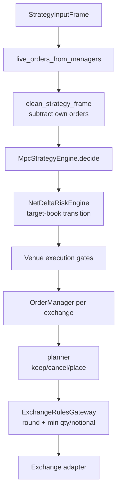

# Controller and execution

## Single production path

All strategy frames flow through **`StrategyRunner`** (`mm.application.strategy_runner`).



```text
StrategyInputFrame
  → clean book (subtract own live orders)
  → MPC decide
  → target-book risk
  → per-venue gates
  → OrderManager target sync
  → planner
  → venue rules gateway
  → exchange adapter
```

## Layer responsibilities

| Layer | Module | Role |
|-------|--------|------|
| Frame prep | `frame_preparation.clean_strategy_frame` | Remove bot orders from primary/hedge books |
| Trading context | `trading_context` | Live orders from managers; `TradingState` for risk |
| Strategy | `MpcStrategyEngine.decide` | MPC optimize, raw ladder, strategy cap, target book |
| Risk | `NetDeltaRiskEngine` | Kill switch, staleness, collateral, inventory, target-book transition |
| Execution gates | `compute_venue_execution_gates` | dry_run, warmup, control plane, manager present, venue readiness |
| Venue sync | `OrderManager` | Target-book diff into keep/cancel/place commands |
| Venue rules | `ExchangeRulesGateway` | Tick/lot rounding plus min qty/min notional validation |
| Router | `OrderRouter` | Cancel then place via exchange adapter |

## MpcStrategyEngine

**File:** `mm/strategies/mpc_engine.py`

Builds `StrategyDecision` + `Action` from a **clean** frame (books already adjusted).

Strategy-owned constraints inside `decide`:

- MPC optimizer bounds and reward penalties
- Spread grid: `orderbook_grid`, `max_orders_per_side`
- State book clipped to `orderbook_grid.max_spread`

Venue tick/lot rounding and venue minimum sizes are intentionally not applied
inside ladder construction. They happen later in the venue rules gateway so
diagnostics can distinguish strategy intent from exchange admissibility.

## Risk engine

**Files:** `mm.risk.engine`, `mm.risk.factory`

Configured under `controller.risk` in runtime JSON:

```json
"risk": {
  "enabled": true,
  "local": {"max_inventory": 1000.0, "max_market_data_age_ms": 60000},
  "global": {"max_inventory": 1000.0, "max_market_data_age_ms": 60000}
}
```

| Rule | Effect |
|------|--------|
| `kill_switch` | Reject all actions (synced from `RuntimeControlPlane` each frame) |
| Stale data | Reject if market/private state is missing or too old |
| Collateral | Reject target books that require more cash/inventory than the venue ledger can support |
| Inventory/notional | Reject target transitions breaching min/max inventory or notional caps |

Filtered actions publish `risk:events` (`RiskActionsFiltered`).

Set `"enabled": false` to use `PassThroughRiskEngine` (no risk checks).

## Execution gates (`StrategyRunner`)

After risk, live sync is computed per venue. A venue may sync when:

| Gate | Source |
|------|--------|
| Actionable approved venue target book | Risk output |
| `not controller.dry_run` | JSON |
| `not control_plane.state.dry_run` | Admin command |
| `frame_step > execution_after_steps` | JSON warm-up |
| `OrderManager` exists for that exchange | Token + `enable_execution` |

## OrderManager (venue layer)

**File:** `mm.execution.order_manager`

Runs **after** risk. Additional checks:

- Per-exchange routing and dedupe vs live book
- `ExchangeRulesGateway` normalizes price/qty to tick/lot and checks min base / min notional from trade_stats
- Adapter success/failure on REST

Rejected orders emit `OrderValidationRejected` on `execution:orders:{exchange}`.

## Runtime wiring

`build_runtime_components` (`mm.runtime.engine`):

1. Creates `RuntimeControlPlane` (admin commands).
2. Calls `build_strategy_runner(..., control_plane=control_plane)`.
3. Passes `order_managers` keyed by exchange.

## Debugging breakpoints

| Step | Location |
|------|----------|
| Own-order subtraction | `clean_strategy_frame` |
| MPC | `MpcStrategyEngine.decide` |
| Risk | `AbstractRiskEngine.validate_frame` |
| Live gate | `StrategyRunner._should_execute_live` |
| Venue limits | `ExchangeRulesGateway.validate` |

## Related documents

- [Data flow](data-flow.md)
- [Runtime mechanisms](mechanisms.md)
- [Configuration](configuration.md)
- [Observability](observability.md)
