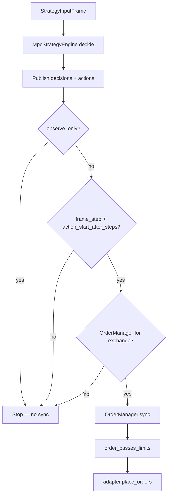
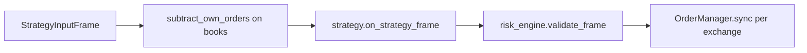

# Controller and execution

## Production path (MPC runtime)

The live stack does **not** use `Actor` or `RuntimeRiskEngine`. Flow:

```text
StrategyInputFrame → MpcControllerRunner.on_frame
  → MpcStrategyEngine.decide
  → publish StrategyDecision + Action
  → [gates] → OrderManager.sync → venue REST
```



## MpcStrategyEngine

**File:** `mm/strategies/mpc_engine.py`

### `decide(frame, frame_step)`

1. **Model updates** (before optimize):
   - Hedge representative price model from hedge VWAP on `State`
   - Market-flow model from frame
   - Float price / residual model from previous vs current frame

2. **State construction** — `_state_from_frame`:
   - Mid from primary book
   - `OrderbookRelative` bids/asks within `orderbook_grid.max_spread`
   - Inventory/cash from `primary_private` balances
   - VWAP buy/sell from book; hedge VWAP when hedge present

3. **Optimization** — `self._controller.optimize(state)` (tensor batched MPC in `mm.mpc.mpc_tensor_batched`):
   - Sigmoid-mixture action bounds (`sigmoid_mixture_action_bounds`)
   - Optional `project_total_q_target` / `max_total_qty` depth projection
   - Reward terms: `reward_coef`, `inv_coef`, `risk_coef` (volatility), `spread_coef`, etc.

4. **Ladder discretization** — `_orders_from_sigmoid_action` / `_side_orders`:
   - Spread grid from `min_spread`, `max_spread`, `price_step`
   - Marginal qty from cumulative depth; quantize with `qty_step`
   - Skip below `min_order_qty`, non-positive price
   - Cap at `max_orders_per_side`

5. **Output** — `StrategyDecision` with:
   - `action: Action(orders_to_create=…)`
   - `continuous_action_depth` (pre-discretization curves for Grafana)
   - `orders` summaries, model update report, `decision_hash`, `latency_ms`

### Controller config (`ControllerRuntimeConfig`)

| Field | Effect |
|-------|--------|
| `enabled` | If false, no `MpcControllerRunner` |
| `observe_only` | If true, never call `OrderManager.sync` |
| `action_start_after_steps` | Warm-up: MPC runs, live sync only after this frame index |
| `decisions_topic` / `action_topic` | Bus topics (defaults `strategy:decisions`, `strategy:actions`) |
| `orderbook_grid` | `price_step`, `max_spread` for MPC grid and ladder |
| `min_spread`, `qty_step`, `min_order_qty`, `max_orders_per_side` | Ladder constraints |
| `price_model`, `market_flow_model`, `hedge_price_model`, `execution_model`, `optimizer` | Passed into MPC builder |

## MpcControllerRunner gates (before execution)

| Gate | Config / condition |
|------|-------------------|
| Observe only | `controller.observe_only == true` |
| Warm-up | `frame_step <= action_start_after_steps` |
| No manager | No API token, `enable_execution: false`, or exchange not configured |
| Exception in `decide` | Publishes `ControllerError`, returns empty `Action` |

**Not applied today:** `RuntimeControlPlane.kill_switch` / dynamic `observe_only` from `admin:commands` — control plane state is **not** read by `MpcControllerRunner` (only static JSON `observe_only`).

## OrderManager (execution layer)

**File:** `mm.execution.order_manager`

After strategy gates, **`sync(actions)`** runs:

| Step | Behavior |
|------|----------|
| Lock | One sync at a time per exchange |
| Cancel explicit | `orders_to_cancel` from action |
| Cancel missing | Optional: drop live orders not in desired create set (`cancel_missing`, default **false** in runtime) |
| Dedupe | Skip create if same `(actor, client_order_id, exchange, symbol, side, price, qty, type)` already live |
| Venue limits | `order_passes_limits` — min base qty, min notional (from `TradeStatsVenueOrderLimitSource` for supported exchanges) |
| Place | `AbstractOrderCommandAdapter.place_orders` |
| State | Update `_live_orders`, publish `execution:state:{exchange}` |

Rejected orders emit bus event `OrderValidationRejected` (observed by `RuntimeObservabilitySubscriber`).

### Venue adapters

- **Nobitex:** `NobitexRestOrderCommandAdapter` → `private_rest.place_limit_order`
- **Wallex:** `WallexRestOrderCommandAdapter`

Adapters raise on failed/rejected exchange responses (no silent drop).

## Alternate path: Actor + risk engine

**Files:** `mm.application.actor`, `mm.risk.engine`

Used in unit tests / custom wiring, **not** in `build_runtime_components`:



### RuntimeRiskEngine rules

| Rule | On failure |
|------|------------|
| `kill_switch` | Reject all actions |
| Stale data (`now - event.t_end_ms > max_data_age_ms`) | Reject all |
| `max_inventory` per order | Drop that order; keep cancels |

`PassThroughRiskEngine` approves everything.

When risk filters actions, `Actor` may publish `risk:events` (`RiskActionsFiltered`).

## Wiring execution in runtime

From `mm.runtime.engine`:

- `OrderManager` is created per exchange when **`private_config.enable_execution`** and API token resolve.
- `MpcControllerRunner` receives `order_managers` dict keyed by normalized exchange name.
- `ExecutionStateReconciler` + `PrivateStateReconciler` keep private snapshots and fills aligned with the manager.

## Grafana alignment

Postgres dashboard **`mm_orderbook_depth_pg.json`** reads:

- Row 1: latest `MarketEvent` on `market:events:{exchange}:{symbol}:{interval_ms}`
- Rows 2–3: latest `StrategyDecision` on `strategy:decisions` (`continuous_action_depth`, `orders`)

Set dashboard variables to match your runtime symbol and `orderbook_grid.max_spread`.

## Related documents

- [Data flow](data-flow.md)
- [Configuration](configuration.md)
- [Observability](observability.md)
