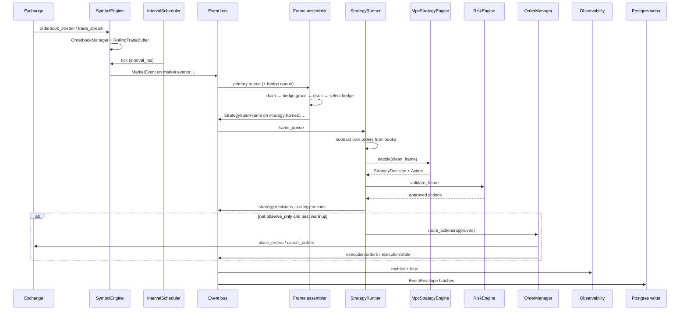

# Data flow

High-level path from exchange feeds to optional live orders. For **task queues, timing, double-drain hedge alignment, raw vs cleaned books**, and other internals, see **[Runtime mechanisms](mechanisms.md)**.

## End-to-end diagram

## Phase 1 — Market ingestion

`SymbolEngine` maintains a local book + trade buffer, then publishes interval **`MarketEvent`** on `market:events:{exchange}:{symbol}:{interval_ms}`.

Details: [Mechanisms — market ingestion](mechanisms.md#phase-1--market-ingestion-symbolengine)

## Phase 2 — Strategy input frames

`StrategyInputFrameAssembler` runs async tasks on primary/hedge market queues and private snapshot queues.

Per primary `MarketEvent`:

1. **Drain** pending hedge + private inputs.
2. **Wait** up to `hedge_grace_ms` for hedge with same `t_end_ms`.
3. **Drain** again (catch arrivals during wait).
4. **Select** hedge → `hedge_status` (`ready` / `missing` / `stale` / `disabled`).
5. **Publish** `StrategyInputFrame` on `strategy:frames:…`.

The published frame still has the **exchange** orderbook (includes your resting orders). Cleaning happens in phase 2b.

Details: [Mechanisms — frame assembly](mechanisms.md#phase-2--frame-assembly-strategyinputframeassembler)

### Frame contents

| Field | Source |
|-------|--------|
| `primary` | Primary `MarketEvent` for this interval |
| `hedge` | Aligned hedge event or `None` |
| `primary_private` / `hedge_private` | Latest `private:state:{exchange}:snapshot` |
| `hedge_status`, `hedge_lag_ms` | Assembler |
| `created_at_ms` | Wall clock when frame was built |

## Phase 2b — Own-order subtraction

`StrategyRunner` loads `OrderManager.live_orders`, then `clean_strategy_frame` → `subtract_own_orders` on primary/hedge books before MPC.

Details: [Mechanisms — own-order subtraction](mechanisms.md#phase-2b--own-order-subtraction-strategyrunner)

## Phase 3 — Strategy runner

`StrategyRunner`: clean frame → `MpcStrategyEngine.decide` → risk → publish → optional `OrderManager.sync`.

Details: [Mechanisms — strategy decision](mechanisms.md#phase-3--strategy-decision-strategyrunner--mpcstrategyengine) · [Controller & execution](controller-and-execution.md)

## Phase 4 — Execution sync

`OrderManager.sync`: cancels → place with venue limits → update `live_orders` → `execution:state`.

Details: [Mechanisms — execution](mechanisms.md#phase-4--execution-ordermanager)

## Phase 5 — Side effects

| Subscriber | Role |
|------------|------|
| `RuntimeObservabilitySubscriber` | Metrics, logs, traces |
| `PostgresEventWriter` / `ParquetEventWriter` | Durable `mm_events` |
| `RuntimeControlPlane` | Admin kill_switch / observe_only |

Details: [Mechanisms — bus & persistence](mechanisms.md#event-bus-delivery) · [Observability](observability.md)

## Parallel flows (hedge venue)

Separate `SymbolEngine` per venue; assembler aligns hedge to primary window; MPC places on **primary**; hedge informs models/VWAP.

## Debugging breakpoints

| Goal | Location |
|------|----------|
| Frame assembled | `frame_assembler.build_frame` / `_run_primary` publish |
| Hedge drain / grace | `frame_assembler._drain_latest_inputs`, `_wait_for_matching_hedge` |
| Own-order subtraction | `clean_strategy_frame` |
| MPC | `mpc_engine.decide` |
| Risk | `risk_engine.validate_frame` |
| Venue limits | `order_manager._place_new` |

Full map: [Mechanisms — debugging](mechanisms.md#debugging-map)

## Replay

`mm.ingestion.replay_adapter` republishes persisted envelopes into the bus for offline runs.

## Related documents

- **[Runtime mechanisms](mechanisms.md)** — detailed internals (recommended)
- [Architecture overview](architecture.md)
- [Controller & execution](controller-and-execution.md)
- [Configuration](configuration.md)
