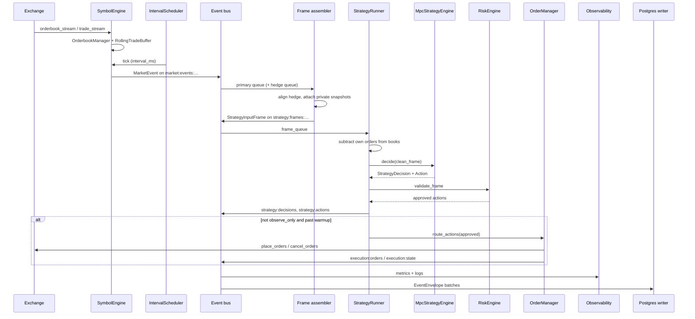

# Data flow

This document traces **one primary interval** from exchange feeds through strategy to optional order placement and persistence.

## End-to-end diagram



## Phase 1 — Market ingestion

### SymbolEngine (`mm.ingestion.symbol_engine`)

For each configured source (primary and optional hedge):

1. **`adapter.connect()`** — REST poll or WebSocket session.
2. **`_feed_orderbook`** — snapshots/deltas into `OrderbookManager`.
3. **`_feed_trades`** — trades into `RollingTradeBuffer` (deduplicated); optional publish on `market:raw:…:trades`.
4. **`publish_on_intervals`** — registered on the shared **`IntervalScheduler`**.

On each interval tick `(t_start_ms, t_end_ms, interval_ms)`:

```text
MarketEventBuilder.build(...) → bus.publish(
  "market:events:{exchange}:{symbol}:{interval_ms}",
  MarketEvent
)
```

`MarketEvent` includes full `RawOrderbook`, interval trades, buy/sell volume, VWAP, imbalance, microprice.

Errors publish to `market:errors:{exchange}:{symbol}`.

## Phase 2 — Strategy input frames

### StrategyInputFrameAssembler (`mm.application.frame_assembler`)

Runs a background task on the **primary** market-event queue:

1. **`next_frame()`** — blocks on next primary `MarketEvent`.
2. **`build_frame(primary)`**:
   - Drains newer hedge events from hedge queue into a short history deque.
   - **`_wait_for_matching_hedge`** — waits up to `hedge_grace_ms` for a hedge event whose `t_end_ms` is within `max_hedge_lag_ms` of primary.
   - **`_select_hedge`** — picks best hedge or sets `hedge_status` (`ok`, `missing`, `stale`, …).
   - Attaches latest **`PrivateStateSnapshot`** per role (primary / hedge) from private queues.
3. **`bus.publish(frame_topic, StrategyInputFrame)`** where  
   `frame_topic = strategy:frames:{primary_exchange}:{primary_symbol}:{interval_ms}`.

Own-order subtraction happens later in **`StrategyRunner`** (`clean_strategy_frame`), not in the assembler.

### Frame contents

| Field | Source |
|-------|--------|
| `primary` | Latest primary `MarketEvent` |
| `hedge` | Aligned hedge `MarketEvent` or `None` |
| `primary_private` / `hedge_private` | Latest snapshot from `private:state:{exchange}:snapshot` |
| `hedge_status`, `hedge_lag_ms` | Assembler logic |
| `created_at_ms` | Wall clock when frame was built |

## Phase 3 — Strategy runner

See [Controller & execution](controller-and-execution.md) for the full pipeline (`StrategyRunner`: clean book → MPC → risk → gates → `OrderManager`).

## Phase 4 — Execution sync

### OrderManager (`mm.execution.order_manager`)

Under a per-exchange lock:

1. Publish `ExecutionSyncRequested` on `execution:orders:{exchange}`.
2. **`_cancel_explicit`** — cancel IDs listed on the action.
3. **`_cancel_missing`** — only if `cancel_missing=True` (runtime default: **false**).
4. **`_place_new`** — for each order in the action:
   - Skip wrong exchange, duplicate live key, failed venue limits.
   - **`command_adapter.place_orders`**
   - Update `_live_orders`, publish `PlaceOrdersAccepted`.
5. Publish **`execution:state:{exchange}`** snapshot.

Private reconcilers continuously refresh snapshots from exchange REST; execution reconciler aligns manager state with private streams.

## Phase 5 — Side effects (non-blocking for strategy)

| Subscriber | Input topics | Output |
|------------|--------------|--------|
| `RuntimeObservabilitySubscriber` | frames, decisions, actions, execution, errors | Prometheus metrics, JSON logs, optional spans |
| `PostgresEventWriter` | configured `persistence.topics` | `mm_events` table |
| `ParquetEventWriter` | same | files under `MM_PARQUET_ROOT` |
| `RuntimeControlPlane` | `admin:commands` | `admin:events`; kill_switch → risk; observe_only blocks live sync |

Persistence uses `envelope_event()` so Postgres stores both `payload` JSONB and full `envelope` JSONB.

## Parallel flows (hedge venue)

When `hedge` is configured:

- Separate `SymbolEngine` publishes `market:events:wallex:…` (example).
- Frame assembler consumes both primary and hedge market topics.
- Hedge may have its own `OrderManager` if `hedge_private.enable_execution` and token are set.
- MPC decision targets **primary** exchange for placement; hedge informs state/VWAP in `MpcStrategyEngine._state_from_frame`.

## Debugging breakpoints

| Goal | Location |
|------|----------|
| Frame assembled | `frame_assembler.build_frame` return or `bus.publish` in `_run_primary` |
| Frame consumed by strategy | `strategy_runner.on_frame` entry |
| Own-order subtraction | `clean_strategy_frame` |
| Risk | `risk_engine.validate_frame` |
| MPC math / orders | `mpc_engine.decide` |
| Pre-exchange validation | `order_manager._place_new` → `order_passes_limits` |
| Bus-only inspection | `python -m mm.tools.print_events --config …` |

## Replay

`mm.ingestion.replay_adapter` can republish persisted envelopes from disk into the bus for offline analysis (topics matching `market:events:*` and optional private topics).

## Related documents

- [Architecture overview](architecture.md)
- [Controller & execution](controller-and-execution.md)
- [Observability](observability.md)
