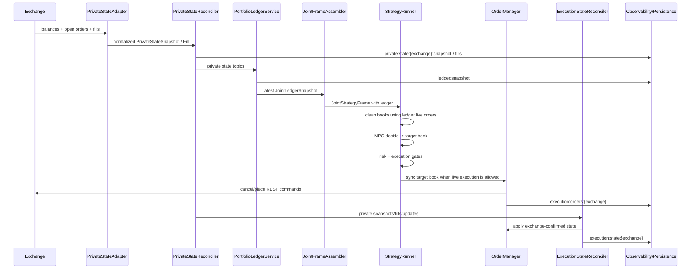

# Execution, ledger, and observability

This document describes the live execution process in enough detail to debug
disagreements between the exchange, the strategy ledger, execution events, and
Grafana dashboards.

The most important operational rule is:

> Current state and historical events are different data products.

Open orders are current state. Placements, cancels, rejections, and fills are
events. A chart that counts every historical state snapshot as if it were a new
order can show 50 orders when the exchange currently has 7.

## Sources of truth

| Question | Primary source | Topic / table | Notes |
|----------|----------------|---------------|-------|
| What orders are open on the exchange now? | Private exchange snapshot | `private:state:{exchange}:snapshot` | This is the exchange-confirmed truth after normalization. |
| What does the strategy believe is open now? | Joint ledger | `ledger:snapshot` | Built from private snapshots/fills/updates. |
| What does execution use for reconciliation now? | `OrderManager.live_orders` / execution state | `execution:state:{exchange}` | Mirrors private state, with short-lived optimistic updates after local place/cancel calls. |
| What did the strategy want? | Target book / decision | `strategy:target_books:{actor}` / `strategy:decisions` | Desired resting book for one controller frame. |
| What did risk allow? | Controller diagnostics | `strategy:diagnostics:{actor}` | `risk` and `action_pipeline.risk_approved_target`. |
| What did execution attempt? | Execution order events | `execution:orders:{exchange}` | Sync, place, cancel, validation, and adapter failures. |
| What actually filled? | Private fill events | `private:state:{exchange}:fills` | Emitted by private adapters or inferred from open-order deltas. |

For live trading decisions, private state and ledger should dominate. Execution
events explain how the system got there, but they are not the current open-order
truth.

## End-to-end flow



## Private state

`PrivateStateReconciler` owns normalized exchange-private data.

For REST-polling venues, each poll calls `adapter.snapshot()` and publishes one
authoritative `PrivateStateSnapshot` containing balances and open orders from the
same poll. It also publishes:

- `private:state:{exchange}:fills` when adapter fill polling reports a new fill.
- `private:state:{exchange}:fills` when a REST open-order delta proves that an
  order's filled or remaining quantity changed.
- `private:state:{exchange}:balances` and `private:state:{exchange}:open_orders`
  as convenience streams after each full snapshot.
- `private:state:{exchange}:errors` when polling fails.

`PrivateStateStore` is replacement-oriented for snapshots:

- A full `PrivateStateSnapshot` replaces the store's open-order map.
- Terminal statuses and zero remaining quantity remove an order.
- Fills update remaining quantity if the order is still present.

This means the latest private snapshot should match the exchange's open-order
view after normalization. If it does not, the adapter normalization or exchange
API response should be investigated before looking at strategy logic.

## Ledger

`PortfolioLedgerService` subscribes to private state topics and maintains one
`VenueLedgerStateMachine` per configured private venue.

Each ledger state machine is driven only by exchange-private facts:

- full private snapshots
- balance events
- open-order events
- order updates
- fills

The service publishes:

- `ledger:snapshot:{exchange}` for venue-level state
- `ledger:snapshot` for the local/global joint ledger
- `ledger:diagnostics:consistency:{exchange}` comparing ledger open orders with
  `OrderManager.live_orders` when an order manager exists

The strategy should use the ledger, not placement events, to know its current
wallet and live-order state. A placement event means "the REST call returned an
id"; the ledger means "the private exchange state now says this is true."

## Strategy and risk

`StrategyRunner` consumes `JointStrategyFrame`s. The frame includes the latest
joint ledger selected by `JointFrameAssembler`.

Per frame:

1. Read live orders from the ledger.
2. Clean the market book by subtracting own live orders.
3. Run `MpcStrategyEngine.decide`.
4. Validate the proposed action through risk.
5. Publish `strategy:decisions`, `strategy:actions`, target books, and
   `ControllerDiagnostics`.
6. If live execution is enabled and all execution gates pass, route the approved
   target book to `OrderManager`.

Important consequence: if the ledger is stale or wrong, the strategy can clean
the book incorrectly, quote around stale orders, or reconcile toward a target
that does not match the real venue state.

## Order manager and router

`OrderManager` is a target-book reconciler. It does not decide prices or sizes.
It compares desired orders with its current live-order map, then asks the router
to cancel/place the delta.

Planner policy matters:

- `reconcile` means "move live orders toward these desired orders with
  tolerance-aware diffs."
- `replace` means "this venue target book is authoritative." An empty `replace`
  target book is still actionable: it means cancel existing live orders for that
  venue/actor/symbol, not "skip execution."

Execution lifecycle events include:

- `ExecutionSyncRequested`
- `CancelOrdersRequested`
- `CancelOrdersAccepted`
- `CancelOrdersFailed`
- `PlaceOrdersRequested`
- `PlaceOrdersAccepted`
- `PlaceOrdersFailed`
- `OrderValidationRejected`
- `ExecutionSyncCompleted`

`OrderManager` can apply optimistic updates after successful local place/cancel
calls so the next reconciliation round does not immediately duplicate work. The
`ExecutionStateReconciler` then mirrors exchange-confirmed private state back
into the manager by applying private snapshots, open-order updates, and fills.

The intended invariant is:

```text
latest private open orders
  == latest venue ledger live_orders
  == OrderManager.live_orders
  == latest execution:state live_orders
```

Small short-lived differences are acceptable immediately after a REST command.
Persistent differences are not.

## Observability and persistence

`RuntimeObservabilitySubscriber` and persistence writers subscribe to the bus.
The same business fact may appear in multiple places:

- Metrics: current health and low-cardinality counters/gauges
- Events: durable domain facts in `mm_events`
- Logs: human-readable incident trail
- Dashboards: SQL/Prometheus views over those facts

Dashboard rules:

- Current open-order panels should use the latest state snapshot, or the latest
  snapshot per bucket, not cumulative placement events.
- Historical placement panels should use `PlaceOrdersAccepted` events.
- Historical cancel panels should use cancel events.
- Fill panels should use `private:state:{exchange}:fills`; if there are no rows,
  the issue is upstream of Grafana or the persistence topic config.
- Approximate per-step charts can bucket by `${interval_ms}` for speed, but they
  should still respect state-vs-event semantics.

## Why a live-order chart can show 50 when the exchange has 7

Treat this as a data contract problem until proven otherwise.

Likely causes:

1. The panel is summing or counting every `execution:state` snapshot in a time
   bucket. A state snapshot contains the whole current open-order map; repeated
   snapshots are not new orders.
2. The panel is showing historical accepted placements, not current live orders.
   Filled/canceled orders remain valid historical events.
3. `ExecutionStateReconciler` is not applying private snapshots, so
   `OrderManager.live_orders` keeps optimistic or stale orders.
4. The private adapter is normalizing exchange order ids inconsistently, so the
   same venue order appears under multiple ids over time.
5. The dashboard is mixing local/global exchanges, symbols, actors, or old runs.
6. Grafana is stacking multiple side/symbol series and the visual total is being
   read as a single current count.

The current-state query should answer "what is in the latest snapshot?" Example:

```sql
WITH latest AS (
  SELECT e.*
  FROM mm_events e
  WHERE e.topic = 'execution:state:nobitex'
    AND $__timeFilter(e.ts)
  ORDER BY e.ts DESC
  LIMIT 1
)
SELECT
  latest.ts,
  jsonb_object_length(COALESCE(latest.payload->'live_orders', '{}'::jsonb)) AS live_order_count,
  latest.payload->'live_orders' AS live_orders
FROM latest;
```

For a time-series chart, use the latest snapshot in each display bucket rather
than summing snapshots:

```sql
WITH snapshots AS (
  SELECT
    to_timestamp(
      floor(EXTRACT(EPOCH FROM e.ts) /
        GREATEST(COALESCE(NULLIF('${interval_ms}', '')::double precision, 1000.0) / 1000.0, 0.001)
      ) *
      GREATEST(COALESCE(NULLIF('${interval_ms}', '')::double precision, 1000.0) / 1000.0, 0.001)
    ) AS bucket,
    e.ts,
    e.payload
  FROM mm_events e
  WHERE e.topic = 'execution:state:nobitex'
    AND $__timeFilter(e.ts)
),
latest_per_bucket AS (
  SELECT DISTINCT ON (bucket) bucket, ts, payload
  FROM snapshots
  ORDER BY bucket, ts DESC
)
SELECT
  bucket AS "time",
  'nobitex live orders' AS metric,
  jsonb_object_length(COALESCE(payload->'live_orders', '{}'::jsonb))::double precision AS value
FROM latest_per_bucket
ORDER BY 1;
```

## Why fill charts can show no fills while fills happen

Likely causes:

1. The fill event is not published. Check the private adapter's `fill_stream()`
   and REST delta inference.
2. The fill is published but not persisted. Check `persistence.topics`; it must
   include `private:state:{exchange}:fills` or use default topics.
3. The fill is persisted with missing or mismatched `exchange`/`symbol`, and the
   dashboard filters exclude it.
4. The fill row exists, but its `timestamp_ms` is outside the dashboard time
   range or malformed.
5. The venue reports cumulative filled quantity without enough order history for
   the adapter to calculate a positive delta.
6. The order disappears from `open_orders` after a full fill without ever showing
   an intermediate filled/remaining delta. In that case, open-order delta
   inference cannot infer quantity unless the previous and current payloads
   expose enough filled quantity before removal.

Useful SQL checks:

```sql
SELECT ts, topic, event_type, exchange, symbol, actor_id, payload
FROM mm_events
WHERE topic LIKE 'private:state:%:fills'
ORDER BY ts DESC
LIMIT 50;
```

```sql
SELECT ts, topic, event_type, exchange, symbol, payload
FROM mm_events
WHERE topic LIKE 'private:state:%:snapshot'
ORDER BY ts DESC
LIMIT 10;
```

If snapshot rows are present but fill rows are absent, Grafana is not the first
problem. The private fill producer or persistence topic list is.

## Consistency checks

Use these checks during incidents.

1. Exchange vs private snapshot:

```sql
SELECT ts, exchange,
       jsonb_object_length(COALESCE(payload->'open_orders', '{}'::jsonb)) AS open_orders,
       payload->'open_orders' AS orders
FROM mm_events
WHERE topic = 'private:state:nobitex:snapshot'
ORDER BY ts DESC
LIMIT 5;
```

2. Private snapshot vs execution state:

```sql
WITH latest_private AS (
  SELECT payload FROM mm_events
  WHERE topic = 'private:state:nobitex:snapshot'
  ORDER BY ts DESC
  LIMIT 1
),
latest_execution AS (
  SELECT payload FROM mm_events
  WHERE topic = 'execution:state:nobitex'
  ORDER BY ts DESC
  LIMIT 1
)
SELECT
  jsonb_object_length(COALESCE((SELECT payload->'open_orders' FROM latest_private), '{}'::jsonb)) AS private_open_orders,
  jsonb_object_length(COALESCE((SELECT payload->'live_orders' FROM latest_execution), '{}'::jsonb)) AS execution_live_orders;
```

3. Ledger vs order manager diagnostic:

```sql
SELECT ts, topic, payload
FROM mm_events
WHERE topic LIKE 'ledger:diagnostics:consistency:%'
ORDER BY ts DESC
LIMIT 20;
```

If these diagnostics are not persisted, they should be added to persistence
topics for production runs.

## Recommended revisions

The execution data model is close, but the dashboards and event contracts should
be tightened before production decisions rely on them.

Recommended P0/P1 work:

1. Make live-order dashboard panels use latest-state semantics, not event-count
   semantics. The Runtime Overview now has `Execution live orders / step
   (latest snapshot)` and `Latest private vs execution order counts` for this.
2. Add a single canonical `LiveOrdersSnapshot`/`ExecutionStateSnapshot` event
   contract with `exchange`, `symbol`, `actor_id`, `snapshot_source`,
   `open_order_count`, `live_order_count`, and `timestamp_ms`.
3. Persist `ledger:diagnostics:consistency:{exchange}` by default.
4. Add a durable `FillObserved` event contract, even if the underlying adapter
   publishes the current `Fill` dataclass. Required fields: `exchange`,
   `symbol`, `exchange_order_id`, `side`, `price`, `qty`, `fee`, `timestamp_ms`,
   `source`, and `raw_seen_qty` when available.
5. Add dashboard panels for "latest private open orders", "latest execution live
   orders", and "ledger/manager mismatch count" so current-state drift is visible
   without reading raw payloads. The Runtime Overview now includes the first two
   counts; ledger mismatch should still be promoted to a dashboard panel.
6. Make fill charts include an "unmatched/missing symbol" series or a table of
   recent fill payloads so filtering problems are obvious. The Runtime Overview
   now includes `Recent private fills`.
7. Keep approximate per-step bucketing only for event-rate charts. Do not use it
   to derive current open-order counts.

## Debugging order

When the exchange and chart disagree:

1. Confirm the exchange API open-order count directly.
2. Check latest `private:state:{exchange}:snapshot`.
3. Check latest `ledger:snapshot`.
4. Check latest `execution:state:{exchange}`.
5. Check `ledger:diagnostics:consistency:{exchange}`.
6. Only then inspect historical execution events like `PlaceOrdersAccepted`.

When fills are missing:

1. Check `private:state:{exchange}:fills` in `mm_events`.
2. Check private adapter error events.
3. Check recent private snapshots for filled/remaining deltas.
4. Check persistence topics and writer errors.
5. Check dashboard filters last.

## Related code

| Area | Module |
|------|--------|
| Private polling and fill inference | `mm.private_state.reconciler` |
| Private current-state store | `mm.private_state.store` |
| Ledger service | `mm.ledger.service` |
| Ledger state machine | `mm.ledger.state_machine` |
| Strategy runner | `mm.application.strategy_runner` |
| Venue execution routing | `mm.application.venue_execution` |
| Order manager | `mm.execution.order_manager` |
| Execution state reconciler | `mm.execution.reconciler` |
| Observability subscriber | `mm.observability.subscribers` |
| Observability v2 dashboard generator | `mm.tools.generate_observability_v2_dashboards` |
