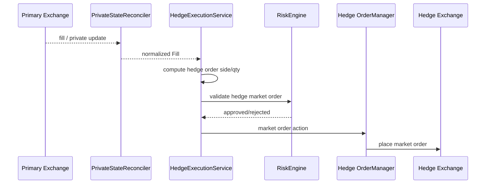

# Hedging In The MPC Objective

This note documents how hedge exchange data is currently used by the MPC optimizer, why live hedging is not complete yet, and a concrete architecture for making it executable.

## Current State

The runtime supports a primary venue and an optional hedge venue:

- market data is ingested for both venues
- `StrategyInputFrameAssembler` aligns hedge `MarketEvent`s to primary `MarketEvent`s
- `MpcStrategyEngine._state_from_frame()` puts hedge VWAPs, hedge inventory, and hedge cash into `State`
- `MonteCarloMPCTensorBatched.optimize()` can simulate hedge price/VWAP dynamics

The important limitation:

> The optimizer simulates hedge trades in the objective, but the strategy output currently places only primary limit orders. It does not emit executable hedge market orders.

So hedge support is currently useful for objective accounting and research, but it is not a complete live hedging system.

## Where Hedge Inputs Enter

### Frame Assembly

`StrategyInputFrame` can contain:

- `primary`: primary venue `MarketEvent`
- `hedge`: aligned hedge venue `MarketEvent`
- `primary_private`: primary wallet/open-order snapshot
- `hedge_private`: hedge wallet/open-order snapshot
- `hedge_status`: `ready`, `missing`, `stale`, or `disabled`

The hedge event is selected by timestamp alignment with `max_hedge_lag_ms` and `hedge_grace_ms`.

### MPC State

`MpcStrategyEngine._state_from_frame()` computes:

- `hedge_buy_vwap`
- `hedge_sell_vwap`
- `hedge_inventory`
- `hedge_cash`

These values are passed into `mm.mpc.mpc_state.State`.

### Hedge Price Model

`_update_hedge_vwap_price_model()` feeds current hedge buy/sell VWAP observations to the hedge price model.

When `hedge_rollout_enabled` is true, `MonteCarloMPCTensorBatched` draws hedge VWAP shocks:

```text
d_hedge_buy, d_hedge_sell ~ hedge_price_model.sample_deltas(n_samples, horizon)
```

The optimizer then rolls forward hedge buy/sell VWAP paths alongside primary paths.

## Current Hedge Objective Logic

Inside each MPC rollout step:

1. The primary limit-order action is softly filled against simulated market order flow.
2. This produces primary inventory delta:

```text
d_inv = inv_delta
```

3. If hedge rollouts are enabled, the optimizer assumes an immediate hedge trade on the hedge venue:

```text
if d_inv > 0:
    sell hedge at hedge_sell_vwap_next
if d_inv < 0:
    buy hedge at hedge_buy_vwap_next
```

4. Hedge cash and inventory are updated:

```text
hedge_cash_next = hedge_cash_t + trade_cash_hedge * (1 - hedge_fee)
hedge_inv_next = hedge_inv_t - d_inv
```

5. Hedge reward is marked to hedge sell VWAP:

```text
hedge_reward = hedge_wealth_next - hedge_wealth_t
hedge_wealth = hedge_cash + hedge_inventory * hedge_sell_vwap
```

6. Total step reward becomes:

```text
step_reward = primary_step_reward + hedge_reward_weight * hedge_reward
```

This means the objective can prefer primary quotes whose expected fills look good after simulated hedge execution.

## Why This Is Not Fully Working Yet

The current optimizer assumes that every primary fill is hedged immediately and exactly on the hedge venue. But the execution layer does not currently perform that hedge.

Current live action flow:

```text
MPC continuous depth
  -> primary ladder limit orders
  -> venue constraints
  -> risk
  -> OrderManager.sync()
  -> primary limit orders
```

There is no current action field for:

- hedge market order to buy/sell the hedge venue
- hedge order sizing policy
- hedge trigger based on realized fills
- hedge execution failure handling
- hedge residual inventory tracking

`Order.order_type` can be `"market"` in the domain model, and `route_actions_to_managers()` can route orders by exchange. However, the strategy currently creates only primary limit orders from `ladder_orders_from_sigmoid()`. Also, the existing optimizer output does not contain the realized future fill; it only produces a quote curve. So an immediate hedge market order cannot be known at decision time unless it is based on a target inventory adjustment rather than actual fills.

## Correct Mental Model

The current hedge objective is a **post-fill hedge assumption**:

```text
If my primary quote fills by +q base, I assume I can sell q base on hedge.
If my primary quote fills by -q base, I assume I can buy q base on hedge.
```

That is not the same as executable live hedging, because real primary fills happen later and may be partial.

For a market maker, the hedge order should usually be triggered by actual fill events, not by the quote decision itself.

## Recommended Solution

Implement hedging as a separate execution loop driven by realized primary fills.

### Phase 1: Fill-Driven Hedge Orders

Add a `HedgeExecutionService` subscribed to primary fills/private state updates.

For every realized primary fill:

```text
primary buy fill  -> inventory increases -> sell hedge market order
primary sell fill -> inventory decreases -> buy hedge market order
```

Suggested flow:



This makes the MPC assumption executable: hedge when the primary fill actually occurs.

### Phase 2: Hedge Order Domain Model

Current `Order` can technically represent `order_type="market"`, but hedge execution needs clearer semantics.

Recommended additions:

```python
@dataclass(frozen=True)
class HedgeIntent:
    actor_id: str
    source_fill_id: str
    primary_exchange: str
    hedge_exchange: str
    symbol: str
    side: Literal["buy", "sell"]
    qty: float
    reason: str = "primary_fill_hedge"
```

Then convert `HedgeIntent` to an `Order(order_type="market")` only at the execution boundary.

This gives diagnostics a clean hedge-specific event before exchange-specific order formatting.

### Phase 3: Adapter Support For Market Orders

`AbstractOrderCommandAdapter.place_orders()` already accepts `Order`, including `order_type`. Each exchange adapter should explicitly support or reject market orders.

Add venue capability checks:

- supports market buy by base quantity?
- supports market buy by quote notional?
- market order min notional
- market order fee
- maximum market order size
- expected slippage guard support

If an exchange cannot safely place market orders, the hedge service can use aggressive IOC/FOK limit orders if the venue supports them.

### Phase 4: Hedge Risk

Add risk gates specific to hedge orders:

- hedge venue private state freshness
- max hedge order notional
- max hedge slippage from hedge VWAP/top-of-book
- max residual unhedged inventory
- rate limit / retry budget
- no hedge when hedge market data is stale
- no hedge when hedge wallet balance is insufficient

Emit structured rejection reasons:

- `hedge_private_state_stale`
- `hedge_market_data_stale`
- `hedge_qty_too_small`
- `hedge_notional_too_small`
- `hedge_slippage_limit`
- `hedge_balance_insufficient`
- `hedge_adapter_unsupported_order_type`

### Phase 5: Diagnostics

Add a hedge diagnostics event:

```text
hedge:diagnostics:{actor_id}
```

Suggested fields:

```text
type = HedgeExecutionDiagnostic
actor_id
source_fill_id
primary_exchange
hedge_exchange
symbol
primary_fill:
  side
  qty
  price
  fee
hedge_intent:
  side
  qty
  order_type
  expected_vwap
  max_slippage
risk:
  approved
  rejected_reason
execution:
  submitted
  exchange_order_id
  accepted_qty
  avg_price
  fee
residual:
  unhedged_qty_before
  unhedged_qty_after
```

Add metrics:

- `mm_hedge_orders_total`
- `mm_hedge_reject_total`
- `mm_hedge_residual_inventory`
- `mm_hedge_latency_ms`
- `mm_hedge_slippage`
- `mm_hedge_fill_ratio`

## Changes Needed In The Optimizer Objective

The objective should continue to support simulated hedging, but its assumptions should be explicit in diagnostics.

Recommended optimizer diagnostic fields:

```text
hedge_rollout:
  enabled
  hedge_reward_weight
  hedge_fee
  hedge_fill_policy: immediate_full_market_hedge_of_primary_fill
  simulated_hedge_reward_mean
  simulated_hedge_inventory_terminal_mean
  simulated_hedge_cash_terminal_mean
```

This prevents confusion between:

- simulated hedge in objective
- actual hedge orders in execution

## Is Hedge Weight 1.0 Correct?

`hedge_reward_weight = 1.0` is correct when the live system really behaves like the rollout assumption:

```text
objective PnL = primary market-making PnL + hedge PnL
```

That means primary fills are hedged quickly, reliably, and under bounded slippage/risk. With fill-driven hedging implemented, this is the clean default because the optimizer is valuing the strategy it actually executes.

It is not correct when hedging is only simulated. If primary fills are not followed by real hedge orders, then a full hedge weight makes the optimizer overconfident: it optimizes quotes as if the inventory delta will be neutralized, while live execution keeps the risk.

Recommended interpretation:

| Setting | When to use |
| --- | --- |
| `hedge_reward_weight = 1.0` | Hedge execution is live, monitored, and reliable |
| `hedge_reward_weight = 0.0` | Hedge venue is reference data only; no hedge orders are sent |
| `hedge_reward_weight = 0.25..0.75` | Transitional/conservative mode while hedge execution is partial, slow, or still being validated |

A clearer future model would replace a vague weight with explicit assumptions:

```json
"optimizer": {
  "hedge_rollout_enabled": true,
  "hedge_pnl_weight": 1.0,
  "hedge_fill_probability": 0.95,
  "hedge_slippage_bps_assumption": 10.0
}
```

Then simulated hedge reward can be discounted by expected fill probability and expected slippage. This is easier to reason about than a single weight that mixes confidence, slippage, and accounting preference.

## Clean Risk, Execution, And Objective Config

Separate hard constraints from soft preferences. This keeps the system understandable:

```text
risk       = hard constraints; reject or reduce actions
execution  = what orders are allowed and how to send them
optimizer  = soft preferences; shape quotes before risk/execution
hedging    = policy for turning realized primary fills into hedge orders
```

### Hard Risk And Execution Limits

Hard limits should live under risk/execution config and should be enforced outside the objective. These limits protect the system even if the optimizer proposes something bad.

Suggested shape:

```json
"risk": {
  "primary": {
    "min_inventory": -1000.0,
    "max_inventory": 1000.0,
    "min_cash": 10000000.0,
    "max_open_notional": 200000000.0,
    "max_order_notional": 50000000.0
  },
  "hedge": {
    "min_inventory": -1000.0,
    "max_inventory": 1000.0,
    "min_cash": 10000000.0,
    "max_market_order_notional": 50000000.0,
    "max_slippage_bps": 20.0
  }
}
```

Primary risk should apply before placing/replacing limit orders. Hedge risk should apply before sending hedge market orders.

### Soft Objective Preferences

Soft limits should live under the optimizer. They guide the optimizer toward desired states but should not be relied on as safety controls.

Suggested shape:

```json
"optimizer": {
  "target_primary_inventory": 10.0,
  "primary_inventory_penalty_weight": 0.2,

  "target_hedge_inventory": 0.0,
  "hedge_inventory_penalty_weight": 0.2,

  "cash_penalty_weight": 0.0,
  "inventory_volatility_penalty_weight": 1.0
}
```

These objective penalties are useful for quote shaping:

- skewing quotes away from inventory accumulation
- discouraging volatile inventory paths
- preferring a target primary or hedge inventory
- discouraging cash depletion

But they do not replace hard risk checks.

### Hedge Execution Policy

Live hedge behavior should have its own section:

```json
"hedging": {
  "enabled": true,
  "mode": "fill_driven_market",
  "hedge_exchange": "wallex",
  "hedge_ratio": 1.0,
  "min_hedge_qty": 1.0,
  "max_hedge_delay_ms": 1000,
  "retry": {
    "max_attempts": 3,
    "backoff_ms": 250
  }
}
```

`hedge_ratio` makes the relationship to the objective explicit:

```text
primary fill qty * hedge_ratio = target hedge qty
```

If `hedge_ratio = 1.0` and hedge execution is reliable, `hedge_reward_weight = 1.0` is conceptually aligned. If the hedge ratio is partial, delayed, or conditional, the optimizer's hedge reward assumptions should be discounted accordingly.

## Suggested Config Shape

Separate objective hedge assumptions from live hedge execution:

```json
"optimizer": {
  "hedge_rollout_enabled": true,
  "hedge_reward_weight": 1.0
},
"hedging": {
  "enabled": true,
  "mode": "fill_driven_market",
  "hedge_exchange": "wallex",
  "max_slippage_bps": 20,
  "min_hedge_qty": 1.0,
  "max_hedge_notional": 100000000.0,
  "private_state_max_age_ms": 5000,
  "market_data_max_age_ms": 2000
}
```

Do not use `optimizer.hedge_rollout_enabled` as the live execution switch. The optimizer switch controls simulation; `hedging.enabled` should control real hedge order placement.

## Implementation Roadmap

1. Add `HedgingRuntimeConfig`.
2. Add `HedgeIntent` and `HedgeExecutionDiagnostic` models.
3. Teach exchange command adapters to explicitly support/reject `order_type="market"`.
4. Add `HedgeExecutionService` subscribed to primary fills/private updates.
5. Route hedge market orders through the hedge exchange `OrderManager`.
6. Add hedge-specific risk checks.
7. Add persistence and Grafana panels for hedge diagnostics.
8. Add replay tests: primary fill in, hedge intent/order out.

## Summary

The current optimizer hedge logic is useful but incomplete. It models the economics of instant full hedging after primary fills, but the runtime does not yet execute those hedge trades. The right production architecture is fill-driven hedging: primary quote decisions remain limit orders, and actual primary fills trigger hedge market orders on the hedge venue under separate risk and diagnostics.
