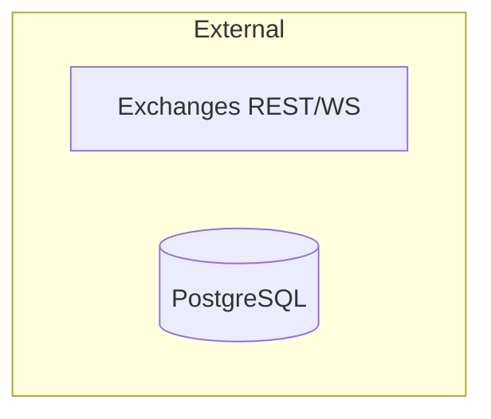

# Lesson 03 - `docs/architecture.md`

Original file: [`docs/architecture.md`](../architecture.md)

This lesson is about the first big-picture architecture document. This is where
we stop looking only at documentation structure and start learning the shape of
the application itself.

The key idea: architecture is about responsibilities and relationships.

Code tells you exact behavior. Architecture tells you where behavior belongs.

## The opening paragraph

The file begins:

```md
The market maker is a **single-process async runtime** (optionally backed by **Redis Streams**) that turns exchange data into **interval `MarketEvent`s**, assembles **strategy input frames**, runs **`StrategyRunner`** (MPC + risk + execution), and syncs orders through venue adapters. Business logic uses an **event bus**; metrics, logs, traces, and persistence are **subscribers**.
```

This is dense. A good architecture paragraph usually is. Let's unpack it.

## Single-process runtime

"Single-process" means the main Python application runs as one OS process.

That does not mean the system is simple. Inside that one process, it can still
have many async tasks:

- listen to exchange websockets
- aggregate market events
- assemble frames
- run strategy decisions
- publish events
- write observability data

Why programmers may choose a single-process design:

- simpler local development
- fewer deployment pieces
- easier shared in-memory state
- easier debugging than many separate services

Tradeoff:

If one process owns many responsibilities, boundaries must be clear in code.
That is why packages like `ingestion`, `application`, `execution`, and `risk`
matter.

## Async runtime

Async means the program can wait on I/O without blocking the whole process.

In Python, async code usually uses:

```python
async def run():
    ...

await some_operation()
```

This project talks to exchanges, Redis, databases, and websocket streams. Those
are I/O-heavy activities. Async is common here because the program often waits
for network data.

Beginner mental model:

- normal function: starts, works, returns
- async function: can pause at `await` and let other tasks run

Real-app reason:

Market-making software must watch many streams and timers at once. Async lets
one process coordinate many waiting operations.

## Redis Streams as optional backing

The architecture says the runtime is "optionally backed by Redis Streams."

That means the event bus can probably run in memory for local/simple use, or use
Redis Streams for a more durable/distributed style.

This is a common pattern:

```text
interface: AbstractEventBus
implementation 1: in-memory bus
implementation 2: Redis Streams bus
```

Why programmers do this:

- tests can use the simpler in-memory version
- local development is easier
- production-like runs can use Redis
- application code can depend on the interface, not the concrete backend

The package map confirms this:

```md
| `mm.bus` | In-memory or Redis Streams |
```

## Data transformation pipeline

The opening paragraph says the app:

```text
exchange data -> interval MarketEvents -> strategy input frames -> StrategyRunner -> venue adapters
```

This is a pipeline. Pipelines are everywhere in real software.

Examples:

- web app: request -> validation -> service -> database -> response
- data app: raw rows -> cleaned rows -> features -> model -> report
- trading app: exchange feeds -> market state -> strategy input -> decision -> execution

Why pipelines are useful:

- each step has a clear input and output
- each step can be tested
- each step can be logged
- failures are easier to locate

## `MarketEvent`

`MarketEvent` is written in backticks because it is likely an exact class or
data model name.

Common naming pattern:

- event names often end in `Event`
- input bundles often end in `Frame`
- managers coordinate operations
- adapters translate external APIs
- engines contain domain decision logic

Names are part of architecture. A good name tells you what role a thing plays.

## `StrategyRunner`

The doc says:

```md
runs **`StrategyRunner`** (MPC + risk + execution)
```

This tells us `StrategyRunner` is an orchestrator. It probably does not contain
all MPC math, all risk rules, and all exchange API code itself. Instead, it owns
the sequence:

```text
prepare frame -> ask MPC engine -> ask risk engine -> route to execution
```

Common pattern:

An orchestrator coordinates specialized components.

Why this is useful:

- each specialized component stays smaller
- the pipeline order is visible in one place
- tests can replace a component with a fake
- risk can remain separate from strategy math

## Venue adapters

Venue adapters translate internal order intentions into exchange-specific API
calls.

Common adapter pattern:

```text
internal model -> adapter -> external API format
external API response -> adapter -> internal model
```

Why programmers use adapters:

- external APIs differ
- external APIs change
- the core strategy should not know every exchange's JSON details
- tests can check adapter contracts per venue

In this repo, venue code lives under `mm/exchanges/`.

## Subscribers

The architecture says:

```md
metrics, logs, traces, and persistence are **subscribers**
```

This is an important event-bus idea.

Instead of the core strategy directly calling:

```python
write_to_postgres(event)
update_grafana_metric(event)
write_log(event)
```

the strategy can publish an event, and subscribers react.

Why this is common:

- the core business flow stays cleaner
- adding a new subscriber does not require changing producers
- observability and persistence become side effects of events
- tests can run without every production subscriber enabled

Tradeoff:

You must understand event topics, because subscribers depend on those topics.

## Design principles

The doc lists five design principles. These are not just comments. They are
rules for how future code should be written.

### 1. One decision pipeline

```md
`StrategyRunner` owns frame prep -> MPC -> risk -> execution routing.
```

This is a responsibility rule.

It means if you are adding logic to the decision sequence, `StrategyRunner` is
probably the place to inspect first.

Common reason:

Having one decision pipeline avoids duplicated decision behavior in several
places.

### 2. Bus-first

```md
Topics are the contract; multiple consumers subscribe without changing producers.
```

In direct-call code, the function signature is the contract.

In event-bus code, the topic name and event payload shape are the contract.

For example:

```text
strategy:decisions
execution:state:{exchange}
market:events:{ex}:{sym}:{interval}
```

If a producer changes the topic name or payload shape, consumers can break.

This is why topic names are centralized in code. In this project, see:

[`mm/core/topics.py`](../../mm/core/topics.py)

That file includes constants like:

```python
STRATEGY_ACTIONS_TOPIC = "strategy:actions"
DEFAULT_STRATEGY_DECISIONS_TOPIC = "strategy:decisions"
```

Common practice:

Do not scatter important string contracts across the codebase. Put them in one
place.

### 3. Float domain at the strategy boundary

```md
Mid, spreads, and quantities are floats until adapters format wire payloads.
```

This is about numeric representation.

Inside strategy logic, floats are convenient for math. But exchanges often need
prices and quantities formatted in exact ways:

- certain decimal precision
- string payloads
- minimum tick size
- minimum order size

The architecture says formatting belongs near adapters, not deep inside the MPC
strategy.

Common principle:

Keep domain math separate from wire/API formatting.

### 4. Observe by default

```md
`controller.dry_run` defaults to `true`; live sync is explicit.
```

This is a safety principle. The system should not place real orders unless the
operator intentionally enables that behavior.

Common in risky systems:

- dry run by default
- read-only by default
- confirmation required for destructive operations
- separate config for live mode

### 5. Envelopes for durability

```md
Persistence wraps payloads in versioned `EventEnvelope` records.
```

An envelope is a wrapper around a message.

Instead of storing only:

```json
{"price": 100, "qty": 2}
```

an envelope might store:

```json
{
  "event_type": "MarketEvent",
  "version": 1,
  "timestamp": 123456789,
  "payload": {"price": 100, "qty": 2}
}
```

Why this is common:

- databases can store different event types consistently
- old events can still be interpreted after schemas change
- replay systems know what kind of event they are reading
- debugging gets metadata, not only payload data

## Layer diagram

The architecture uses a Mermaid diagram:



Mermaid is a text format for diagrams. GitHub and many docs tools can render it.

Basic syntax:

- `flowchart TB` means top-to-bottom flowchart
- `subgraph name [Label]` creates a grouped area
- `A --> B` means A points to B
- `A <--> B` means two-way relationship
- `EX[Text]` creates a box node
- `PG[(PostgreSQL)]` creates a database-looking node

This is a common programmer skill: use text-based diagrams that live in Git
with the code.

## Layers in the diagram

The diagram has these groups:

- External
- Ingestion
- Event bus
- Application
- Subscribers

This is a layered architecture. Each layer has a role.

### External

External things are outside the Python application:

- exchanges
- PostgreSQL
- Redis
- Prometheus/Grafana

External systems are slower and less reliable than in-memory code, so real apps
usually isolate them behind adapters, clients, or subscribers.

### Ingestion

Ingestion brings external data into the app.

Here it includes:

- `SymbolEngine`
- `IntervalScheduler`
- `MarketEventBuilder`

The naming suggests:

- `SymbolEngine` manages one exchange/symbol data stream
- `IntervalScheduler` creates timed ticks
- `MarketEventBuilder` turns current state into interval events

### Event bus

The bus sits between producers and consumers.

This central position is the point. It lets many parts communicate through
events instead of hard-coded object references.

### Application

Application layer usually means the part that coordinates business use cases.

Here it includes:

- `StrategyInputFrameAssembler`
- `StrategyRunner`
- `MpcStrategyEngine`
- `RuntimeRiskEngine`
- `OrderManager`

The application layer is not just math and not just I/O. It is where the main
workflow is coordinated.

### Subscribers

Subscribers listen and react:

- observability subscriber
- Postgres writer
- runtime control plane

This keeps side effects attached to events.

## Package map

The package map table is a responsibility map:

```md
| `mm.runtime` | `RuntimeComponents`, `build_runtime_components` |
| `mm.application` | Frame assembler, `StrategyRunner`, frame prep, action routing |
| `mm.bus` | In-memory or Redis Streams |
```

When you enter a new codebase, package maps are gold. They tell you where to
look before you use search.

Common package pattern:

- `runtime`: startup and wiring
- `application`: use-case orchestration
- `core`: shared models and contracts
- `execution`: order execution behavior
- `risk`: risk rules
- `persistence`: durable storage
- `observability`: logs, metrics, traces

## Topic naming

The topic table says:

```md
| `market:events:{ex}:{sym}:{interval}` | SymbolEngine | Frame assembler, persistence |
```

Topic names are strings with structure.

The parts in braces are variables:

- `{ex}` means exchange
- `{sym}` means symbol
- `{interval}` means interval in milliseconds

This is similar to route patterns in web apps:

```text
/users/{user_id}/orders/{order_id}
```

Why structure topic names:

- easy to subscribe by exact topic
- easy to inspect logs
- easy to group related messages
- easy to generate names in code

## Connecting the docs to Python syntax

Open [`mm/core/topics.py`](../../mm/core/topics.py). You will see:

```python
@dataclass(frozen=True, slots=True)
class RuntimeTopics:
    local: MarketDataSourceLike
    interval_ms: int
    global_: MarketDataSourceLike | None = None
```

This is a dataclass. Dataclasses are a common Python way to define data objects
with less boilerplate.

`frozen=True` means instances should not be changed after creation.

`slots=True` can reduce memory use and prevent accidental new attributes.

Type annotations like `interval_ms: int` tell readers and tools what type is
expected.

The field name `global_` has an underscore because `global` is a Python keyword.
Programmers often add a trailing underscore when a desired name conflicts with a
keyword.

## Properties

The same file contains:

```python
@property
def strategy_actions(self) -> str:
    return self.action_topic
```

`@property` lets code access a method like an attribute:

```python
topics.strategy_actions
```

instead of:

```python
topics.strategy_actions()
```

Common use:

Use properties for values that are computed from object state but feel like
attributes.

## Static methods and f-strings

The topics file also has:

```python
@staticmethod
def execution_orders(exchange: str) -> str:
    return f"execution:orders:{exchange.lower().strip()}"
```

`@staticmethod` means the method belongs to the class namespace but does not
need `self`.

The `f"..."` syntax is an f-string. It builds a string using expressions inside
braces.

```python
exchange.lower().strip()
```

means:

- make the exchange lowercase
- remove whitespace from the beginning and end

This normalizes topic names. Normalization is common when strings become
contracts.

## Tiny exercise

After reading this lesson, answer these:

1. What does "topics are the contract" mean?
2. Why is `StrategyRunner` an orchestrator rather than just a math class?
3. Why should exchange-specific formatting live near adapters?
4. In `RuntimeTopics.execution_orders("Wallex")`, what string would you expect?

