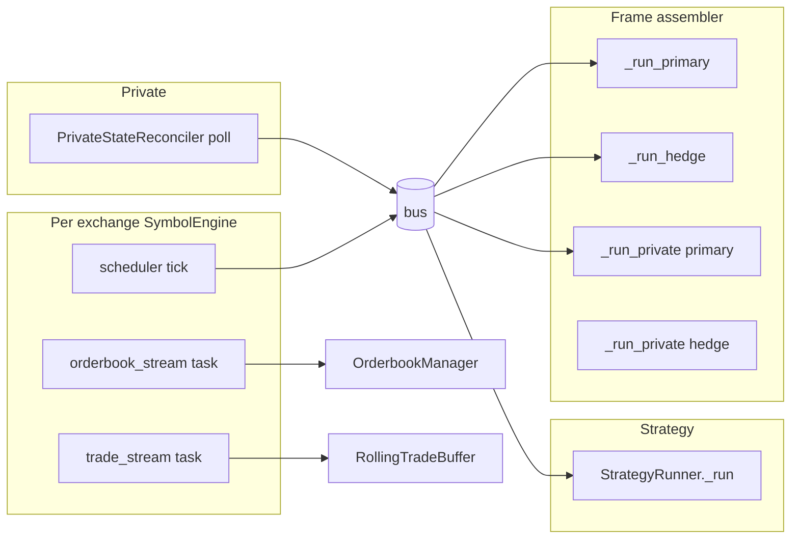
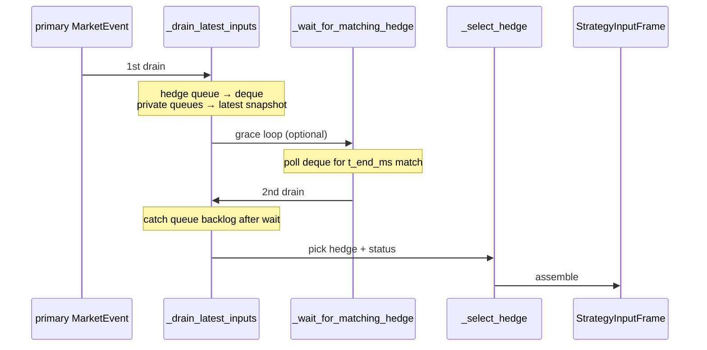
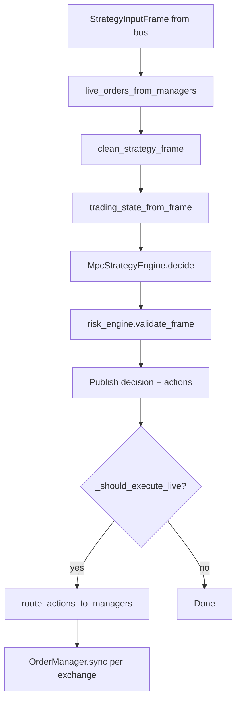
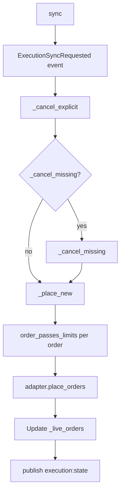

# Runtime mechanisms (detailed)

This document explains **how** each stage works: concurrent tasks, queues, timing, and why the code is structured the way it is. For a lighter walkthrough, see [Data flow](data-flow.md).

## Runtime concurrency model

`build_runtime_components` starts many **asyncio tasks** in one process. They communicate only via the **event bus** (in-memory queues or Redis Streams).



| Component | Blocking call | What unblocks it |
|-----------|---------------|------------------|
| `SymbolEngine._feed_orderbook` | `async for book in adapter.orderbook_stream()` | Next WS/REST book update |
| `SymbolEngine` interval publish | Scheduler callback | Wall-clock interval (`interval_ms`) |
| `FrameAssembler._run_primary` | `primary_queue.get()` | Next primary `MarketEvent` |
| `FrameAssembler._run_hedge` | `hedge_queue.get()` | Next hedge `MarketEvent` |
| `StrategyRunner._run` | `frame_queue.get()` | Next `StrategyInputFrame` |
| `PrivateStateReconciler` | Poll interval / streams | REST timer or WS message |

**Important:** There is no global lock across stages. Ordering is **per-topic FIFO** into each subscriber queue.

---

## Event bus delivery

### In-memory (`bus.kind: memory`)

- Each `subscribe_queue(topic)` gets its **own** `asyncio.Queue`.
- `publish(topic, event)` **awaits** `put` on every subscriber queue (back-pressure if a consumer is slow).
- File: `mm/bus/memory.py`.

### Redis Streams (`bus.kind: redis_streams`)

- Durable streams for fan-out across processes; same topic names.
- File: `mm/bus/redis_streams.py`.

### Who subscribes to what (typical production config)

| Topic | Producers | Consumers |
|-------|-----------|-----------|
| `market:events:{ex}:{sym}:{interval}` | `SymbolEngine` | Frame assembler (primary/hedge queue), Postgres writer |
| `market:raw:…:orderbook` | `SymbolEngine` | Optional debug / replay |
| `strategy:frames:…` | Frame assembler | `StrategyRunner`, observability |
| `strategy:decisions` | `StrategyRunner` | Postgres, observability |
| `strategy:actions` | `StrategyRunner` | Postgres, observability |
| `private:state:{ex}:snapshot` | Private reconciler | Frame assembler, Postgres |
| `execution:orders:{ex}` | `OrderManager` | Observability |
| `execution:state:{ex}` | `OrderManager` | Observability, execution reconciler |

---

## Phase 1 — Market ingestion (`SymbolEngine`)

**File:** `mm/ingestion/symbol_engine.py`

### Continuous tasks (start with `engine.start()`)

1. **`_feed_orderbook`** — Applies snapshot/delta to in-process `OrderbookManager`. Also publishes each raw book to `market:raw:{exchange}:{symbol}:orderbook` (not used by MPC directly).
2. **`_feed_trades`** — Deduplicated trades into `RollingTradeBuffer`; may publish `market:raw:…:trades`.

The **canonical book for strategy** is read from `OrderbookManager` inside `MarketEventBuilder`, not from the raw topic.

### Interval aggregation

`IntervalScheduler` calls `publish_event(t_start_ms, t_end_ms, interval_ms)`:

```python
event = builder.build(interval_ms, t_start_ms, t_end_ms)
await bus.publish(f"market:events:{exchange}:{symbol}:{interval_ms}", event)
```

`MarketEvent` fields:

| Field | Meaning |
|-------|---------|
| `t_start_ms`, `t_end_ms` | Window boundaries for this interval |
| `orderbook` | Snapshot from `OrderbookManager` at tick time |
| `trades` | Trades in `(t_start, t_end]` from buffer |
| `buy_volume`, `sell_volume`, `vwap`, `imbalance`, `microprice` | Aggregated features |

If the book is empty, `build` may raise `LookupError` and **no event is published** for that tick.

### Two books: raw vs strategy

| Book | Includes your orders? | Used by |
|------|------------------------|---------|
| Exchange feed → `OrderbookManager` → `MarketEvent` on bus | **Yes** (exchange view) | Frame assembler input, Grafana “market” row |
| After `subtract_own_orders` in `StrategyRunner` | **No** (bot qty removed) | `MpcStrategyEngine.decide` only |

---

## Phase 2 — Frame assembly (`StrategyInputFrameAssembler`)

**File:** `mm/application/frame_assembler.py`

### Background tasks

When `frame_assembler.start()` runs:

| Task | Input queue | Side effect |
|------|-------------|-------------|
| `_run_primary` | `primary_queue` | `build_frame` → `bus.publish(strategy:frames:…)` |
| `_run_hedge` | `hedge_queue` | Appends each hedge `MarketEvent` to `_hedge_events` deque |
| `_run_private` (×2) | private snapshot queues | Updates `_primary_private` / `_hedge_private` |

Hedge history is capped (`hedge_history_size`, default 128). Old hedge windows roll off.

### `build_frame(primary)` step-by-step



#### Why `_drain_latest_inputs` is called **twice**

`_drain_latest_inputs` is **non-blocking** (`get_nowait` until `QueueEmpty`). It:

1. Moves all pending hedge `MarketEvent`s from `hedge_queue` into `_hedge_events`.
2. Replaces `_primary_private` / `_hedge_private` with the **latest** snapshot from each private queue.

| Call | When | Purpose |
|------|------|---------|
| **1st** | Before `_wait_for_matching_hedge` | If a matching hedge is already in `hedge_queue`, move it into the deque so the wait loop can exit immediately (avoid sleeping full `hedge_grace_ms`). Refresh private state at frame start. |
| **2nd** | After grace window | Ingest hedge events that sat in `hedge_queue` during the wait (race if `_run_hedge` has not run yet). Refresh private snapshots immediately before `_select_hedge`. |

`_wait_for_matching_hedge` **does not** drain queues itself; it only checks:

```python
any(event.t_end_ms == primary_t_end_ms for event in self._hedge_events)
```

and sleeps 5 ms until `hedge_grace_ms` expires.

**Efficiency:** Two drains are O(pending queue depth) per primary frame — cheap compared to network I/O. Alternative design: call `_drain_latest_inputs` inside the wait loop each iteration (equivalent semantics).

#### `_select_hedge(primary)`

1. If no hedge configured → `hedge_status = "disabled"`.
2. Candidates: hedge events with `t_end_ms <= primary.t_end_ms`.
3. Pick **latest** candidate by `t_end_ms`.
4. If none → `"missing"`.
5. If `primary.t_end_ms - hedge.t_end_ms > max_hedge_lag_ms` → `"stale"` (hedge discarded, `hedge = None`).
6. Else → `"ready"`, `hedge_lag_ms = primary.t_end_ms - hedge.t_end_ms`.

MPC still runs when hedge is missing/stale; `MpcStrategyEngine` uses `frame.hedge_status` and optional hedge VWAP fields.

### Output

Published `StrategyInputFrame` still has the **raw** exchange orderbook on `primary` / `hedge`. Own-order adjustment happens in the next phase.

---

## Phase 2b — Own-order subtraction (`StrategyRunner`)

**Files:** `mm/application/strategy_runner.py`, `frame_preparation.py`, `orderbook_view.py`

### When and what

On every `on_frame`:

```python
open_orders = live_orders_from_managers(self.order_managers)
clean_frame = clean_strategy_frame(frame, open_orders)
decision = self._engine.decide(clean_frame, ...)
```

`live_orders_from_managers` reads `OrderManager.live_orders` (orders you believe are open after last place/cancel/reconcile).

### `subtract_own_orders` algorithm

For each open `Order` on matching exchange/symbol:

- **Buy** → subtract `qty` from bid level at `price`.
- **Sell** → subtract `qty` from ask level at `price`.
- Remove level if qty ≤ 0.

```7:17:mm/application/orderbook_view.py
def subtract_own_orders(book: RawOrderbook, open_orders: dict[str, Order]) -> RawOrderbook:
    ...
    side[order.price] = side.get(order.price, 0.0) - order.qty
```

### Timing caveat

| Event | Visible in cleaned book |
|-------|-------------------------|
| Order placed end of frame N | Frame N+1 (after `live_orders` updated) |
| Order rejected by venue limits | Never added to `live_orders` |
| Cancel accepted | Next frame after manager removes from `live_orders` |

---

## Phase 3 — Strategy decision (`StrategyRunner` + `MpcStrategyEngine`)

**Files:** `mm/application/strategy_runner.py`, `mm/strategies/mpc_engine.py`

### Per-frame pipeline



| Step | Detail |
|------|--------|
| Control plane sync | `RuntimeRiskEngine.set_kill_switch` from admin `kill_switch` |
| `decide` | Builds MPC `State` from **clean** book; optimizer; ladder orders (`qty_step`, spreads, …) |
| Risk | Kill switch, stale data (`now - t_end_ms`), per-order `max_inventory` |
| Publish | `strategy:decisions` (payload dict), `strategy:actions` (`Action`), optional `risk:events` |
| Execute gates | `observe_only` (JSON + control plane), `action_start_after_steps`, manager exists |
| Route | Split actions by exchange; `OrderManager.sync` |

See [Controller & execution](controller-and-execution.md) for constraint tables.

---

## Phase 4 — Execution (`OrderManager`)

**File:** `mm/execution/order_manager.py`

### `sync(actions)` (under `asyncio.Lock`)



| Mechanism | Behavior |
|-----------|----------|
| Dedupe | Skip create if same `(actor, client_id, exchange, symbol, side, price, qty, type)` already live |
| Venue limits | `TradeStatsVenueOrderLimitSource` — min base qty, min notional; reject → `OrderValidationRejected` on bus |
| Live book | Optimistic update on accept; reconciler/private stream can correct later |

**Default runtime:** `cancel_missing=False` — only explicit cancels from the `Action`, not “cancel all not in desired set.”

---

## Private state flow

**File:** `mm/private_state/reconciler.py`

REST mode (Nobitex/Wallex): one poll loop fetches balances + open orders together, publishes:

- `private:state:{exchange}:snapshot` — full `PrivateStateSnapshot`

Frame assembler’s `_run_private` keeps the **latest** snapshot per role. Assembler does **not** subtract private open orders from the market book; subtraction uses `OrderManager.live_orders` (execution view).

---

## Persistence and envelopes

Postgres writer subscribes to configured topics, wraps each message:

```python
envelope_event(topic, event, run_id=...)
```

Stored columns include `event_type` (`MarketEvent`, `StrategyDecision`, …), `payload` JSONB, and full `envelope` JSONB. Grafana SQL reads `mm_events.payload` — typically **raw** market events unless you query decision rows.

---

## Debugging map

| Question | Where to look |
|----------|----------------|
| Is hedge aligned? | Frame `hedge_status`, `hedge_lag_ms`; assembler `_select_hedge` |
| Why 250 ms wait? | `hedge_grace_ms`; first drain found no `t_end_ms` match |
| Book seen by MPC | Breakpoint after `clean_strategy_frame` |
| Book in Postgres/Grafana | `market:events` payload (raw) |
| Risk dropped orders | `risk:events`, `mm_risk_reject_total` metric |
| Venue rejected size | `OrderValidationRejected` on `execution:orders:{ex}` |

---

## Related documents

- [Data flow](data-flow.md) — end-to-end phases
- [Architecture overview](architecture.md)
- [Controller & execution](controller-and-execution.md)
- [Configuration](configuration.md)
