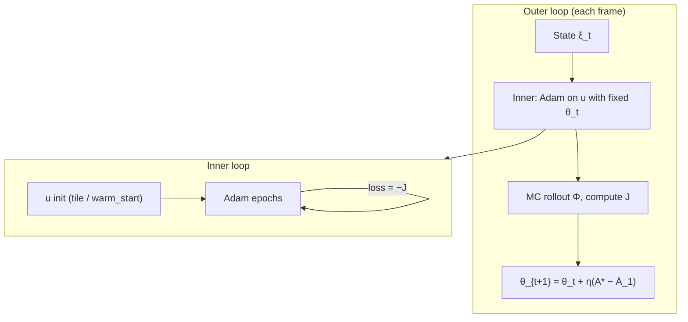

# MPC Market-Making Optimization: Objective, Mechanism, and Business Goals

This document describes the implemented MPC controller: business intent, **mathematical problem formalization (§2)**, mechanism, data flow, configuration surface, diagnostics, and known gaps. It is written for external expert review. It records what the code does and what is uncertain; it does not prescribe tuning values or a preferred redesign.

The compact equation-level statement of \(J\), the quadratic viability deficit, and the linear dual is [`mpc-mathematical-formulation.md`](mpc-mathematical-formulation.md).

Related implementation references:

- `mm.strategies.mpc_engine.MpcStrategyEngine`
- `mm.mpc.mpc_tensor_batched.MonteCarloMPCTensorBatched`
- `mm.mpc.joint_optimizer.optimize_joint_with_diagnostics` (liquidity-sourcing mode)
- `mm.mpc.objective_terms` (book quality, validity, viability availability, dual λ, CE normalization)
- `docs/viability_term.md` (conceptual motivation for availability vs CE)
- `docs/validity_term.md` (validity gate design)
- `mm.mpc.reward_tensor` (risk-adjusted return)
- `docs/old/mpc-optimizer-implementation-details.md` (rollout timing, decoder, joint vs local-only differences)

---

## 1. Business goals (operational intent)

The controller targets **persistent market making**: quoting over many intervals rather than optimizing a single trade.

### 1.1 Two-sided quote availability

Operational intent includes:

- Bid and ask liquidity when wallet capacity allows.
- Wide spreads are not forbidden by the core return term; tightness enters only via **validity** when `validity.penalty_scale > 0`.
- Depleting quote (IRT) or base (USDT) on one side removes hard capacity on that side and ends two-sided quoting in simulation.

Implemented mechanisms that relate to this intent:

| Mechanism | Type | Role |
| --- | --- | --- |
| `bid_max = cash/mid`, `ask_max = inventory` | Hard | Cannot simulate quotes beyond wallet totals in rollout |
| `−μ · max(0, B_min − B)` | Soft (optional) | **Validity** — penalizes poor h=0 book shape (`validity` block) |
| `−λ · 𝒮` | Soft (optional) | **Viability** — penalizes low **next-step** two-sided **availability** after the first simulated fill (`viability` block); `λ` adapts online |

`w_book` and `w_inv` / `inventory_zone` were **removed**. Book scoring still exists via `book_quality.soft_scoring`, but enters `J` only through the validity gate (§8.3–7.4), not as a direct reward term.

Current capacity decoder sets `bid_min = ask_min = 0`. There is **no hard minimum quote per side** at the capacity layer. `cumulative_qty_floor_at_spread_max` affects spread-structure decode at `spread_max`, but mins are clamped to feasible capacity and can be zero when a side has no free balance.

### 1.2 Profitability

Profitability enters through **risk-adjusted horizon return** on simulated mark-to-market wealth, with maker fees and a differentiable soft-fill model. The optimizer maximizes CE (see §8.1). A separate **negative-objective policy** (§10) may alter the action when CE is negative; that policy is outside `J`.

### 1.3 Availability vs profitability (design split)

The objective deliberately separates:

- **CE (§8.1)** — risk-adjusted **return** on simulated wealth (price + fill uncertainty).
- **Validity (§8.3)** — is the **h=0 quote shape** acceptable (spread/depth/balance/uniformity score)?
- **Viability (§8.5–7.6)** — after simulating orderflow and fills over the horizon, is **two-sided quoting capacity** still above target?

Viability uses **total** wallet balances (`free + locked`, see §4.1). It does not model exchange min-notional, tick size, or free-vs-locked separately. Registry allocation caps, risk limits, and physical exchange balances remain outside `J`.

### 1.4 Outside the optimizer objective

Not part of `J`:

- Tick, lot, min-notional validation
- Net-delta and transition risk gates
- Order reconcile, router, venue API errors
- Stale-frame skipping, private-data freshness rules
- Virtual vs physical ledger selection and allocation breach halts

The MPC outputs a **target book**; downstream layers decide live orders.

---

## 2. Mathematical formalization

This section states the **constrained stochastic optimization problem** the controller approximates, the **action-space architecture** (what is actually optimized), how **hard vs soft constraints** enter, the **bi-level primal–dual solve**, and a **complete map from symbols to registry config keys**. Implementation details of each term are expanded in §8; rollout mechanics in §8.

### 2.1 Problem class

At each decision time \(t\), the controller solves a **finite-horizon stochastic program** over differentiable quote parameters, with optional **inequality targets** expressed as **soft penalties** and one **adaptive Lagrange multiplier** (viability \(\lambda\)).

Conceptually this is a **bi-level** problem:

```text
OUTER (slow):   update dual state θ  from next-step availability diagnostics
INNER (fast):   maximize J(u; ξ, θ) over action parameters u via Adam + MC rollout
```

where \(\xi\) is the exogenous market–wallet–model state at \(t\). The inner problem is **not convex** (sigmoid mixtures, soft fills, entropic CE). The implementation returns a **local** solution (best Adam epoch), not a global optimum.

**Single-venue branch** (primary: `monte_carlo_mpc_tensor_batched`):

```text
maximize_{u ∈ 𝒰(ξ)}  J(u; ξ, θ_t)
```

**Joint / liquidity-sourcing branch** stacks local and global action blocks; consolidated wealth drives CE while validity and viability are evaluated **per venue** (§8.0, §16).

---

### 2.2 Exogenous state \(\xi_t\)

The rollout and objective depend on state \(\xi_t\), implemented as `mm.mpc.mpc_state.State` (§4). At decision \(t\):

| Symbol | Code field | Role in optimization |
| --- | --- | --- |
| \(p_t\) | `mid` | Quote anchor (quote per base) |
| \(\mathcal{B}_t\) | `ob_rel` | Market-only book on spread grid \([0, S_{\max}]\) |
| \(b_t\) | `inventory` | Total base balance (USDT) |
| \(q_t\) | `cash` | Total quote balance (IRT) |
| \(V^{\mathrm{buy}}_t, V^{\mathrm{sell}}_t\) | `buy_vwap`, `sell_vwap` | Inventory-aware marks |
| \(\omega_t\) | `buy_vol`, `sell_vol` | Flow observations for MC models |
| Global fields | `global_*` | Second venue when liquidity sourcing enabled |

**Wallet sourcing:** totals use `free + locked` from ledger or private snapshot (§4.1). This is a modeling choice: viability margins use the same totals, not free-only balances.

**Stochastic inputs:** for each MC path \(i=1,\ldots,N\), sample flow innovations and price residuals from configured models (`local_market_flow_model`, `local_price_model`, and global counterparts in joint mode). With `fixed_mc_samples = true`, the same draws are reused across all Adam epochs in one `optimize()` call.

---

### 2.3 Decision variable: flattened horizon action \(u\)

The optimizer does **not** choose individual limit orders directly. It chooses a **continuous parameter vector** that decodes into **cumulative depth curves** on a fixed spread grid.

#### 2.3.1 Horizon stacking

Let \(H =\) `horizon`, \(K =\) `n_components` per venue.

```text
d_venue = 6K + 3
u ∈ ℝ^{H · d_venue}        (local-only)
u = [u^{(0)}, u^{(1)}, …, u^{(H-1)}]   each u^{(h)} ∈ ℝ^{d_venue}
```

**Initialization:** `x0_arr = tile(u_init, H)` — the same seed vector is copied to every horizon step; Adam may **diverge** steps during optimization. **Validity** and book-quality scoring use **only** \(u^{(0)}\) (the first horizon slice). **Viability** uses the full rollout triggered by the entire \(u\) stack.

**Joint mode:** \(u = [u_{\mathrm{local}} \| u_{\mathrm{global}}]\) with separate \(K_{\mathrm{local}}\), \(K_{\mathrm{global}}\); length \(H \cdot (d_{\mathrm{local}} + d_{\mathrm{global}})\).

#### 2.3.2 Per-venue flat layout (\(u^{(h)} \in \mathbb{R}^{6K+3}\))

Indices are zero-based; \(i \in \{0,\ldots,K-1\}\) indexes sigmoid components.

| Index block | Symbol | Decoder output | Adam box bound (default) |
| --- | --- | --- | --- |
| `[3i]` | \(u^L_i\) | logit → mixture weight \(L_i\) | \((-30, 30)\) |
| `[3i+1]` | \(u^k_i\) | → steepness \(k_i > 0\) | \((10^{-6}, 100)\) |
| `[3i+2]` | \(u^{x0}_i\) | → center \(x_{0,i}\) (spread quote units) | \((-S_{\max}, S_{\max})\) |
| `[0:3K)` | bid side | components \(i\) on bid | same pattern |
| `[3K:6K)` | ask side | components \(i\) on ask | same pattern |
| `[6K]` | \(u^{\mathrm{depth}}_{\mathrm{bid}}\) | depth logit at \(S_{\max}\) | \((-30, 30)\) |
| `[6K+1]` | \(u^{\mathrm{depth}}_{\mathrm{ask}}\) | depth logit at \(S_{\max}\) | \((-30, 30)\) |
| `[6K+2]` | \(u^{r}\) | reservation skew logit | \((-30, 30)\) |

Config: `controller.optimizer.local.n_components` (or `.global.n_components`).

#### 2.3.3 Spread grid (structural domain)

Discrete spreads (quote currency from mid):

```text
𝒮_grid = { s_j = j · Δ : j = 1, …, J },   Δ = spread_step,   S_max = spread_max,   J = ⌈S_max / Δ⌉
```

Config: `controller.orderbook_grid.spread_max`, `controller.orderbook_grid.spread_step`.

All decoded cumulative depths are evaluated on \(\mathcal{S}_{\mathrm{grid}}\). Live orders are placed only on these bucket edges downstream.

---

### 2.4 Decode map: \(u^{(h)} \mapsto\) quote curves

The **architecture constraint** is the parametric family — not a free choice of depth at each level.

#### 2.4.1 Sigmoid mixture (per side)

For side \(s \in \{\mathrm{bid}, \mathrm{ask}\}\), raw parameters materialize to \((L_i, k_i, x_{0,i})_{i=0}^{K-1}\), then:

```text
D_s(spread) = Σ_{i=0}^{K-1}  L_i · σ( k_i · (spread − x_{0,i}) )
\tilde{D}_s(spread) = max(0, D_s(spread) − D_s(0))     # effective cumulative depth
```

\(\sigma\) is the logistic sigmoid. Implementation: `materialize_side_torch`, `effective_depth_*_tensor` in `mm.mpc.l_param`.

#### 2.4.2 Depth at \(S_{\max}\) (size logit)

Total cumulative base quantity at the outer grid edge:

```text
Q_s^{max} = Q_{\min} + σ(u^{\mathrm{depth}}_s) · (Q^{\mathrm{cap}}_s − Q_{\min})
```

| Symbol | Config key | Meaning |
| --- | --- | --- |
| \(Q_{\min}\) | `cumulative_qty_floor_at_spread_max` | Decoder floor at \(S_{\max}\) (base units) |
| \(Q^{\mathrm{cap}}_s\) | `cumulative_qty_cap_at_spread_max` (optional) | Hard cap on max depth per side |
| Dynamic cap | `_quote_capacity_bounds_*` | \(\min(Q_{\mathrm{cap}}, b_t)\) ask, \(\min(Q_{\mathrm{cap}}, q_t/p_t)\) bid |

Tail mixture weights are scaled so cumulative depth at \(S_{\max}\) matches \(Q_s^{\max}\) (softmax / structured split per `LParamConfig`).

#### 2.4.3 Optional spread geometry (`book_quality.hard_structure`)

When `action_max_spread` \(= S^{\mathrm{touch}}_{\max} > 0\) is configured:

| Constraint | Config | Enforcement |
| --- | --- | --- |
| First-touch spread sum | `action_max_spread` | \(x_{0,1}^{\mathrm{bid}} + x_{0,1}^{\mathrm{ask}} \le S^{\mathrm{touch}}_{\max}\) via scaled softmax on first centers |
| Minimum depth at first center | `action_min_depth` | Lower bound on component-1 contribution when \(K \ge 2\) |
| Center steepness floor | `action_k_epsilon` | Numerical floor on first \(k\) |

Requires `n_components ≥ 2`. Mapped into `LParamConfig.quote_spread_max`, `quote_spread_min_depth`, `quote_spread_k_epsilon`.

#### 2.4.4 Reservation skew (optional)

When `reservation_skew.max_abs_skew` \(= r_{\max} > 0\):

```text
r_offset = r_max · tanh(u^r)     # shifts effective mid on spread grid, |r_offset| < r_max
```

Config: `controller.optimizer.local.reservation_skew.max_abs_skew`.

---

### 2.5 Feasible set \(\mathcal{U}(\xi)\): hard constraints

Hard constraints are enforced by **projection, clamping, and infeasible-side zeros** — they do **not** appear as penalty terms in \(J\).

#### 2.5.1 Parameter box constraints

```text
u_j ∈ [lo_j, hi_j]     default boxes in §2.3.2
```

Applied implicitly via bounded initialization and Adam (no explicit projection each step; best epoch is clamped when decoded).

#### 2.5.2 Wallet capacity (rollout + decode)

Per side \(s\), at each rollout step with wallet \((b, q)\) and mid \(p\):

```text
Q^{\mathrm{bid}}_{\max} = min(Q_{\mathrm{cap}}, q / p)
Q^{\mathrm{ask}}_{\max} = min(Q_{\mathrm{cap}}, b)
Q^{\mathrm{bid}}_{\min} = Q^{\mathrm{ask}}_{\min} = 0
```

Decoded sizes are clamped to \([Q^{\min}_s, Q^{\max}_s]\). **There is no hard minimum quote size** at the capacity layer (`bid_min = ask_min = 0`). One-sided quoting is feasible whenever CE and soft terms favor it.

Config: `cumulative_qty_cap_at_spread_max`; capacity uses live \(b_t, q_t\) from rollout state.

#### 2.5.3 Non-negativity of depths

```text
\tilde{D}_s(spread) ≥ 0     ∀ spread
```

via `max(0, ·)` on cumulative curves.

#### 2.5.4 Structural decode inequalities

When spread geometry is enabled (§2.4.3), feasible \((x_{0,i})\) lie in the image of the structured decoder — not an arbitrary spread vector.

#### 2.5.5 Outside the optimizer feasible set

These are enforced **after** MPC, not in \(\mathcal{U}(\xi)\):

| Constraint | Layer |
| --- | --- |
| Tick / lot / min-notional | Order validation, reconcile |
| Net delta / transition risk | Risk engine |
| Allocation registry cap | Virtual ledger / halt |
| Exchange min size | Venue API rejection |

---

### 2.6 Stochastic rollout operator \(\Phi\)

Given \(u\) and \(\xi_t\), the closure simulates \(N\) paths:

```text
(b_{i,h}, q_{i,h}, p_{i,h}, W_{i,h})_{h=0}^{H} = Φ(u, ξ_t, ε_i),   ε_i ~ model samples
```

| Step | Operator | Config / notes |
| --- | --- | --- |
| Decode | \(u^{(h)} \mapsto \tilde{D}_{\mathrm{bid}}, \tilde{D}_{\mathrm{ask}}\) | §2.4 |
| Match flow | `soft_fill_batched` | `soft_fill_temp`, `soft_fill_activation`, `soft_fill_queue_model` |
| Fee | maker fee | `execution_model.local_maker_fee` |
| Book evolve | limit-order-flow on public book | market-only book |
| Mark | inventory-aware VWAP | `vwap_depth` from inventory |
| Wealth | \(W_{i,h} = q_{i,h} + b_{i,h} \cdot \mathrm{mark}_{i,h}\) | — |

Path return and CE are computed from \(\Delta W_{i,h}\) (§8.1). Viability snapshots \((b_{i,h}, q_{i,h}, p_{i,h})\) are recorded along each path; **next-step** availability uses index \(h=1\) only (§8.5.4).

---

### 2.7 Nominal constrained problem

Let \(\pi\) denote the policy induced by decode map \(\Gamma\) and parameters \(u\). The **design intent** (see `docs/viability_term.md`) is:

```text
maximize_{u ∈ 𝒰(ξ)}   CE_eff(u; ξ)
subject to            E[Ã_1(u; ξ)] ≥ A*
                      B(u^{(0)}; ξ) ≥ B_min        (optional)
```

where:

- \(CE_{\mathrm{eff}}\) = entropic certainty equivalent of horizon return \(R_i = \sum_h \Delta W_{i,h} / W_0\) (§8.1–8.2)
- \(\mathcal{S}\) = expected next-step quadratic reserve deficit (§8.5)
- \(B\) = book-quality score at **\(h=0\)** decoded action (§8.4)

Expectation \(\mathbb{E}[\cdot]\) is **Monte Carlo average** over \(N =\) `n_samples` paths.

---

### 2.8 Implemented Lagrangian relaxation (scalar \(J\))

Inequalities are **not** enforced as hard constraints in the solver. They enter as **one-sided penalties**:

```text
J(u; ξ, λ) = CE_eff(u; ξ)
             − μ · [B_min − B(u^{(0)}; ξ)]_+
             − λ · 𝒮(u; ξ)
```

| Term | Definition | Config |
| --- | --- | --- |
| \([x]_+ = \max(0, x)\) | hinge | — |
| \(B_{\min}\) | validity floor | `validity.min_score` |
| \(\mu\) | fixed validity scale | `validity.penalty_scale` |
| \(\mathcal{S} = \mathbb{E}_i[d_{\mathrm{bid},1}^{2} + d_{\mathrm{ask},1}^{2}]\) | mean next-step quadratic deficit | `viability.min_viable_quote` |
| \(\lambda\) | bounded linear multiplier | `viability.lambda_init`, clipped to `lambda_max` |

If `validity.penalty_scale = 0` or block absent, the validity term is **omitted**. If `viability` is absent or \(\lambda=0\), viability is omitted.

**Joint mode:**

```text
J = CE_eff
    − μ_ℓ [B_min,ℓ − B_ℓ]_+ − λ_ℓ 𝒮_ℓ
    − μ_g [B_min,g − B_g]_+ − λ_g 𝒮_g
```

with `controller.optimizer.local` vs `.global` blocks.

---

### 2.9 Bi-level solution algorithm

#### Inner problem (each controller decision)

```text
u* = argmin_u  (−J(u; ξ, λ_t))     via Adam,  E = adam_epochs,  lr = adam_lr
```

| Hyperparameter | Config key | Typical role |
| --- | --- | --- |
| Adam steps | `optimizer.adam_epochs` | Inner iteration budget |
| Learning rate | `optimizer.adam_lr` | Step size on \(u\) |
| Gradient clip | `adam_grad_clip` (constructor) | Stability |
| Warm start | `optimizer.warm_start` | Prior \(u\), α-blend, optional Adam state carry-over (§9.1) |
| Best epoch | lowest `loss = −J` | `best` action for target book |

\(\lambda_t\) is **fixed** for all inner epochs.

#### Outer dual update (between decisions)

After inner solve, from diagnostics \(\mathcal{S}\) (mean next-step quadratic deficit):

```text
S̄_{t+1} = α S̄_t + (1−α) 𝒮_t
gap_t    = S̄_{t+1} − ε
λ_{t+1}  = clip(λ_t + η · gap_t, 0, λ_max)
```

| Symbol | Config key |
| --- | --- |
| \(\eta\) | `viability.lambda_learning_rate` |
| \(\varepsilon\) | `viability.shortfall_tolerance` |
| \(\alpha\) | `viability.dual_ewma_decay` |
| \(\lambda_{\max}\) | `viability.lambda_max` |
| \(\lambda_0\) | `viability.lambda_init` |

There is **no inner dual loop** during Adam. \(\lambda = e^\theta\) is not used.



---

### 2.10 Relaxations and approximations

The implemented solver is a **surrogate** for the nominal stochastic program. The table below is the authoritative list of what is exact vs relaxed.

| Exact / ideal object | Implemented surrogate | Implication |
| --- | --- | --- |
| Discrete queue fills | `soft_fill_batched` proportional fill + sigmoid/hardsigmoid | Gradients exist; fill timing/volume approximate |
| Queue position | `soft_fill_queue_model`: `back_of_queue` or `pro_rata` | Conservative vs optimistic queue share |
| Constraint \( \mathbb{E}[\tilde{A}_1] \ge A^* \) | Penalty \(-\lambda \mathcal{S}\) with dual on \(\theta\) | Soft feasibility; strength depends on \(\lambda\) |
| Pathwise viability \(\min_h \tilde{A}_h\) | **Next step only** \(\tilde{A}_1\) | Terminal horizon recovery no longer masks a depleted immediate post-fill wallet |
| Live wallet floor | MC **simulated** next-step wallet | Remaining gap vs live `A_0` if sim fill differs from production |
| Total balances in \(\tilde{A}\) | `free + locked` totals | Locked quote can mark bid side viable while free cash is depleted |
| Validity constraint | Fixed \(\mu\), optional (`penalty_scale=0` common) | Book shape may not enter \(J\) at all |
| Hard min size / two-sided quoting | Only capacity zeros + soft terms | One-sided books allowed |
| Global optimum of nonconvex \(J\) | Local Adam best epoch | Action may be sensitive to init / MC noise |
| Same policy all horizon | \(H\) slices initialized equal; may diverge | Validity sees only \(u^{(0)}\) |
| CE scale stationarity | Optional EWMA normalize CE only | Validity/viability not co-normalized |
| Adverse selection / toxicity | Not in \(J\) | CE may reward fills that deplete wallet |
| Own resting liquidity in future steps | Market-only book in rollout | Does not carry previous interval orders forward |
| Exchange hard min-notional | Outside \(J\) | Optimizer may target shapes venue rejects |

---

### 2.11 Complete config map: symbols → registry keys

Paths are relative to `controller` in the runtime registry JSON unless noted.

#### 2.11.1 MPC shell (`optimizer`)

| Math / algorithm | Config key | Type / notes |
| --- | --- | --- |
| Solver branch | `optimizer.kind` | `monte_carlo_mpc_tensor_batched` |
| Horizon \(H\) | `optimizer.horizon` | int |
| MC paths \(N\) | `optimizer.n_samples` | int |
| Reuse MC draws | `optimizer.fixed_mc_samples` | bool |
| Spread domain \(S_{\max}\) | `orderbook_grid.spread_max` | quote units |
| Grid step \(\Delta\) | `orderbook_grid.spread_step` | quote units |
| Adam epochs \(E\) | `optimizer.adam_epochs` | int |
| Adam lr | `optimizer.adam_lr` | float |
| Warm start | `optimizer.warm_start` | bool or object (§9.1) |
| CE EWMA normalize | `optimizer.objective_normalize.enabled` | bool |
| CE EWMA decay | `optimizer.objective_normalize.ce_ewma_decay` | float |
| Reference price | `optimizer.reference_price_source` | `local` / `global` |
| Device | `optimizer.device` | `cpu` / `cuda` |

#### 2.11.2 Per-venue block (`optimizer.local` / `optimizer.global`)

| Symbol | Config key | Default (example) |
| --- | --- | --- |
| \(K\) components | `n_components` | 4 (local), 2 (global) |
| CE weight (joint) | `objective_weight` | 1.0 |
| \(\beta\) risk aversion | `return_risk_aversion_beta` | 0.1 |
| \(Q_{\min}\) at \(S_{\max}\) | `cumulative_qty_floor_at_spread_max` | 1.0 |
| \(Q_{\mathrm{cap}}\) | `cumulative_qty_cap_at_spread_max` | optional |
| Fill temperature | `soft_fill_temp` | 0.1 |
| Fill activation | `soft_fill_activation` | `hardsigmoid` / `sigmoid` |
| Queue model | `soft_fill_queue_model` | `back_of_queue` / `pro_rata` |
| \(r_{\max}\) skew | `reservation_skew.max_abs_skew` | optional |

#### 2.11.3 Validity + book quality (feeds \(B\))

| Symbol | Config key | Parent |
| --- | --- | --- |
| \(B_{\min}\) | `validity.min_score` | `optimizer.local` |
| \(\mu\) | `validity.penalty_scale` | `optimizer.local` |
| Touch fraction | `book_quality.soft_scoring.touch_spread_fraction` | default 0.01 |
| \(q_{\mathrm{ref}}\) presence | `book_quality.soft_scoring.presence_reference_qty` | |
| Tightness scale | `book_quality.soft_scoring.tightness_spread_scale` | |
| Weights \(v_{\cdot}\) | `book_quality.soft_scoring.v_presence`, `v_tightness`, `v_balance`, `v_uniformity` | default 0.25 each |
| Measure | `book_quality.soft_scoring.measure` | `quoted` / `combined` |
| \(S^{\mathrm{touch}}_{\max}\) | `book_quality.hard_structure.action_max_spread` | optional |
| Min center depth | `book_quality.hard_structure.action_min_depth` | optional |
| \(k\) floor | `book_quality.hard_structure.action_k_epsilon` | optional |

#### 2.11.4 Viability (feeds \(\mathcal{S}\), dual \(\theta\))

| Symbol | Config key | Parent |
| --- | --- | --- |
| \(q_{\min}\) | `viability.min_viable_quote` | quote currency (IRT) |
| \(\delta\) margin buffer | `viability.margin_buffer` | quote currency |
| \(A^*\) | `viability.availability_target` | \([0,1]\) |
| \(\lambda_0\) | `viability.lambda_init` | maps to \(\theta_0\) |
| \(\eta\) | `viability.lambda_learning_rate` | dual step |
| \(\varepsilon\) (inert) | `viability.shortfall_tolerance` | parsed, unused in update |

**Removed / rejected keys:** `w_inv`, `w_book`, `inventory_zone`, `min_quote_qty`, `margin_sharpness`, `lambda_leakage`, etc.

#### 2.11.5 Execution and models (rollout \(\Phi\), not in \(J\) directly)

| Role | Config path |
| --- | --- |
| Maker fee | `optimizer.execution_model.local_maker_fee` |
| Local flow model | `controller.local_market_flow_model` |
| Local price model | `controller.local_price_model` |
| Global models | `controller.global_*` (joint mode) |

#### 2.11.6 Post-optimizer policy (outside \(J\))

| Config | Effect |
| --- | --- |
| `negative_objective_action` | `optimizer_action` / `floor_action` / `zero_action` when CE \(< 0\) |
| Risk / reconcile | See §1.4, §15 |

---

### 2.12 Diagnostic identities (verify formalization against logs)

On each frame, weighted terms should satisfy:

```text
J ≈ CE_eff + validity_penalty + viability_penalty     (penalties ≤ 0)
validity_penalty ≈ −μ · validity_penalty_raw
viability_penalty ≈ −λ · viability_penalty_raw
gap = A* − viability_min_availability
θ_{new} = θ_{old} + η · gap
```

Component keys are listed in §8.7. **Contribution fractions** (§8.8) are not Lagrange multipliers — they are normalized absolute term magnitudes.

---

## 3. End-to-end decision pipeline

```text
Market + private snapshots
  → JointStrategyFrameAssembler (subtract own orders from public book)
  → MpcStrategyEngine.decide
      → State (inventory, cash, books, VWAPs, optional global fields)
      → update online flow / price models (prequential score + update)
      → MonteCarloMPCTensorBatched.optimize_with_diagnostics(state)
          OR optimize_joint_with_diagnostics (liquidity sourcing)
      → Adam on sigmoid parameters, maximize J
      → build_joint_target_book_from_sigmoid
      → StrategyDecision + JointTargetBook
  → negative-objective policy (optional)
  → risk engine
  → OrderManager reconcile → venue
```

Branch selection depends on `liquidity_sourcing` and `reference_price_source`; not all deployments use the same branch (see §16).

Frames may be skipped when market or private data exceeds configured age limits.

---

## 4. State vector and wallet sourcing

Optimizer input: `mm.mpc.mpc_state.State`.

| Field | Role |
| --- | --- |
| `mid` | Quote anchor (quote per base) |
| `ob_rel` | Market-only book as `(spread, qty)` within `spread_max` |
| `inventory`, `cash` | Base and quote totals used in rollout |
| `buy_vwap`, `sell_vwap` | VWAPs at inventory-derived depth |
| `buy_vol`, `sell_vol` | Market-flow observations for models |
| `global_*` | Second venue when liquidity sourcing is active |

### 3.1 How inventory and cash are populated

`MpcStrategyEngine._state_from_frame()` prefers venue ledger when `ledger.last_snapshot_ms > 0`; otherwise private snapshot balances. Diagnostics expose `state.local_inventory`, `state.local_cash`, wallet leg views, and `ledger_source` (`physical` or virtual).

**Blind spot:** Optimizer state can disagree with exchange UI balances when:

- Ledger snapshots stop updating or lag wall clock.
- `ledger_source` is virtual (allocation pool) vs full exchange wallet.
- Locked order collateral is represented differently in `free` vs `total` vs order-manager locks.
- Frame assembly uses stale private events while market is fresh.

Observed in production data: MPC diagnostics have shown `0/0` balances while operators report non-zero exchange balances; conversely diagnostics have shown heavily skewed wallets that may not match post-manual rebalance exchange state. Any expert review should treat **diagnostics state** and **exchange state** as distinct signals until reconciled.

### 3.2 Wealth marking in rollout

Per-step wealth uses inventory-aware marks: bid VWAP when short inventory, sell VWAP when long. Mark choice affects `W_0`, `R_i`, CE, and indirectly gradient direction.

---

## 5. Action representation

Sigmoid-mixture cumulative depth per side on a fixed spread grid:

```text
spread_grid = [spread_step, 2·spread_step, …, spread_max]
D_side(spread) = Σ_i L_i · sigmoid(k_i · (spread − x0_i))
effective_depth(spread) = max(0, D(spread) − D(0))
```

Horizon `H` stacks `H` venue actions (typically same initializer tiled across steps). Optimizer variables are raw logits/centers per component plus depth logit(s).

Spread-structure decode (`book_quality.hard_structure`) maps logits to sizes with constraints on first-touch spread and depth at `spread_max`.

---

## 6. Hard structural constraints (not in `J`)

### 5.1 Side capacity

```text
bid_max_qty = min(optional_quote_size_max_per_side, cash / mid)
ask_max_qty = min(optional_quote_size_max_per_side, inventory)
bid_min_qty = 0
ask_min_qty = 0
```

Zero `cash` → zero bid capacity in simulation. Zero `inventory` → zero ask capacity. This is the main hard guard against quoting a depleted side; it does not guarantee the other side stays quoted.

### 5.2 Decode geometry

`book_quality.hard_structure` can cap first-touch spread sum and minimum depth at the first center. `cumulative_qty_floor_at_spread_max` is a lot-size floor in structural sizing at `spread_max`, not an independent per-side minimum at the capacity layer.

---

## 7. Monte Carlo rollout

### 7.1 Closure structure

Each Adam closure:

1. Sample (or reuse) `n_samples` paths from market-flow and price-residual models.
2. Roll out `horizon` steps; accumulate mark-to-market `ΔW`.
3. Form `J`; backpropagate `loss = −J`.

`fixed_mc_samples = true` reuses the same random draws across all epochs in one optimize call.

### 7.2 Single-venue rollout

Per sample, per step `h`:

1. Decode action → effective depths.
2. `soft_fill_batched` against market-only book + sampled flow.
3. Update `inventory`, `cash` (fees applied).
4. Evolve public book.
5. Recompute VWAPs at `|inventory|`; add price residual.
6. Accumulate `ΔW` with inventory-aware marking.

```text
R_i = (Σ_h ΔW_i,h) / W_0
W_0 = max(1e-8, cash_0 + inventory_0 · mark_0)
```

### 7.3 Soft fill model

Differentiable proportional-fill approximation:

- Sells hit bids; buys hit asks.
- Share at level `i` depends on own vs public size; `back_of_queue` adds next-level public depth to denominator (more conservative than `pro_rata`).
- `soft_fill_temp` and `sigmoid` / `hardsigmoid` activation.

```text
cash_delta = ask_fill_notional · (1 − fee) − bid_fill_notional
inv_delta  = bid_fill_qty · (1 − fee) − ask_fill_qty
```

This is not a discrete queue simulator, not adverse-selection modeling, and not partial-fill correlation across levels.

### 7.4 Joint / liquidity-sourcing rollout

Local and global books evolve in parallel; consolidated wealth drives CE. VWAP timing differs from single-venue rollout (eaten-book effect can lag one step in joint mode — see old implementation doc). Joint objective omits several regularizers present in the legacy single-venue branch (§15).

---

## 8. Scalar objective `J`

The optimizer **maximizes** `J`. Adam minimizes `loss = −J`.

### 8.0 Combined form

**Local-only optimizer:**

```text
J = CE_eff − μ · max(0, B_min − B) − λ · 𝒮
```

**Joint / liquidity-sourcing optimizer** (consolidated CE; per-venue validity and viability):

```text
J = CE_eff
    − μ_local · max(0, B_min,local − B_local) − λ_local · 𝒮_local
    − μ_global · max(0, B_min,global − B_global) − λ_global · 𝒮_global
```

| Symbol | Config / state | Code component key |
| --- | --- | --- |
| `CE_eff` | `objective_normalize` | `risk_adjusted_return` |
| `B` | `book_quality` + `validity.min_score` | `validity_book_score` (unweighted); penalty in `validity_penalty` |
| `μ` | `validity.penalty_scale` | fixed per venue |
| `𝒮` | `viability` block + dual `λ` | `viability_penalty_raw` (unweighted); penalty in `viability_penalty` |
| `λ` | bounded linear dual on the MPC instance | `viability_lambda` (closure); `viability_lambda_learned` (post-update) |

**Removed:** `w_book`, `w_inv`, `inventory_zone`, and all `inventory_zone_*` diagnostics keys.

**Evaluation timing:**

| Term | When evaluated | Differentiable w.r.t. action? |
| --- | --- | --- |
| CE | Terminal closure over full horizon rollout | Yes (via fills, marks, fees) |
| Validity `B` | **Horizon step 0** decoded action only | Yes (h=0 action slice) |
| Viability `𝒮` | **Terminal** wallet after simulated horizon fills | Yes (via rollout path) |

During one `optimize()` call, **`λ` is fixed** for all Adam epochs. It updates **once** after the decision completes (§8.6).

---

### 8.1 Risk-adjusted return (CE)

#### Per-path horizon return

For Monte Carlo path `i`, horizon steps `h = 0 … H−1`:

```text
ΔW_i,h = wealth after step h − wealth before step h   (inventory-aware marking)
R_i    = (Σ_h ΔW_i,h) / W_0
W_0    = max(1e-8, cash_0 + inventory_0 · mark_0)
```

`mark_0` uses bid VWAP when short inventory, sell VWAP when long, else quote anchor (see §4.2).

#### Entropic certainty equivalent

Per-path horizon returns `R_i`, batch size `N`, `β = return_risk_aversion_beta`:

```text
CE = min_i(R_i) − (1/β) · logsumexp_i(−β · (R_i − min_i(R_i))) + (1/β) · ln(N)
```

Properties:

- Soft minimum / entropic certainty equivalent over paths.
- Sensitive to tail paths, not only mean return.
- Units: dimensionless return after dividing by `W_0`.
- When all paths have zero tradeable capacity or zero `ΔW`, `R_i = 0` ∀i → **CE = 0**.

CE is computed from **simulated** fills and model-sampled flows, not realized live PnL.

---

### 8.2 CE normalization (`objective_normalize`)

When `objective_normalize.enabled`:

```text
CE_raw  = CE from §8.1 (before scaling)
s       = EWMA scale from prior decisions (fixed for entire Adam loop on this frame)
CE_norm = CE_raw / s
J       ← J − CE_raw + CE_norm
```

If `s ≤ 0` on first use, `s ← max(|CE_raw|, 1e-12)` for that frame.

EWMA update after the decision completes (`ce_ewma_decay = decay`):

```text
s_new = decay · s + (1 − decay) · |CE_raw|     if s > 0 and |CE_raw| > 0
s_new = max(|CE_raw|, 1e-12)                    if s ≤ 0 (bootstrap)
```

Diagnostics: `risk_adjusted_return_raw`, `risk_adjusted_return` (= `CE_norm`), `objective_ce_ewma_scale`.

**Asymmetry:** Only CE is EWMA-normalized. Validity uses fixed `μ`; viability uses adaptive `λ`. No joint normalization across terms.

---

### 8.3 Validity term (book-shape gate)

Validity penalizes a **low book-quality score** at the **current** (h=0) decoded action. It is **not** a reward for high `B`; only shortfall below `B_min` is penalized.

```text
validity_shortfall = max(0, B_min − B)        # B_min = validity.min_score
validity_penalty   = −μ · validity_shortfall  # μ = validity.penalty_scale
```

If `validity` is absent, `penalty_scale = 0`, or `book_score` is unavailable, the term is skipped.

`B` is the **book quality score** from `book_quality_score()` (§8.4). Diagnostics store `validity_book_score` (= `B`) and `validity_penalty_raw` (= shortfall).

---

### 8.4 Book quality score `B` (feeds validity only)

`B ∈ [0, 1]` at **horizon step 0**. Let `d_bid_touch`, `d_ask_touch` be effective quoted depth at touch spread `touch = spread_max · touch_spread_fraction`, and `q_bid`, `q_ask` cumulative depth at `spread_max`:

```text
presence   = min(d_bid_touch, d_ask_touch) / (q_ref + min(d_bid_touch, d_ask_touch))   # q_ref = presence_reference_qty

tightness  = exp(−(x0_bid,0 + x0_ask,0) / tightness_spread_scale)   # first sigmoid centers

q_bid_$    = q_bid · mid
q_ask_$    = q_ask · mid
balance    = 1 − |q_bid_$ − q_ask_$| / (q_bid_$ + q_ask_$ + ε)

uniformity = ½ · (U(marginals_bid) + U(marginals_ask))
U(m)       = 1 − Var(m) / (Mean(m)² + Var(m) + ε)

B = (v_presence·presence + v_tightness·tightness + v_balance·balance + v_uniformity·uniformity)
    / (v_presence + v_tightness + v_balance + v_uniformity)
B = clamp(B, 0, 1)
```

`measure = "quoted"` uses own decoded depth only. `measure = "combined"` adds market cumulative depth at each grid level.

Sub-scores are stored in diagnostics (`book_presence`, `book_tightness`, `book_balance`, `book_uniformity`) but **do not** enter `J` unless `validity` maps `B` into a penalty.

---

### 8.5 Viability term (quadratic reserve deficit)

Viability encodes **two-sided quoting capacity** after simulating orderflow and fills. It replaces the removed inventory-zone penalty (`w_inv · Z̄`).

Conceptual target: maximize CE subject to keeping enough **bid and ask capacity** to place minimum viable size `q_min`. The implementation uses a **squared-hinge deficit** (zero above `q_min`) and a **Lagrangian penalty** with a bounded linear `λ` (§8.6). The soft constraint is what lets the optimizer **widen spread** under shortfall instead of emptying the book: validity still wants presence; viability wants the wallet not drained further.

#### 8.5.1 Wallet inputs

At each viability snapshot along a rollout path:

| Variable | Code field | Meaning |
| --- | --- | --- |
| `b_t` | `inventory` | Total base balance (USDT), `max(0, ·)` |
| `q_t` | `cash` | Total quote balance (IRT), `max(0, ·)` |
| `p_t` | `mid` | Quote per base, `max(1e-12, ·)` |

Totals use **reported wallet total** (`free + locked`) from ledger/snapshot (§4.1). **Free-only balances are not used.**

Config (`viability` block):

| Key | Symbol | Default | Role |
| --- | --- | --- | --- |
| `min_viable_quote` | `q_min` | `50000` | Minimum operational quote-notional required on **each** side |
| `margin_buffer` | `δ` | `5000` | Kept for config compatibility; **not** used in the deficit |
| `availability_target` | `A*` | `0.99` | Kept for config compatibility; **not** used in the dual |
| `lambda_init` | `λ_0` | `0` | Initial linear multiplier |
| `lambda_learning_rate` | `η` | `0.02` | Dual learning rate |
| `shortfall_tolerance` | `ε` | `0.05` | Constraint slack: dualize \(\bar{\mathcal{S}} \le \varepsilon\) |
| `lambda_max` | `λ_max` | `100` | Hard roof on `λ` |
| `dual_ewma_decay` | `α` | `0.9` | EWMA of `𝒮` before the dual step |

**Removed keys** (rejected at load): `min_quote_qty`, `margin_sharpness`, `inventory_zone`, `w_inv`, `lambda_leakage`, etc.

#### 8.5.2 Quote-notional margins (both sides in quote currency)

```text
m_bid(t) = q_t − q_min
m_ask(t) = b_t · p_t − q_min
```

Interpretation:

- `m_bid > 0` → total quote exceeds minimum required to fund bids.
- `m_ask > 0` → base notional exceeds minimum required to fund asks.
- Margins are in **quote currency** (IRT for USDT_IRT), not unitless ratios.

#### 8.5.3 Squared-hinge deficit

```text
d_bid(t) = [q_min − q_t]_+ / q_min
d_ask(t) = [q_min − b_t p_t]_+ / q_min
S(t)     = d_bid(t)² + d_ask(t)²
```

`S` is **strictly zero** when both sides sit above `q_min` (no inventory headwind). Below the floor the slope **steepens** with depth, so Adam still sees a gradient when a crash drives the wallet far underwater. Diagnostic health `1 / (1 + S)` is reported as `viability_step_availability` / `viability_min_availability` and is **not** used in `J` or the dual.

Diagnostics (batch means over path/time unless noted):

| Key | Maps to |
| --- | --- |
| `viability_bid_margin` | mean `m_bid` |
| `viability_ask_margin` | mean `m_ask` |
| `viability_base_notional` | mean `b · p` |
| `viability_bid_deficit` | mean `d_bid` |
| `viability_ask_deficit` | mean `d_ask` |
| `viability_step_deficit` | mean next-step `S_1` |
| `viability_step_availability` | mean `1 / (1 + S_1)` (diagnostic only) |
| `viability_min_availability` | same as step availability |

#### 8.5.4 Rollout path snapshots

During each Adam closure, for each MC sample, the rollout records wallet/mid snapshots:

```text
index 0:  (b_0, q_0, p_0)     initial wallet before horizon step 0
index 1:  after step 0 soft_fill + book evolution   ← viability uses this step
index 2:  after step 1
…
index H:  after step H−1
```

Path tensors have shape `(N_paths, H+1)`.

Viability reads **next-step deficit only**:

```text
S_1^(i) = S(b_1^(i), q_1^(i), p_1^(i))     column 1 of path i
```

**Design note:** Shortfall uses `S_1`, not terminal `S_H` and not `min_h`. The penalty targets the wallet immediately after the first simulated action/fill, matching the goal of keeping both sides above `q_min` on every decision step rather than allowing optimistic end-of-horizon recovery in simulation.

#### 8.5.5 Per-path and batch shortfall

```text
𝒮 = (1/N) Σ_i S_1^(i)        # viability_penalty_raw / viability_shortfall
```

```text
viability_penalty = −λ · 𝒮
```

Gradients flow: action → first-step fills → `(b_1, q_1, p_1)` → `S_1` → `𝒮` → `J`.

---

### 8.6 Dual optimization for `λ` (linear, EWMA)

Viability uses a **primal–dual** pattern: `λ` is not hand-tuned each frame like `w_inv`; it is **state** on the `MonteCarloMPCTensorBatched` instance, persisted across controller decisions.

#### 8.6.1 Multiplier parameterization

```text
λ ∈ [0, λ_max]
λ_0 = clip(λ_init, 0, λ_max)
```

Implementation: `viability_lambda_from_init` in `objective_terms.py`. State: `mpc._viability_lambda_local`, `mpc._viability_lambda_global` (joint mode), plus EWMA state `_viability_shortfall_ewma_*`.

#### 8.6.2 Closure vs between-decision updates

**Inside Adam closure** (each epoch, each `optimize()` call):

```text
λ_closure = λ_t                  # fixed for all epochs
J        ← J − λ_closure · 𝒮     # combine_viability_term
```

`λ` does **not** update during Adam; only the action vector changes.

**After `optimize()` completes** (once per controller decision):

```text
S̄_{t+1} = α S̄_t + (1−α) 𝒮_t     # first observation: S̄ = 𝒮
gap     = S̄_{t+1} − ε
λ_{t+1} = clip(λ_t + η · gap, 0, λ_max)
```

Implementation: `update_viability_lambda`. Joint mode updates local and global `λ` separately from `viability_penalty_raw` and `global_viability_penalty_raw`.

**Dual dynamics:**

| Situation | `gap` | Effect on `λ` |
| --- | --- | --- |
| Next-step deficit above tolerance (`S̄ > ε`) | `> 0` | `λ` increases → stronger viability penalty next decision |
| Next-step deficit below tolerance (`S̄ < ε`) | `< 0` | `λ` decreases → weaker penalty next decision |
| At tolerance (`S̄ = ε`) | `0` | `λ` unchanged |

The EWMA (`dual_ewma_decay`) keeps one noisy Monte Carlo batch from slamming `λ`. `λ_max` (default 100) is large enough to force spread-widening but cannot overflow or permanently annihilate CE.

#### 8.6.3 Diagnostics: which `λ` to read

| Key | When | Meaning |
| --- | --- | --- |
| `viability_lambda` | After optimize stamp | `λ` used in **this** decision's penalty (reconciled from `|penalty|/shortfall` when needed) |
| `viability_lambda_theta` | After optimize stamp | Alias of applied `λ` (no longer log-space `θ`) |
| `viability_lambda_learned` | After optimize stamp | `λ_{t+1}` for **next** decision |
| `viability_lambda_theta_learned` | After optimize stamp | Same as learned `λ` |
| `viability_shortfall_ewma` | After dual update | `S̄` used in the dual step |
| `viability_dual_gap` | After dual update | `S̄ − ε` |

`stamp_viability_dual_diagnostics()` runs on initial/final/best snapshots after the dual update, overwriting closure-side `viability_lambda` keys so they match the multiplier that shaped `viability_penalty`.

**Identity (per decision):**

```text
viability_penalty ≈ − viability_lambda · viability_penalty_raw
```

Use `viability_lambda_learned` when correlating the **next** tick's penalty strength with the prior update.

#### 8.6.4 Constrained optimization interpretation

The implemented penalty is the Lagrangian form of:

```text
maximize_π  CE_eff(π)
subject to  E[S_1] ≤ ε
```

`λ` rises when the constraint is violated (wallet below `q_min`) and falls when the constraint is slack. Unlike fixed `w_inv`, the trade-off against CE **adapts**, but:

- Only **next-step** deficit enters `𝒮` (index 1, not terminal).
- `λ` is fixed during the inner Adam solve (no inner dual loop).
- Because `S` is a squared hinge, the **primal gradient** itself grows with depth, so a bounded linear `λ` is enough; the old `exp(θ)` sledgehammer is not needed.

---

### 8.7 Combined objective and component keys

```text
J = CE_eff − μ · max(0, B_min − B) − λ · 𝒮        # local-only
```

Representative diagnostics keys:

| Key | Value stored |
| --- | --- |
| `risk_adjusted_return` | `CE_eff` |
| `risk_adjusted_return_raw` | `CE_raw` (if normalization on) |
| `objective_ce_ewma_scale` | EWMA scale `s` |
| `validity_penalty` | `−μ · max(0, B_min − B)` |
| `validity_penalty_raw` | `max(0, B_min − B)` |
| `validity_book_score` | `B` |
| `viability_penalty` | `−λ · 𝒮` |
| `viability_penalty_raw` | `𝒮` |
| `viability_shortfall` | same as `𝒮` in tensor components |
| `viability_min_availability` | diagnostic `mean 1/(1+S_1)` (not used in J) |
| `viability_lambda` / `viability_lambda_learned` | see §8.6.3 |

Joint mode prefixes global venue keys with `global_`.

---

### 8.8 Contribution fractions

From `compute_contribution_fractions()` on **weighted** terms only:

```text
fraction_k = |component_k| / Σ_j |component_j|
```

Keys in `OBJECTIVE_CONTRIBUTION_KEYS`:

- `risk_adjusted_return`
- `validity_penalty`
- `viability_penalty`
- `global_validity_penalty`
- `global_viability_penalty`

Raw sub-scores (`viability_penalty_raw`, `book_presence`, etc.) are **excluded**.

**Interpretation constraints:**

- Fractions are shares of **absolute weighted terms in `J`**, not economic PnL.
- If `CE_eff ≈ 0`, viability/validity can show ~100% share while absolute penalty remains tiny.
- `viability_lambda` in closure components should match `|viability_penalty| / |viability_penalty_raw|` when `𝒮 > 0`.

---

### 8.9 Worked viability example (illustrative units)

Take `q_min = 5×10⁶` IRT, `δ = 5×10⁵` IRT, `A* = 0.9`, wallet after first simulated step:

| `q_1` (IRT) | `b_1` (USDT) | `p_1` | `m_bid` | `m_ask` | `Ã_1` (approx.) | `S^(i)` |
| --- | --- | --- | --- | --- | --- | --- |
| 18×10⁶ | 0.005 | 170k | 13×10⁶ | −8.5×10⁵ | ~0 | 0.9 |
| 10×10⁶ | 45 | 170k | 5×10⁶ | 2.65×10⁶ | ~0.88 | 0.02 |
| 10×10⁶ | 108 | 170k | 5×10⁶ | 13.4×10⁶ | ~0.99 | 0 |

With `λ = 0.01`, `𝒮 = 0.9` → `viability_penalty = −0.009`. With `λ = 1`, same shortfall → `−0.9`.

This shows why **`q_min` calibration in quote currency** dominates viability behavior: wrong `q_min` saturates `𝒮` or leaves it near zero regardless of action.

---
## 9. Optimization procedure

- Adam on flattened horizon action vector.
- `loss = −J`.
- `adam_epochs`, `adam_grad_clip`, optional `warm_start` (§9.1).
- Best epoch = lowest loss; target book from best clamped vector (`last_eval_x`, not post-update `x_torch`).

### 9.1 Warm start (`optimizer.warm_start`)

Accepts a **bool** (legacy) or object:

| Key | Role |
| --- | --- |
| `enabled` | Use prior best action when available |
| `preserve_optimizer_state` | Keep Adam moments across decisions (independent of init blend) |
| `alpha` | Fixed blend weight when `alpha_mode=fixed` |
| `alpha_mode` | `fixed` or `adaptive` |
| `alpha_max` | Cap for adaptive α (default `0.95`) |
| `grad_norm_eps` | ε in adaptive ratio |

Per-step initializer (before tiling across horizon \(H\)):

```text
u_init = α · u_warm + (1 − α) · u_default
```

- `u_warm`: last decision’s best raw flat action (`_last_raw_flat`).
- `u_default`: uniform marginal q-range initializer.
- `α = 0` → cold start on default only; `α = 1` → legacy full warm start.
- **`alpha_mode=adaptive`:** one gradient-norm probe per decision (same MC draws as inner solve):

```text
α = min(α_max, ‖∇J(u_warm)‖ / (‖∇J(u_warm)‖ + ‖∇J(u_default)‖ + ε))
```

When the warm point sits in a flat region, `‖∇J(u_warm)‖` is small → α shrinks → init moves toward `u_default` where gradient signal is stronger.

Diagnostics: `optimizer.config.warm_start` (requested) and `warm_start_resolved` (resolved α, grad norms when adaptive).

Legacy shorthand: `"warm_start": true` ≡ `{enabled: true, preserve_optimizer_state: true, alpha: 1.0}`; `false` ≡ disabled.

Diagnostics count nonfinite loss/gradient events. No guarantee that Adam finds global optimum; nonconvexity from fills, sigmoids, and finite samples.

---

## 10. Post-optimizer policy

If `best_risk_adjusted_return < 0`, `negative_objective_action` may select:

| Mode | Behavior |
| --- | --- |
| `optimizer_action` | Use optimized curves |
| `floor_action` | Minimum feasible quote from decoder + capacity |
| `zero_action` | Zero depth |

This gate uses optimizer diagnostics, not live PnL. Interaction with validity, viability `λ`, and CE normalization is configuration-dependent.

---

## 11. Configuration surface (example deployment)

Illustrative values from MPC diagnostics snapshots (not authoritative; live registry may differ):

| Parameter | Example value |
| --- | --- |
| `kind` | `monte_carlo_mpc_tensor_batched` |
| `horizon` | 4 |
| `n_samples` | 64 |
| `spread_max` / `spread_step` | 200 / 20 |
| `fixed_mc_samples` | true |
| `adam_epochs` | 40 |
| `reference_price_source` | `local` or `global` |
| `objective_normalize.enabled` | true |
| `objective_normalize.ce_ewma_decay` | 0.9 |
| `validity.penalty_scale` | e.g. 0 (disabled) or >0 |
| `validity.min_score` | e.g. 0.5 — book score floor `B_min` |
| `viability.min_viable_quote` | e.g. 5×10⁶ IRT — `q_min` |
| `viability.shortfall_tolerance` | e.g. 0.05 — dual slack `ε` |
| `viability.lambda_init` | e.g. 0.1 — initial `λ_0` |
| `viability.lambda_learning_rate` | e.g. 0.02 — dual step `η` |
| `viability.lambda_max` | e.g. 100 — roof on `λ` |
| `viability.dual_ewma_decay` | e.g. 0.9 — EWMA of `𝒮` |
| `return_risk_aversion_beta` | e.g. 0.1 |
| `cumulative_qty_floor_at_spread_max` | decoder cumulative qty floor at `spread_max` |
| `cumulative_qty_cap_at_spread_max` | optional decoder cumulative qty cap |
| `book_quality.soft_scoring.presence_reference_qty` | presence sub-score reference |
| `book_quality.soft_scoring.tightness_spread_scale` | tightness sub-score spread scale |
| `reservation_skew.max_abs_skew` | learnable reservation skew bound |
| `execution_model` maker fee | e.g. 0.0015 |
| `soft_fill_queue_model` | `back_of_queue` |

Separate `local_optimizer` and `global_optimizer` blocks exist in joint mode.

### 11.1 Optimizer parameter names

| Key | Role |
| --- | --- |
| `cumulative_qty_floor_at_spread_max` | Decoder total base qty floor at outer spread |
| `cumulative_qty_cap_at_spread_max` | Optional decoder total base qty cap |
| `book_quality.soft_scoring` | Sub-score weights and references for `B` (§8.4) |
| `validity` | `penalty_scale` (`μ`), `min_score` (`B_min`) |
| `viability` | `min_viable_quote`, `shortfall_tolerance`, `lambda_init`, `lambda_learning_rate`, `lambda_max`, `dual_ewma_decay` |
| `presence_reference_qty` | Presence sub-score reference qty |
| `tightness_spread_scale` | Tightness sub-score spread scale |
| `reservation_skew` | Learnable bid/ask curve skew block |
| `max_abs_skew` | Bound on reservation skew parameter |

Legacy keys (`w_inv`, `w_book`, `inventory_zone`, `min_quote_qty`, `quote_size_min_per_side`, etc.) are **rejected** at parse time. Registry Postgres configs were migrated via `mm/tools/migrate_optimizer_config_keys.py`.

---

## 12. Coupling: CE scale vs validity `μ` vs viability `λ`

### 12.1 What is implemented

| Quantity | Scale / units | Adaptive? |
| --- | --- | --- |
| CE (`risk_adjusted_return`) | Wealth-normalized return; optionally ÷ EWMA `|CE_raw|` | CE only, via `objective_normalize` |
| `−μ · max(0, B_min − B)` | `B ∈ [0,1]` × fixed `μ` | No — `validity.penalty_scale` |
| `−λ · 𝒮` | `𝒮 ≥ 0` quadratic deficit × bounded linear `λ` | **Yes** — dual update on `λ` after each decision (§8.6) |

`μ` is a **static config scalar**. `λ` adapts to next-step deficit gap `S̄ − ε` but is **fixed during** each Adam solve.

### 12.2 Why tuning is non-obvious

CE magnitude moves with fees, spread, fill rate, `horizon`, `n_samples`, `β`, wealth, EWMA state, and wallet fidelity in `State`.

Viability magnitude moves with:

- `q_min` (reserve in **quote currency**)
- Next-step simulated wallet after fills (`b_1`, `q_1`, `p_1`)
- `ε`, current `λ`, and `λ_max`
- Whether totals include locked funds the exchange treats as unavailable for new quotes

Validity magnitude moves with h=0 decoded shape only; it does not see horizon path depletion.

There is **no single `μ` or `λ_init`** that yields a constant economic trade-off against CE across regimes without recalibrating `q_min` and dual dynamics.

### 12.3 Illustrative viability arithmetic (not a tuning guide)

With `𝒮 = 0.15` (mean next-step quadratic deficit) and `|CE_eff| = 1`:

| `λ` | `\|−λ · 𝒮\|` | Share of `\|J\|` terms (CE + viability) |
| --- | --- | --- |
| 0.001 | 0.00015 | ~0.015% |
| 0.01 | 0.0015 | ~0.15% |
| 0.1 | 0.015 | ~1.5% |
| 1.0 | 0.15 | ~13% |
| 100 | 15 | CE is swamped (roof of `λ_max`) |

If `|CE_eff| = 0.01` with `λ = 0.1`, viability share rises to ~60%. If `CE_eff = 0`, viability can dominate **relative** contribution fractions while absolute penalty stays small.

**Dual steady state (sketch):** if `S̄` persistently sits above `ε`, `λ` ramps (linearly, capped) until the optimizer quotes more conservatively — typically by **widening spread** so simulated fill probability drops — and next-step deficit falls. If `q_min` is set far above realistic wallets, `𝒮` stays large regardless of action → dual may sit at `λ_max` without recovering the reserve.

### 12.4 Design space not implemented

- Inner dual loop during Adam (update `λ` each epoch)
- Path-min deficit `max_h S_h` instead of next-step `S_1`
- Free-balance margins separate from locked collateral
- `μ` or `λ` proportional to EWMA `|CE_raw|`
- Hard capacity clamps that force quote size to zero (rejected: would empty the book)

See `docs/viability_term.md` for older design alternatives. The implemented dual is the linear EWMA rule in §8.6, not `λ = exp(θ)`.

---

## 13. Diagnostics map

| Field | What it reflects | Caveats |
| --- | --- | --- |
| `optimizer.objective.final.value` | Best `J` | Simulation objective, not realized PnL |
| `optimizer.objective.final.components` | Weighted terms | See §8.7–7.8 |
| `optimizer.objective.contribution_fractions` | Relative \|term\| shares | Misleading when terms are near zero |
| `optimizer.objective.best.expected_total_return` | Mean `R_i` over paths | Simulated |
| `state.local_inventory`, `local_cash` | Wallet fed to MPC | May lag exchange; virtual vs physical |
| `state.local_*_wallet` | Free/total/locked legs | Viability uses **total**; capacity uses same totals |
| `validity_book_score` | `B` at h=0 | Unweighted; penalty via `validity_penalty` |
| `viability_min_availability` | `Ā_1` (mean next-step `Ã`) | Drives dual update (§8.6) |
| `viability_penalty_raw` | `𝒮` | Unweighted shortfall |
| `viability_lambda_learned` | `λ` for **next** decision | Tracks dual state; `viability_lambda` should match prior tick's learned |

Postgres tables: `mm_optimizer_facts`, `mm_optimizer_component_facts`, `mm_events` diagnostics payloads.

---

## 14. Business goal → mechanism mapping (with gaps)

| Intent | Implemented linkage | Gap / blind spot |
| --- | --- | --- |
| Profitable quoting | Maximize simulated CE | Sim ≠ live; model error; fee/slippage gaps |
| Both sides quoted | Hard capacity; optional validity on `B` | `μ=0` → no soft book-shape gate; mins are 0 |
| Don't run out of IRT/USDT | Capacity zeros depleted side; viability on next-step `Ã_1` | Uses **total** balance; locked funds can hide free depletion |
| Wide spread OK | No BBO term in CE | Tightness only if validity enabled |
| Maintain quoting capacity | `−λ · 𝒮` on simulated paths | `q_min`/`δ` calibration; next-step `Ã_1`; small `λ` vs CE |
| Safe live operation | Risk + reconcile | Outside `J`; can reject MPC output entirely |

---

## 15. Blind spots, limitations, and open gaps

This section lists areas the documentation and diagnostics do not fully resolve. External review should treat these as first-class concerns.

### 15.1 State and ledger fidelity

- Optimizer wallet may be **virtual allocation**, not full exchange wallet (`ledger_source`).
- Ledger snapshot pipeline may stall; optimizer may optimize on **zeros or stale balances** while exchange holds funds.
- Manual exchange rebalance may not appear in diagnostics until ingest catches up.
- `inventory`/`cash` use reported wallet totals from ledger/snapshot; relationship to **locked in orders** depends on how balances are reported upstream.

### 15.2 Simulation vs live execution

- Soft fill is differentiable approximation; live fills depend on queue position, latency, cancels, and competitor behavior.
- Rollout uses **market-only** books; resting own orders from previous intervals are not carried as liquidity in future rollout steps.
- Horizon `H` and interval length (e.g. 30s) may not match time to fill or mean-revert inventory.
- MC sample count and fixed seeds affect gradient noise and chosen action.

### 15.3 Objective structure

- **CE normalization applies only to CE**; validity `μ` and viability `λ` sit in different units unless manually aligned.
- **Viability `λ` adapts** on next-step availability gap, but `shortfall_tolerance` is not wired into the dual update.
- **Viability shortfall uses next-step `Ã_1` only** (first post-fill snapshot), not terminal horizon availability.
- **Viability margins use total balances**, not free-only; exchange may reject quotes when funds are locked in resting orders.
- **`μ = 0`** disables validity; **`λ_init = 0`** starts with negligible viability penalty until dual raises `θ`.
- **Sigmoid calibration:** at `m = 0`, each side has `σ(0) = 0.5`, so `Ã = 0.25` when both margins are exactly zero.

### 15.4 Capacity vs intent

- `bid_min = ask_min = 0`: optimizer may choose **one-sided** quotes when CE favors it and capacity allows the other side.
- Capacity uses `cash` and `inventory` totals, not separate buffers for “minimum operational reserve”.
- Large rebalance trades in simulation can flip imbalance sign within short horizons → **churn** in objective landscape; no explicit turnover penalty in current `J`.

### 15.5 Economics

- Maker fee (e.g. 0.15%) vs typical spread width affects whether CE rewards quoting at all.
- Negative CE triggers optional post-policy; behavior may quote floor/zero while validity/viability still shaped the optimizer before gating.
- No explicit adverse selection or toxicity term in `J`.

### 15.6 Joint vs single-venue divergence

- **Liquidity sourcing** uses consolidated wealth CE; single-venue batched path uses local rollout (see code branch).
- Joint rollout has **different VWAP timing** than local-only (documented lag in old implementation doc).
- Joint objective **lacks** some regularizers still present in legacy single-venue objective (volatility, CVaR, quote-shape penalties — §16).
- `global_*` validity/viability blocks can differ from local; consolidated wallet may not match per-venue penalties.

### 15.7 Diagnostics interpretation

- Contribution fractions **≠** economic importance.
- `viability_min_availability` is mean next-step `Ã_1` over MC paths, not live wallet availability.
- Plot **`viability_lambda_learned`** for dual time series; closure `viability_lambda` may lag or disagree if stamping is inconsistent.
- `expected_total_return` is simulated mean return, not accounting PnL.
- Component facts store initial/final/best snapshots; Grafana may show final fractions while operator inspects best CE.

### 15.8 Configuration and policy layers

- Registry **allocation** (capital cap) is not the same as viability `q_min` (minimum quote-notional per side).
- Risk caps can block orders that MPC thought feasible if risk uses different ledger view or freshness rules.
- `quote_imbalance_skew_strength` appears in legacy config validation; current `_quote_capacity_bounds_*` does not apply imbalance skew to mins (mins stay 0).

### 15.9 Expert review dimensions (unresolved)

Areas where multiple valid approaches exist and the current code picks one:

| Topic | Current approach | Alternatives not in code |
| --- | --- | --- |
| Return vs capacity trade-off | Adaptive `λ` on next-step `𝒮`; fixed `μ` on `B` | Inner dual loop; CE-linked `μ`; constraint formulation |
| CE scale | Optional EWMA normalize CE only | Joint normalization; normalize all terms |
| Two-sided presence | Hard capacity + optional validity | Hard min size per side; path-min viability |
| Capacity target | Soft `Ã_H` vs `A*` with dual `λ` | Free-balance margins; inventory ratio targets |
| Risk in objective | Entropic CE over paths | Mean-variance, CVaR in terminal `J` (legacy branch only) |
| Horizon objective | Sum of `ΔW` then one CE; next-step viability | Per-step viability over full horizon; discounting |

---

## 16. Legacy and branch-specific objectives

Not all code paths share the same `J`.

### 16.1 Primary path (`monte_carlo_mpc_tensor_batched`)

Terminal `J` = CE − validity − viability as in §8. Used when joint optimizer is not selected.

### 16.2 Joint path (`optimize_joint_with_diagnostics`)

Consolidated CE + per-venue validity and viability terms. See §7.4 and old implementation doc for timing differences.

### 16.3 Legacy single-venue objective (still in codebase)

Some documentation and older configs reference a richer local-only objective:

```text
J_legacy =
  w_pnl · E[reward]
  − w_vol · volatility
  − w_cvar · soft_CVaR
  − w_conc · concentration
  − w_size · size_penalty
  − w_spread · spread_penalty
```

Shortage/threshold inventory penalties in that branch are **no longer wired** into the primary tensor batched optimizer. Experts should confirm which branch a given deployment actually runs before mapping math to behavior.

---

## 17. Glossary

| Symbol | Definition |
| --- | --- |
| `Q`, `cash` | Base inventory and quote cash in optimizer state (totals) |
| `mid` | Quote per base |
| `W` | Mark-to-market wealth |
| `W_0` | Initial wealth `max(1e-8, cash_0 + Q_0·mark_0)` |
| `ΔW_i,h` | Per-step wealth change on path `i` |
| `R_i` | Per-path horizon return `Σ_h ΔW_i,h / W_0` |
| `CE`, `CE_raw` | Entropic risk-adjusted return over paths (raw before normalization) |
| `CE_eff` | CE after optional EWMA normalization (`risk_adjusted_return` in diagnostics) |
| `β` | `return_risk_aversion_beta` |
| `σ(x)` | Logistic sigmoid `1/(1+e^{−x})` |
| `B` | Book quality score ∈ [0, 1] at h=0 |
| `B_min` | `validity.min_score` |
| `μ` | `validity.penalty_scale` |
| `q_min` | `viability.min_viable_quote` |
| `δ` | `viability.margin_buffer` |
| `m_bid`, `m_ask` | Quote-notional margins `q − q_min`, `b·p − q_min` |
| `d_bid`, `d_ask` | Normalized reserve deficits `[q_min − ·]_+ / q_min` |
| `S`, `S_1` | Squared-hinge deficit `d_bid² + d_ask²`; next-step value on path (column 1) |
| `ε` | `viability.shortfall_tolerance` |
| `𝒮` | Mean path deficit `E[S_1]` (`viability_penalty_raw`) |
| `λ` | Viability multiplier, persisted on MPC instance, clipped to `λ_max` |
| `η` | `viability.lambda_learning_rate` |
| `s` | CE EWMA scale when normalization enabled |
| `fraction_k` | `\|component_k\| / Σ_j \|component_j\|` over weighted objective keys |
