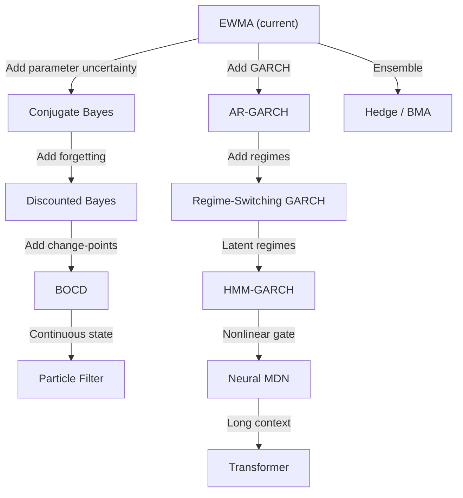

# First-Principles Mathematical Roadmap for Market Transition Modeling

> **What this document is.** A rigorous, axiomatic development of the prediction problem
> facing the market maker, starting from the mathematical primitives and arriving at
> model classes only as *theorems* — consequences of empirical properties of the data.
> It synthesizes and deepens the disperse ideas in the existing THEORY documents,
> filling gaps, correcting imprecisions, and adding the formal structure they lack.
>
> **What this document is not.** A list of models to try. A hyperparameter search plan.
> A survey of ML methods applied to finance.

---

## Table of Contents

- [Preamble: The Epistemological Stance](#preamble-the-epistemological-stance)
- [Part I: The Mathematical Object](#part-i-the-mathematical-object)
  - [I.1 The Observation Space](#i1-the-observation-space)
  - [I.2 The Filtration and the Causality Constraint](#i2-the-filtration-and-the-causality-constraint)
  - [I.3 The Prediction Problem as a Probability Kernel](#i3-the-prediction-problem-as-a-probability-kernel)
  - [I.4 The Factorisation Question](#i4-the-factorisation-question)
- [Part II: The Theoretical Limits of Prediction](#part-ii-the-theoretical-limits-of-prediction)
  - [II.1 The Entropy Rate as the Absolute Floor](#ii1-the-entropy-rate-as-the-absolute-floor)
  - [II.2 The Decomposition of Achievable Gain](#ii2-the-decomposition-of-achievable-gain)
  - [II.3 The Predictive Information Curve](#ii3-the-predictive-information-curve)
  - [II.4 Impossibility Results: When to Stop](#ii4-impossibility-results-when-to-stop)
- [Part III: The Nature of the Process — What Must Be True Before Any Model](#part-iii-the-nature-of-the-process)
  - [III.1 Is the Process Stationary? (And in What Sense?)](#iii1-is-the-process-stationary)
  - [III.2 Is the Process Markov? (And of What Order?)](#iii2-is-the-process-markov)
  - [III.3 Is the Process Ergodic? (And Over What Window?)](#iii3-is-the-process-ergodic)
  - [III.4 Is the Mean Predictable or is it a Martingale?](#iii4-is-the-mean-predictable)
  - [III.5 Is the Variance Predictable? (ARCH Structure)](#iii5-is-the-variance-predictable)
  - [III.6 What Is the Tail Behaviour?](#iii6-what-is-the-tail-behaviour)
  - [III.7 Is There Regime Structure?](#iii7-is-there-regime-structure)
  - [III.8 What Are the Dependence Structures?](#iii8-what-are-the-dependence-structures)
- [Part IV: Why NLL — And When It Is Not Enough](#part-iv-why-nll)
  - [IV.1 The Properness Theorem](#iv1-the-properness-theorem)
  - [IV.2 The KL Connection](#iv2-the-kl-connection)
  - [IV.3 Failure Modes of NLL](#iv3-failure-modes-of-nll)
  - [IV.4 Decision-Theoretic Misalignment with MPC](#iv4-decision-theoretic-misalignment)
  - [IV.5 Complementary Scoring Rules](#iv5-complementary-scoring-rules)
- [Part V: The Online Learning Problem — Why This Is Not Batch ML](#part-v-the-online-learning-problem)
  - [V.1 Static Regret vs. Tracking Regret](#v1-static-vs-tracking-regret)
  - [V.2 The EWMA as a Degenerate Kalman Filter](#v2-ewma-as-degenerate-kalman)
  - [V.3 The Optimal Forgetting Rate Is a Derived Quantity](#v3-optimal-forgetting-rate)
  - [V.4 The Expert Aggregation Guarantee](#v4-expert-aggregation)
  - [V.5 The Catastrophic Forgetting Barrier for Neural Methods](#v5-catastrophic-forgetting)
- [Part VI: The Data as a Scientific Instrument — Prescribed Diagnostics](#part-vi-prescribed-diagnostics)
  - [Phase 0: Data Audit](#phase-0-data-audit)
  - [Phase 1: Entropy Floor Estimation](#phase-1-entropy-floor)
  - [Phase 2: Stationarity and Drift Characterisation](#phase-2-stationarity)
  - [Phase 3: Memory and Predictability Structure](#phase-3-memory)
  - [Phase 4: Distributional Shape](#phase-4-distributional-shape)
  - [Phase 5: Regime Discovery](#phase-5-regime-discovery)
  - [Phase 6: Dependence and Factorisation Testing](#phase-6-dependence)
  - [Phase 7: Incumbent Model Audit](#phase-7-incumbent-audit)
- [Part VII: Model Classes as Theorems](#part-vii-model-classes-as-theorems)
  - [VII.1 The Derivation Principle](#vii1-derivation-principle)
  - [VII.2 The Hierarchy](#vii2-the-hierarchy)
  - [VII.3 Connections Between Model Families](#vii3-connections)
- [Part VIII: The Market Maker Context — What Prediction Means for Decisions](#part-viii-market-maker-context)
  - [VIII.1 The Value of Variance Reduction Without Directional Signal](#viii1-variance-reduction)
  - [VIII.2 The Independence of Price Change from Order Flow](#viii2-price-flow-independence)
  - [VIII.3 Reference Pricing and Transformations](#viii3-reference-pricing)
- [Part IX: The Research Programme — Decision Tree](#part-ix-research-programme)

---

## Preamble: The Epistemological Stance

The question is not "which model should we use?" The question is:

> **Given a streaming sequence of market observations, what is the mathematical structure
> of the conditional law of the next observation given the past, and how much of that
> structure can be recovered by a computationally bounded online algorithm?**

This is a question about the *process*, not about models. Models are approximations to the
answer; they do not constitute the answer. The correct research trajectory is:

```
Nature of the process
        ↓
Limits of prediction (information theory)
        ↓
Structure of the predictable component (stochastic process theory)
        ↓
Computational constraints (online learning theory)
        ↓
Model class as a consequence
```

Every existing theory document touches parts of this pipeline but none completes it
rigorously. The gap is particularly severe in two places:

1. **No document derives the entropy floor from data**, so there is no way to know
   whether the current models are 0.01 nats or 5 nats from optimal.
2. **No document formalises what "online" means as a mathematical constraint** on the
   solution class — it is treated as an engineering requirement rather than as a
   theoretical structure that governs achievable regret.

This document fills both gaps and connects them to the concrete data in Postgres.

---

## Part I: The Mathematical Object

### I.1 The Observation Space

Let $t \in \mathbb{Z}_{\geq 0}$ index 30-second intervals. At each $t$, we observe:

$$
\mathbf{x}_t = \bigl(V_t^+, V_t^-, M_t, S_t, \mathcal{B}_t, \tau_t, \mathbf{r}_t\bigr) \in \mathcal{X}
$$

| Symbol | Domain | Meaning |
|--------|--------|---------|
| $V_t^+, V_t^-$ | $\mathbb{Z}_{\geq 0}$ | Aggressive buy/sell volume (integer lots) |
| $M_t$ | $\mathbb{R}_{>0}$ | Mid price $= \frac{1}{2}(\text{best\_bid} + \text{best\_ask})$ |
| $S_t$ | $\mathbb{R}_{\geq 0}$ | Spread $= \text{best\_ask} - \text{best\_bid}$ |
| $\mathcal{B}_t$ | $\mathcal{M}(\mathbb{R}_{>0})$ | Limit order book (a random measure on price space) |
| $\tau_t$ | $[0, 2\pi)$ | Cyclic calendar encoding (time-of-day, day-of-week) |
| $\mathbf{r}_t$ | $\mathbb{R}^k$ | Reference/external venue prices (if available) |

The observation space $\mathcal{X}$ is a product of a discrete space (volumes),
continuous spaces (prices), a function space (orderbook), and a torus (calendar).
This mixed type is not a nuisance — it is a fundamental feature that constrains
which density/PMF families are even well-defined.

> [!IMPORTANT]
> The observation $\mathbf{x}_t$ is a *projection* of the true market state, which
> includes latent order intent, off-exchange activity, maker inventory, and
> macroeconomic context. The gap between $\mathbf{x}_t$ and the true state is
> *irreducible from our vantage point* and constitutes part of the entropy floor.

### I.2 The Filtration and the Causality Constraint

Define the natural filtration:

$$
\mathcal{F}_t = \sigma(\mathbf{x}_0, \mathbf{x}_1, \ldots, \mathbf{x}_t)
$$

**The causality constraint** (matching production): at the moment when the controller
must decide quotes for interval $t+1$, only $\mathcal{F}_t$ is available. Any model
that uses $\mathbf{x}_{t+1}$ to score $\mathbf{x}_{t+1}$ violates causality.

**The action qualification.** If our own quotes $A_t$ can change the displayed book,
the fills, and therefore the measured $\mathbf{x}_{t+1}$, then the filtration should
be $\mathcal{I}_t = \sigma(\mathbf{x}_{0:t}, A_{0:t-1})$ and the correct target is
the interventional distribution:

$$
P(\mathbf{x}_{t+1} \mid \mathcal{I}_t, \operatorname{do}(A_t = a))
$$

For the model lab (evaluating on historical data where our impact was small), we
approximate this by the observational conditional $P(\mathbf{x}_{t+1} \mid \mathcal{F}_t)$.
This approximation must be verified by measuring the correlation between our past
actions and the next observation.

### I.3 The Prediction Problem as a Probability Kernel

A **predictive model** is a probability kernel:

$$
Q_t(\cdot) = Q(\cdot \mid \mathcal{F}_t; \theta_t)
$$

where $\theta_t \in \Theta$ is a state vector computed from $\mathcal{F}_t$ and updated
according to a causal update rule:

$$
\theta_{t+1} = U(\theta_t, \mathbf{x}_{t+1})
$$

The key distinction from batch ML: $\theta_t$ is not a fixed parameter vector learned
from a training set. It is a *filtering state* — the posterior (or an approximation
thereof) given all past data. It evolves with the stream.

**Definition (Prequential Loss).** The per-step loss of the model is:

$$
\ell_{t+1} = -\log Q_t(\mathbf{x}_{t+1})
$$

The aggregate loss over $T$ scored steps is:

$$
\bar{\ell}_T = \frac{1}{T} \sum_{t=0}^{T-1} \ell_{t+1}
$$

This is the **prequential** or **sequential** log-loss (Dawid, 1984). It is the
only honest metric for online predictive models.

### I.4 The Factorisation Question

The current system decomposes the predictive kernel as:

$$
Q_t(\mathbf{x}_{t+1}) = Q_t^{\text{flow}}(V_{t+1}^+, V_{t+1}^-) \cdot Q_t^{\text{price}}(\mathbf{p}_{t+1} \mid V_{t+1}^+, V_{t+1}^-)
$$

where $\mathbf{p}_{t+1} = (M_{t+1}, S_{t+1}, \mathcal{B}_{t+1})$ is the price-related state.

**This factorisation is exact if and only if:**

$$
(V_{t+1}^+, V_{t+1}^-) \perp\!\!\!\perp \mathbf{p}_{t+1} \mid \mathcal{F}_t
$$

i.e., flow and price are conditionally independent given history. This is a testable
hypothesis (Part VI, Phase 6).

Furthermore, the flow model currently assumes:

$$
V_{t+1}^+ \perp\!\!\!\perp V_{t+1}^- \mid \mathcal{F}_t
$$

This is a second conditional independence assumption. Both must be tested.

**Information loss from incorrect factorisation.** If the true joint entropy is
$H(V, \mathbf{p} \mid \mathcal{F}_t) = h_{\text{joint}}$ but the factored model
achieves $h_{\text{flow}} + h_{\text{price|flow}}$, the gap is:

$$
\Delta = I(V; \mathbf{p} \mid \mathcal{F}_t) \geq 0
$$

This is the mutual information between flow and price *after* conditioning on history.
If $\Delta > 0$, the factored model is provably suboptimal regardless of how good the
individual components are.

---

## Part II: The Theoretical Limits of Prediction

### II.1 The Entropy Rate as the Absolute Floor

For a stationary ergodic process $(\mathbf{x}_t)$, the **entropy rate** is:

$$
h = \lim_{t \to \infty} H(\mathbf{x}_{t+1} \mid \mathcal{F}_t)
$$

**Theorem (Shannon, 1948; Dawid, 1984).** No predictive model — of any complexity,
with any amount of training data — can achieve per-step NLL below $h$:

$$
\bar{\ell}_T \geq h + o(1) \quad \text{for any well-calibrated } Q
$$

This is the irreducible uncertainty of the process. It comes from three sources:

1. **Genuine randomness** — the market is not a deterministic system
2. **Unobserved state** — latent variables (off-exchange flow, maker intent) that
   influence $\mathbf{x}_{t+1}$ but are not in $\mathcal{F}_t$
3. **Aggregation loss** — the 30-second bucketing discards sub-second microstructure

> [!CAUTION]
> The process is **not** stationary, so the entropy rate $h$ is not a single number
> but a time-varying quantity $h_t$. In practice, we estimate a *local* entropy rate
> over windows where approximate stationarity holds. The variation in $\hat{h}_t$
> across windows is itself informative — it measures how much the intrinsic uncertainty
> of the market fluctuates.

### II.2 The Decomposition of Achievable Gain

The mean NLL of any model decomposes as:

$$
\bar{\ell}_T = \underbrace{\bar{h}_T}_{\text{irreducible entropy}} + \underbrace{\frac{1}{T}\sum_t D_{\text{KL}}(P_t \| Q_t)}_{\text{model error (reducible)}}
$$

where $P_t$ is the true conditional distribution at step $t$ and $Q_t$ is the model's.

**This is the most important equation in the entire research programme.**

- If $\bar{\ell}_T - \bar{h}_T \approx 0$: the model is near-optimal. No improvement
  is possible regardless of model complexity. Stop.
- If $\bar{\ell}_T - \bar{h}_T \gg 0$: there is exploitable structure. The gap tells
  you *how many nats of predictive information* your model is failing to capture.

The model error term further decomposes into:

$$
D_{\text{KL}}(P_t \| Q_t) = \underbrace{D_{\text{KL}}(P_t \| Q_t^*)}_{\text{approximation error}} + \underbrace{D_{\text{KL}}(Q_t^* \| Q_t)}_{\text{estimation error}}
$$

where $Q_t^*$ is the best model in the model class. The first term is due to model
misspecification (wrong family); the second is due to finite data (wrong parameters).

### II.3 The Predictive Information Curve

Define the **predictive information** as a function of history depth $k$:

$$
\text{PI}(k) = I(\mathbf{x}_{t+1}; \mathbf{x}_{t-k+1:t}) = H(\mathbf{x}_{t+1}) - H(\mathbf{x}_{t+1} \mid \mathbf{x}_{t-k+1:t})
$$

This curve answers the question: *how much does extending history by one more lag
reduce prediction uncertainty?*

Key properties:
- $\text{PI}(0) = 0$ (no history, no prediction)
- $\text{PI}(k)$ is non-decreasing in $k$ (more history never hurts)
- $\text{PI}(\infty) = I(\mathbf{x}_{t+1}; \mathcal{F}_t) = H(\mathbf{x}_{t+1}) - h$

**The shape of PI(k) determines the architecture:**

| PI(k) shape | Implication | Architecture consequence |
|-------------|-------------|------------------------|
| Saturates at $k = 1$ | First-order Markov | No history needed beyond $\mathbf{x}_t$ |
| Saturates at $k \approx 5{-}10$ | Short memory | EWMA, GARCH, short AR sufficient |
| Slow saturation ($k > 50$) | Long memory | Transformer, S4/Mamba, fractional models |
| Non-saturating | Infinite memory / non-ergodic | Change-point structure; reset vs. remember |

**This curve must be estimated before any model is chosen.** If PI saturates at $k=3$,
building a Transformer with context length 4096 is provably wasteful.

### II.4 Impossibility Results: When to Stop

The following are hard limits that no model can overcome:

**Limit 1 (Efficient Markets).** If mid-price returns are a martingale difference
sequence ($E[\Delta M_{t+1} \mid \mathcal{F}_t] = 0$), then:
- No model can predict the *direction* of price moves
- All value of the price model comes from predicting the *distribution shape*
  (variance, tails, kurtosis), not the mean

**Limit 2 (i.i.d. Flow).** If $V_{t+1} \perp\!\!\!\perp \mathcal{F}_t$ (flow is
independent of history), then:
- $\text{PI}_V(k) = 0$ for all $k$
- The optimal flow model is the marginal distribution of $V$, updated only to track
  slow parameter drift. No temporal model adds value.

**Limit 3 (Aggregation).** Information in the sub-30s microstructure (trade-by-trade
sequence, queue position dynamics) is destroyed by bucketing. Define the *aggregation
information loss*:

$$
\Delta_{\text{agg}} = I(\mathbf{x}_{t+1}^{\text{tick-level}}; \mathcal{F}_t^{\text{tick}}) - I(\mathbf{x}_{t+1}^{\text{30s}}; \mathcal{F}_t^{\text{30s}})
$$

This is not directly measurable from 30s data, but it bounds how much improvement is
possible by ingesting finer-grained data.

---

## Part III: The Nature of the Process — What Must Be True Before Any Model {#part-iii-the-nature-of-the-process}

Each subsection below is a *hypothesis about the process*, not a model proposal.
Each has a diagnostic test (Part VI) and a model-class consequence.

### III.1 Is the Process Stationary? (And in What Sense?) {#iii1-is-the-process-stationary}

**Non-stationarity taxonomy:**

| Type | Definition | Diagnostic | Model consequence |
|------|-----------|------------|-------------------|
| I: Unit root in level | $M_t$ is I(1) | ADF test on $M_t$ | Model $\Delta M_t$, not $M_t$ |
| II: Time-varying moments | $\text{Var}(\Delta M_t \mid \mathcal{F}_{t-1}) = \sigma_t^2$ | ACF of $(\Delta M)^2$ | GARCH-type adaptive variance |
| III: Structural breaks | Abrupt parameter jumps | CUSUM, BOCD | Change-point detection + reset |
| IV: Slow drift | Parameters drift smoothly | Rolling parameter estimates | EWMA / discounted Bayes |
| V: Periodicity | Calendar effects | Time-of-day stratified statistics | Condition on $\tau_t$ |

**Critical point:** the EWMA update used in production is theoretically correct for
Type IV only. It handles Type III badly (exponential forgetting is too slow after a
structural break) and ignores Type V entirely.

### III.2 Is the Process Markov? (And of What Order?) {#iii2-is-the-process-markov}

The process $(\mathbf{x}_t)$ is Markov of order $p$ if:

$$
P(\mathbf{x}_{t+1} \mid \mathcal{F}_t) = P(\mathbf{x}_{t+1} \mid \mathbf{x}_{t-p+1:t})
$$

**Test:** partial autocorrelation function (PACF). If PACF$(k) = 0$ for $k > p$, the
process is AR($p$). But PACF only captures *linear* dependence. For nonlinear Markov
order, use the conditional mutual information:

$$
\text{CMI}(k) = I(\mathbf{x}_{t+1}; \mathbf{x}_{t-k} \mid \mathbf{x}_{t-k+1:t})
$$

If $\text{CMI}(k) = 0$, lag $k$ adds no information beyond lags $1, \ldots, k-1$.

**Why this matters:** if the Markov order is $p = 1$, any model that maintains a hidden
state (HMM, RNN, Transformer) is encoding redundant information. The sufficient
statistic for prediction is $\mathbf{x}_t$ alone.

But: the *augmented* process $(\mathbf{x}_t, \sigma_t^2)$ with GARCH variance is
first-order Markov even when $(\mathbf{x}_t)$ alone is not. This is the state-space
interpretation: the "hidden state" is not mystical — it is a well-defined function
of the observable past (the GARCH variance, the EWMA parameters, etc.).

### III.3 Is the Process Ergodic? (And Over What Window?) {#iii3-is-the-process-ergodic}

Ergodicity means time averages converge to ensemble averages. For a non-stationary
process, this fails globally but may hold locally: the process is ergodic within
"epochs" of approximate stationarity.

**Practical implication:** any statistic computed over a long window (e.g., 4-day mean
NLL) is valid only if the process is ergodic over that window. If there are structural
breaks (Type III), the mean NLL is an average over fundamentally different regimes
and may not represent performance in any single regime.

**Test:** compute the mean NLL in non-overlapping 6-hour windows. If the inter-window
variance of mean NLL is comparable to the intra-window variance, the process is
roughly ergodic over 4 days. If inter-window variance dominates, the process has
regime structure that invalidates naive averaging.

### III.4 Is the Mean Predictable or is it a Martingale? {#iii4-is-the-mean-predictable}

**The central question for price models.**

The Efficient Market Hypothesis (in its weakest form) states:

$$
E[\Delta M_{t+1} \mid \mathcal{F}_t] = 0
$$

This does not mean price is "random" — it means *direction is unpredictable*. The full
distribution (variance, skewness, kurtosis, support) may be highly predictable.

**Tests:**
1. **Variance ratio test** (Lo & MacKinlay): $\text{VR}(k) = \frac{\text{Var}(\Delta_k M)}{k \cdot \text{Var}(\Delta_1 M)}$
   - $\text{VR} = 1$: random walk (unpredictable mean)
   - $\text{VR} < 1$: mean-reverting (bid-ask bounce)
   - $\text{VR} > 1$: momentum

2. **ACF of $\Delta M_t$**: if ACF(1) $\approx -0.24$ (as found in THEORY_CLAUDE2),
   there is negative serial correlation — the Roll bid-ask bounce. This is *not*
   information about future "true" price; it is microstructure noise. The correct
   decomposition is:

$$
\Delta M_t = \underbrace{\varphi \cdot \Delta M_{t-1}}_{\text{Roll bounce (structural)}} + \underbrace{\sigma_t \cdot z_t}_{\text{innovation (unpredictable)}}
$$

If $\varphi \approx -0.24$, this explains about 5.7% of variance — small in $R^2$ but
meaningful in NLL because even a small mean-shift moves probability mass.

**What this means for the market maker:** a model that correctly predicts variance
$\sigma_t^2$ (narrowing the distribution when the market is quiet, widening it when
volatile) improves NLL *without predicting direction*. This is directly useful for
the MPC: tighter variance estimates → tighter bid-ask quotes → more efficient spread.

### III.5 Is the Variance Predictable? (ARCH Structure) {#iii5-is-the-variance-predictable}

If ACF of $(\Delta M_t)^2$ is significantly positive at lag 1, the conditional variance
is predictable. This is the definition of ARCH effects (Engle, 1982).

**Known from the data (THEORY_CLAUDE2):**
- ACF($\Delta M^2$)[lag 1] = 0.180, [lag 2] = 0.203
- This confirms conditional heteroscedasticity

**The GARCH(1,1) representation:**

$$
\sigma_t^2 = \omega + \alpha \varepsilon_{t-1}^2 + \beta \sigma_{t-1}^2
$$

where $\varepsilon_t = \Delta M_t - \varphi \Delta M_{t-1}$.

The EWMA variance used in production is IGARCH(1,1): $\alpha + \beta = 1$, which implies
infinite persistence of variance shocks. The empirical ACF decay to near-zero by lag 20
suggests $\alpha + \beta \approx 0.85{-}0.95$ — finite persistence. This is a
*measurable misspecification* of the current model.

**Information-theoretic value of GARCH:**

$$
\Delta_{\text{GARCH}} = H(\Delta M_{t+1} \mid \sigma_{\text{EWMA}}) - H(\Delta M_{t+1} \mid \sigma_{\text{GARCH}})
$$

This measures how many additional nats of predictive information a proper GARCH
variance gives over EWMA. It is estimable from data by comparing conditional
entropies.

### III.6 What Is the Tail Behaviour? {#iii6-what-is-the-tail-behaviour}

**Known from the data (THEORY_CLAUDE2):**
- $\Delta M_t$ has kurtosis ≈ 7.2 (excess), severely non-Gaussian
- 40.4% of intervals have $\Delta M_t = 0$
- Student-t MLE gives $\nu \approx 0.38$ (reflecting the zero mass + heavy tails)

The correct model is a **mixture**:

$$
\Delta M_t \sim \begin{cases} \delta_0 & \text{with prob } p_0(\mathcal{F}_{t-1}) \\ F_{\text{continuous}}(\cdot; \theta_t) & \text{with prob } 1 - p_0 \end{cases}
$$

where $F_{\text{continuous}}$ must have heavy tails. Candidates for the non-zero part:

| Family | Tail behaviour | Parameters | Tractable online? |
|--------|---------------|------------|-------------------|
| Gaussian | Exponential | $\mu, \sigma$ | Yes (EWMA) |
| Student-t | Power law, $P(|x| > v) \sim v^{-\nu}$ | $\mu, \sigma, \nu$ | Approximate |
| NIG | Semi-heavy, between Gaussian and power | $\alpha, \beta, \mu, \delta$ | Yes (sufficient stats) |
| Variance-Gamma | Like NIG, lighter tails | $\lambda, \alpha, \beta, \mu$ | Yes |
| Generalised Hyperbolic | Nests NIG, VG, Student-t | 5 parameters | Harder |

**The +3,967 nats over Gaussian** found in THEORY_CLAUDE2 (≈ 0.46 nats/step) is
the *distributional misspecification cost*. This is a guaranteed, model-free
improvement from switching the innovation family — no temporal structure needed.

> [!IMPORTANT]
> The distributional fix is the single largest source of NLL improvement available.
> It must be implemented first, before any temporal or regime-based enhancement.

### III.7 Is There Regime Structure? {#iii7-is-there-regime-structure}

**Known from the data (THEORY_CLAUDE2):**
- Three spread regimes: tight (<10 IRT, 28%), medium (10-200, 56%), wide (>200, 15%)
- Non-monotonic variance by regime (tight has *higher* variance than medium)
- ACF(spread)[1] = 0.516 (spread is highly persistent)

The non-monotonic variance is important: tight spread ≠ low volatility. It indicates
competitive repositioning — a regime with high-frequency price discovery despite
narrow spreads. This is a microstructure phenomenon specific to this venue.

**Mathematical representation:**

$$
R_t \in \{A, B, C\} \quad \text{(tight, normal, wide)}
$$

Two approaches to regime inference:

1. **Observable threshold (SETAR):** $R_t = f(S_t)$ — no latency, directly observable
2. **Hidden Markov:** $R_t$ is latent, inferred from emissions — handles noisy transitions

If spread is directly observable and highly predictive of regime, the SETAR approach
is preferred because it avoids the filtering problem entirely.

### III.8 What Are the Dependence Structures? {#iii8-what-are-the-dependence-structures}

Three independence hypotheses to test:

**H1: Buy ⊥ Sell | History.** If rejected, correlated bursts are common
(informed traders hitting both sides, or cascading liquidations).

**H2: Flow ⊥ Price | History.** If rejected, the factored model is provably
suboptimal. The contemporaneous correlation between net flow and $\Delta M$ measures
the price impact — how much of the price move is "explained by" the flow that
consumed the book.

**H3: Price changes are independent of future flow.** This is the causal direction:
does a price move at $t$ predict flow at $t+1$? If yes, the correct factorisation is
$P(\text{flow}) \cdot P(\text{price} \mid \text{flow})$ rather than the reverse.
Transfer entropy from price to flow measures this.

---

## Part IV: Why NLL — And When It Is Not Enough {#part-iv-why-nll}

### IV.1 The Properness Theorem {#iv1-the-properness-theorem}

**Theorem (Bernardo, 1979).** The logarithmic score $S(Q, x) = -\log Q(x)$ is the
unique proper scoring rule that is also *local*: the score depends only on the
probability assigned to the observed outcome, not to unobserved outcomes.

**Properness** means: in expectation under the true distribution $P$, the score is
uniquely minimised when $Q = P$:

$$
E_P[-\log Q(x)] \geq E_P[-\log P(x)] \quad \text{with equality iff } Q = P
$$

This ensures that minimising NLL forces the model toward the true conditional
distribution. Any improper scoring rule can be "gamed" by a miscalibrated model.

### IV.2 The KL Connection {#iv2-the-kl-connection}

$$
\bar{\ell}_T = \bar{h}_T + \frac{1}{T}\sum_t D_{\text{KL}}(P_t \| Q_t)
$$

Minimising NLL ≡ minimising mean KL divergence from the true conditional. This is
the information-theoretically optimal objective for generative model selection.

**Minimum Description Length (MDL) interpretation:** $-\log Q_t(\mathbf{x}_{t+1})$
is the codelength of $\mathbf{x}_{t+1}$ under the model's code. Total NLL = total
codelength. Minimising NLL = finding the shortest description = formalised Occam's razor.

### IV.3 Failure Modes of NLL {#iv3-failure-modes-of-nll}

1. **Tail sensitivity.** A single step with near-zero model probability dominates the
   mean. Report both mean and median NLL. Divergences diagnose tail misspecification.

2. **Regime aggregation.** Mean NLL averages over regimes. A model good in one regime
   and catastrophic in another can tie a mediocre-everywhere model. Report
   regime-stratified NLL.

3. **Target sensitivity.** NLL depends on the exact target definition. Scores on
   $\Delta M_t$ vs. VWAP residuals vs. book-shape deltas are not comparable. Fix the
   target before comparing models.

### IV.4 Decision-Theoretic Misalignment with MPC {#iv4-decision-theoretic-misalignment}

The MPC samples *multi-step paths* from the model. One-step NLL scores single
transitions. Two models with identical one-step NLL can produce radically different
multi-step rollout distributions (because serial correlations in the error compound
differently).

The correct evaluation is *multi-step NLL* or downstream MPC performance. But one-step
NLL is a necessary prerequisite: a model with high one-step error cannot produce
calibrated rollouts.

**Decision principle:** one-step NLL is the primary filter; models that pass the filter
should be validated by MPC simulation before deployment.

### IV.5 Complementary Scoring Rules {#iv5-complementary-scoring-rules}

| Score | Formula | Advantage over NLL |
|-------|---------|--------------------|
| CRPS | $\int (F_Q(y) - \mathbf{1}[y \geq x])^2 dy$ | Less sensitive to tails |
| Energy Score | Multivariate extension of CRPS | Handles joint predictions |
| PIT Calibration | Uniformity of $F_Q(x_t)$ | Direct calibration test |
| Quantile Coverage | Fraction in $\alpha$-credible interval | Interpretable by practitioners |

NLL is the primary metric. CRPS and PIT are complementary diagnostics.

---

## Part V: The Online Learning Problem — Why This Is Not Batch ML {#part-v-the-online-learning-problem}

### V.1 Static Regret vs. Tracking Regret {#v1-static-vs-tracking-regret}

**Static regret** (against the best fixed model in hindsight):

$$
\text{Regret}_T^{\text{static}} = \sum_t \ell_t - \min_{Q \in \mathcal{Q}} \sum_t -\log Q(\mathbf{x}_{t+1})
$$

For exponential family Bayesian predictors, this is $O(\log T)$ — essentially free.

**Tracking regret** (against the best time-varying model):

$$
\text{Regret}_T^{\text{track}} = \sum_t \ell_t - \sum_t -\log Q_t^*(\mathbf{x}_{t+1})
$$

where $Q_t^*$ is the locally optimal model at time $t$. If the total parameter variation
is $C_T = \sum_t \|\theta_t^* - \theta_{t-1}^*\|$, the optimal tracking regret scales as
$O(T^{2/3} C_T^{1/3})$ (Besbes, Gur & Zeevi, 2015).

**Implication:** for a highly non-stationary market ($C_T$ large), even the optimal
algorithm has unavoidably large tracking regret. Beyond a certain point, improving model
architecture yields diminishing returns — the bottleneck is the rate of change, not
model expressiveness.

### V.2 The EWMA as a Degenerate Kalman Filter {#v2-ewma-as-degenerate-kalman}

The EWMA update $\hat{\mu}_t = \gamma \hat{\mu}_{t-1} + (1-\gamma) x_t$ is the
steady-state solution to a scalar Kalman filter with:
- State equation: $\mu_t = \mu_{t-1} + w_t$, $w_t \sim N(0, Q)$ (random walk)
- Observation: $x_t = \mu_t + v_t$, $v_t \sim N(0, R)$
- Steady-state gain: $K = 1 - \gamma = \sqrt{Q/R + Q^2/R^2 + ...}$

**What EWMA discards:**
- Parameter *uncertainty* (the Kalman filter maintains $\Sigma_t$; EWMA produces a point estimate)
- Multivariate correlation (separate EWMAs for each parameter ignore their joint posterior)
- Heterogeneous timescales (one $\gamma$ for all parameters forces identical memory lengths)

A vector Kalman filter with state $\theta_t = (\varphi_t, \omega_t, \log\sigma_t^2)$
gives theoretically optimal online estimation with different adaptation rates per parameter.

### V.3 The Optimal Forgetting Rate Is a Derived Quantity {#v3-optimal-forgetting-rate}

For a locally drifting parameter with drift variance $\tau^2$ and observation variance
$\sigma^2$, the optimal EWMA decay is:

$$
\gamma^* = 1 - \sqrt{\tau^2 / \sigma^2}
$$

**$\gamma$ is not a hyperparameter to tune on a grid.** It is a function of the
drift-to-noise ratio, which can be estimated directly from data:

$$
\hat{\tau}^2 = \text{Var}(\hat{\mu}_t^{\text{local}} - \hat{\mu}_{t-1}^{\text{local}})
$$

where $\hat{\mu}_t^{\text{local}}$ is a local parameter estimate over a window of
known length. This turns the most important "hyperparameter" into a derived quantity.

### V.4 The Expert Aggregation Guarantee {#v4-expert-aggregation}

Given $K$ candidate models $\{Q^{(1)}, \ldots, Q^{(K)}\}$, the **Hedge algorithm**
(Freund & Schapire, 1997) maintains weights:

$$
w_t^{(i)} \propto \exp\left(\eta \sum_{s<t} \log Q_s^{(i)}(\mathbf{x}_{s+1})\right)
$$

and predicts $Q_t = \sum_i w_t^{(i)} Q_t^{(i)}$.

**Guarantee:**

$$
\bar{\ell}_T^{\text{Hedge}} \leq \min_i \bar{\ell}_T^{(i)} + \sqrt{\frac{\log K}{2T}}
$$

**This is a free improvement.** The ensemble is never worse than the best individual
model by more than $O(T^{-1/2})$. Applied to the current model zoo (all hurdle
variants, both price models, baselines), this gives an *automatic, theoretically
guaranteed* improvement with negligible computational cost.

Furthermore, the weights $w_t^{(i)}$ provide automatic regime-based model selection:
when the market shifts, the weights rebalance toward whichever model handles the
new regime best.

### V.5 The Catastrophic Forgetting Barrier for Neural Methods {#v5-catastrophic-forgetting}

A neural network updated by one SGD step per observation faces:

$$
n_{\text{eff}} \approx \frac{1}{1-\gamma} \sim 20\text{–}100 \text{ effective samples}
$$

For a network with $d$ parameters, the estimation error scales as $O(d / n_{\text{eff}})$.
If $d \gg n_{\text{eff}}$ (which is true for any network with >100 parameters at
decay $\gamma = 0.95$), the model is overparameterised for the effective sample size
and generalisation is dominated by regularisation, not architecture.

**Mitigation strategies** (all with theoretical backing):
1. **Frozen backbone + adaptive head:** train a feature extractor offline, update only
   the final linear layer online (equivalent to kernel Kalman filter)
2. **In-context learning (Transformers):** use the context window as "memory" — no
   gradient updates needed per step. Non-stationarity is handled by the context window.
3. **Elastic Weight Consolidation:** Fisher-weighted penalty prevents forgetting
4. **Meta-learning:** learn-to-learn from diverse market episodes

---

## Part VI: The Data as a Scientific Instrument — Prescribed Diagnostics {#part-vi-prescribed-diagnostics}

> [!IMPORTANT]
> **None of the analyses below require choosing or fitting a model.** They characterise
> the process directly and answer the theoretical questions from Part III. Each test
> has a specific theoretical implication that determines which model classes are
> justified.

### Phase 0: Data Audit {#phase-0-data-audit}

Before any analysis, verify data integrity:

| Check | Purpose |
|-------|---------|
| Timestamp monotonicity and gaps | Missing intervals invalidate autocorrelation |
| Book staleness detection | Repeated book snapshots indicate data feed issues |
| Volume vs. trade count consistency | Zero volume with nonzero trades → data error |
| Own-action contamination | Our quotes in the book distort "market" observations |
| Reference venue alignment | External price staleness degrades reference models |

**Query target:** `mm_events` table for full orderbook data; `mm_market_facts` for
summary statistics. The full Postgres history is substantially larger than the 4-day
CSV and should be used for all stability analyses.

### Phase 1: Entropy Floor Estimation {#phase-1-entropy-floor}

**Goal:** estimate $h$, the irreducible entropy rate.

**Method 1: Lempel-Ziv compression.** Discretise $\Delta M_t$ into tick-sized bins.
Run zlib/bzip2 compression on the resulting symbol sequence. Compression ratio is
a consistent (biased) estimator of $h / \log |\text{alphabet}|$.

**Method 2: $k$-NN conditional entropy (Kozachenko-Leonenko).** For the continuous
components, embed $(\mathbf{x}_{t-L:t})$ in delay space and estimate
$H(\mathbf{x}_{t+1} \mid \mathbf{x}_{t-L:t})$ via nearest-neighbour distances.

**Method 3: Context Tree Weighting (CTW).** An optimal universal compressor for
discrete sequences. Gives tighter entropy bounds than LZ for short sequences.

**Decision gate:**
- If $\bar{\ell}_T^{\text{current}} - \hat{h} < 0.05$ nats: **STOP**. Current model
  is near-optimal.
- If gap $> 0.5$ nats: significant structure remains unexploited. Proceed.

### Phase 2: Stationarity and Drift Characterisation {#phase-2-stationarity}

| Test | Target | Expected result | Implication |
|------|--------|-----------------|-------------|
| ADF on $M_t$ | Unit root | $p > 0.1$ (unit root) | Model $\Delta M$, not $M$ |
| ADF on $\Delta M_t$ | Stationarity | $p < 0.01$ | $\Delta M$ is I(0) |
| KPSS on $\Delta M_t$ | Stationarity | $p > 0.1$ | Confirms I(0) |
| Rolling variance (1h windows) | Time-varying $\sigma$ | Factor >3 variation | ARCH effects present |
| CUSUM on $(\Delta M)^2$ | Structural breaks | Break dates | Reset-on-break needed |
| Estimate $\hat{\tau}^2$ | Drift rate | $\hat{\tau}^2 / \hat{\sigma}^2$ ratio | Compute $\gamma^*$ |

### Phase 3: Memory and Predictability Structure {#phase-3-memory}

| Analysis | Target series | What it measures |
|----------|--------------|-----------------|
| ACF/PACF of $\Delta M_t$ | Price changes | Linear serial dependence (Roll bounce) |
| ACF of $(\Delta M_t)^2$ | Squared returns | ARCH effects |
| ACF of $I_t = \mathbf{1}[V_t > 0]$ | Activity indicator | Activity clustering |
| ACF of $\log V_t \cdot I_t$ | Log-volume | Volume persistence |
| Permutation entropy (order 3–6) | $\Delta M_t$ and $V_t$ | Nonlinear predictability |
| PI$(k)$ curve | $\Delta M_t$ vs. $\mathbf{x}_{t-k:t}$ | Predictive horizon |
| Variance ratio test VR$(k)$ | $\Delta M_t$ | Mean-reversion vs. momentum |
| Hurst exponent (R/S analysis) | $\Delta M_t$ and $V_t$ | Long-range dependence |
| Transfer entropy $V \to M$ | Volume→Price | Causal flow-price information |
| Transfer entropy $M \to V$ | Price→Volume | Reverse causality |

### Phase 4: Distributional Shape {#phase-4-distributional-shape}

| Test | Target | Purpose |
|------|--------|---------|
| Jarque-Bera on $\Delta M_t$ | Normality | If rejected → non-Gaussian family needed |
| Hill estimator on $|V_t|$ (positive) | Tail index $\xi$ | $\xi > 0$: power law; $\xi = 0$: exponential |
| Q-Q plot vs. LogNormal, Gamma, Weibull | $V_t > 0$ | Visual family assessment |
| KS test vs. LogNormal for $\log V_t$ | LogNormal assumption | Current model's distributional assumption |
| Excess kurtosis of $\log V_t$ | LogNormal tails | If $\gg 3$: LogNormal is misspecified |
| NIG MLE on standardised $\Delta M$ residuals | Innovation distribution | Identify correct family |
| Zero-inflation rate by regime | $p_0$ stationarity | Is zero-rate constant or regime-dependent? |

### Phase 5: Regime Discovery {#phase-5-regime-discovery}

| Analysis | Method | Purpose |
|----------|--------|---------|
| Spread histogram | Kernel density, GMM | Identify number of modes |
| HMM ($K=2,3$) on $(\Delta M, \log V)$ | Batch EM (diagnostic only) | Discover regime structure |
| Regime transition matrix $A$ | From fitted HMM | Regime persistence |
| Per-regime NLL comparison | HMM vs. single-regime | Quantify regime value |
| Time-of-day stratification | Group by hour | Calendar seasonality |

### Phase 6: Dependence and Factorisation Testing {#phase-6-dependence}

| Hypothesis | Test | Result meaning |
|------------|------|---------------|
| $V^+ \perp\!\!\!\perp V^- \mid \mathcal{F}_{t-1}$ | HSIC, conditional correlation | If rejected: joint flow model needed |
| $V_{t+1} \perp\!\!\!\perp \mathbf{p}_{t+1} \mid \mathcal{F}_t$ | Conditional MI estimation | If rejected: factored model is suboptimal |
| $\text{corr}(\mathbf{1}[\Delta M = 0], \mathbf{1}[V = 0])$ | Contingency table | Shared zero mechanism? |
| $I(\Delta M_{t+1}; V_{t+1} \mid \mathcal{F}_t)$ | $k$-NN MI estimator | Contemporaneous flow-price dependence |

### Phase 7: Incumbent Model Audit {#phase-7-incumbent-audit}

Before trying new models, diagnose the *current* models:

| Diagnostic | Method | What it reveals |
|------------|--------|-----------------|
| PIT histogram | $u_t = F_{Q_t}(x_t)$, check uniformity | Calibration failure pattern |
| Coverage at $\alpha = 0.5, 0.8, 0.9, 0.95$ | Fraction in credible interval | Over/under-confident? |
| Regime-stratified NLL | Split by volume tercile, spread regime | Where does the model fail? |
| Residual serial correlation | ACF of PIT values $u_t$ | Unexploited temporal structure |
| Score tails | P99 of per-step NLL | Catastrophic failures |

---

## Part VII: Model Classes as Theorems {#part-vii-model-classes-as-theorems}

### VII.1 The Derivation Principle {#vii1-derivation-principle}

No model should be tried unless it is the *consequence* of a diagnostic finding:

$$
\text{Empirical finding} \implies \text{Mathematical requirement} \implies \text{Model class}
$$

If a diagnostic finds no evidence for a particular structure, the model that
represents it is *not justified* and should not be tried.

### VII.2 The Hierarchy {#vii2-the-hierarchy}

Each tier adds one theoretically motivated component. Each is implemented only if
the diagnostic from Part VI justifies it.

#### Tier 0: Correct the Distribution (OBLIGATORY)

**Finding:** Gaussian innovation has kurtosis 7.2, +3967 nats misspecification cost.
**Requirement:** Heavy-tailed, zero-inflated innovation distribution.
**Model:** Hurdle-NIG (or Hurdle-t) for $\Delta M_t$, with EWMA on the NIG parameters.

$$
\Delta M_t \mid \mathcal{F}_{t-1} \sim \text{Hurdle}(p_0) \times \text{NIG}(\mu_t, \sigma_t, \alpha, \beta)
$$

**Expected gain:** ≈ 0.46 nats/step (measured, not estimated).

#### Tier 1: Add the AR(1) Mean (Roll Bounce)

**Finding:** ACF($\Delta M$)[1] = -0.238, $t = -22.87$.
**Requirement:** Conditional mean is nonzero.
**Model:** AR(1) correction:

$$
\Delta M_t \mid \mathcal{F}_{t-1} \sim \text{Hurdle}(p_0) \times \text{NIG}(\varphi \cdot \Delta M_{t-1}, \sigma_t, \alpha, \beta)
$$

with $\varphi$ estimated online via recursive least squares.

**Expected gain:** ≈ 0.03–0.06 nats/step.

#### Tier 2: Add GARCH Variance Dynamics

**Finding:** ACF($\Delta M^2$)[1] = 0.18, variance is predictable.
**Requirement:** Time-varying conditional variance.
**Model:** GARCH(1,1) on the residuals:

$$
\sigma_t^2 = \omega + \alpha \varepsilon_{t-1}^2 + \beta \sigma_{t-1}^2
$$

This replaces the IGARCH (EWMA) with a proper GARCH with $\alpha + \beta < 1$.

**Expected gain:** ≈ 0.05–0.15 nats/step.

#### Tier 3: Add Regime Conditioning

**Finding:** Three spread regimes with different variance structures.
**Requirement:** Regime-specific parameters.
**Model:** SETAR (threshold) or soft-gated regime-switching:

$$
\sigma_t^2 = \sum_r q_r(S_t) \cdot (\omega_r + \alpha_r \varepsilon_{t-1}^2 + \beta_r \sigma_{t-1}^2)
$$

where $q_r(S_t)$ is a soft-assignment based on observed spread.

**Expected gain:** ≈ 0.02–0.08 nats/step.

#### Tier 4: Add Volume Memory

**Finding:** ACF(buy\_vol)[1] = 0.272, volume is serially correlated.
**Requirement:** Conditional flow model with autoregressive structure.
**Model:** AR(1)-Negative Binomial or Hawkes-type:

$$
E[V_t \mid \mathcal{F}_{t-1}] = \mu_V + \kappa \cdot V_{t-1}
$$

with Negative Binomial innovations (captures overdispersion).

#### Tier 5: Joint Flow-Price Model

**If** Phase 6 finds $I(V_{t+1}; \mathbf{p}_{t+1} \mid \mathcal{F}_t) > 0$ significantly:
replace the factored model with a joint model using copulas or a joint emission
distribution.

#### Tier 6: Expert Ensemble (Hedge)

**Always justified.** Apply Hedge/Bayesian model averaging over all Tier 0–5 candidates.
Guaranteed to be no worse than the best individual model.

#### Tier 7: Neural/Transformer Methods

**Only if:** gap remains > 0.3 nats after Tiers 0–6, AND permutation entropy shows
nonlinear dependence, AND sufficient data volume (> 10k intervals).

**Architecture:** domain-trained small Transformer (4–8 layers, $d = 64$–128) with
MDN output head. Sliding-window inference (no online weight updates). Offline
retraining daily/weekly.

### VII.3 Connections Between Model Families {#vii3-connections}



---

## Part VIII: The Market Maker Context — What Prediction Means for Decisions {#part-viii-market-maker-context}

### VIII.1 The Value of Variance Reduction Without Directional Signal {#viii1-variance-reduction}

Suppose the price model has zero directional signal ($E[\Delta M_{t+1}] = 0$) but
correctly predicts variance $\sigma_{t+1}^2$. How does this help the market maker?

The MPC uses the model to generate future paths. Paths with correct variance lead to:

1. **Tighter spread in low-volatility regimes:** if $\sigma$ is small, the MPC knows
   adverse selection risk is low → quotes can be tighter → more fills → more PnL
2. **Wider spread in high-volatility regimes:** if $\sigma$ is large, the MPC widens
   to avoid being picked off by informed flow
3. **Correct inventory risk assessment:** portfolio risk is proportional to $\sigma$,
   so correct variance → correct position sizing

**Quantitatively:** if the current model overestimates $\sigma$ by a factor $c > 1$
on average, the MPC quotes are $c$ times wider than necessary in stable periods,
missing fills. If it underestimates $\sigma$, the MPC is too aggressive and suffers
adverse selection. A well-calibrated $\sigma$ is worth more than a directional
signal of comparable NLL improvement.

### VIII.2 The Independence of Price Change from Order Flow {#viii2-price-flow-independence}

**Observation (from data):** $\text{corr}(\text{net\_flow}_t, \Delta M_{t+1}) \approx 0.012$.

**What this means:**
1. The exchange's matching engine + existing market makers are efficiently incorporating
   flow information into the current price. By the time the 30s bucket closes, the
   information in that bucket's flow is already reflected in the new mid.
2. **Price discovery is happening within the interval**, not between intervals.
3. The current factorisation (predict flow, then predict price conditional on flow)
   is approximately justified — flow at $t$ tells you little about $\Delta M$ at $t+1$.
4. **However:** flow may predict *variance* at $t+1$ (large flow → high volatility
   next period), even if it doesn't predict *direction*. This is a second-order
   dependence missed by correlation.

### VIII.3 Reference Pricing and Transformations {#viii3-reference-pricing}

**Data transformations that may improve prediction:**

1. **Microprice:** $\tilde{M}_t = M_t + S_t \cdot \frac{Q_{\text{bid}}}{Q_{\text{bid}} + Q_{\text{ask}}}$.
   Removes some bid-ask bounce noise from the mid-price series.

2. **Log-price returns:** $r_t = \log(M_t / M_{t-1})$. Stabilises variance across
   different price levels (multiplicative → additive).

3. **Spread-normalised returns:** $r_t^* = \Delta M_t / S_t$. Measures price moves
   in units of spread — the natural unit for a market maker.

4. **VWAP residual:** $\varepsilon_t = \text{VWAP}_{\text{observed}} - \text{VWAP}_{\text{mechanical}}$.
   Isolates the component of price movement not explained by passive book consumption.
   This is what the production `residual` model targets.

5. **Orderbook imbalance features:** $\text{OBI}_t = \frac{Q_{\text{bid}} - Q_{\text{ask}}}{Q_{\text{bid}} + Q_{\text{ask}}}$.
   Contains information about short-term price pressure.

Each transformation defines a different target random variable and therefore a different
entropy floor. The "best" target is the one that:
- Has the lowest conditional entropy $H(Y_{t+1} \mid \mathcal{F}_t)$ (most predictable)
- Is most useful for the MPC's decision (generates the most value)

These two objectives may conflict: the most predictable feature may not be the one
the MPC needs most. The resolution is to evaluate models on the *joint* target
$(V, \Delta M, S, \text{book shape})$ rather than on any single marginal.

---

## Part IX: The Research Programme — Decision Tree {#part-ix-research-programme}

The following is a **falsification-based** research programme. Each step produces a
binary gate. Only affirmative gates lead to the next step.

```
Phase 0: Data Audit
│
├─ Data quality sufficient? ─── NO → Fix data pipeline first
│
└─ YES → Phase 1: Entropy Floor
│
Phase 1: Estimate h
│
├─ Current NLL - h < 0.05 nats? ─── YES → STOP. Model is near-optimal.
│                                          Focus on MPC, not prediction.
│
└─ Gap > 0.05 → Phase 2: Where is the gap?
│
Phase 2: Characterise the gap
│
├─ 2a: Is the distribution misspecified? (Tier 0 diagnostic)
│   ├─ YES → Implement Hurdle-NIG. Re-measure gap.
│   └─ NO → Continue
│
├─ 2b: Is there AR(1) structure in mean? (Tier 1 diagnostic)
│   ├─ YES → Add Roll correction. Re-measure.
│   └─ NO → Continue
│
├─ 2c: Is variance predictable? (Tier 2 diagnostic)
│   ├─ YES → Add GARCH. Re-measure.
│   └─ NO → Continue
│
├─ 2d: Is there regime structure? (Tier 3 diagnostic)
│   ├─ YES → Add regime conditioning. Re-measure.
│   └─ NO → Continue
│
├─ 2e: Is volume serially correlated? (Tier 4 diagnostic)
│   ├─ YES → Add AR-volume model. Re-measure.
│   └─ NO → Continue
│
├─ 2f: Is the factorisation invalid? (Tier 5 diagnostic)
│   ├─ YES → Build joint model.
│   └─ NO → Continue
│
Phase 3: Ensemble
│
└─ Apply Hedge over all justified models. Measure gap.
│
├─ Gap < 0.05? ─── YES → STOP. Near-optimal.
│
└─ Gap > 0.3 AND nonlinear dependence detected?
   │
   ├─ YES → Phase 4: Neural/Transformer (Tier 7)
   │
   └─ NO → STOP. Remaining gap is likely irreducible.
│
Phase 5: Validation
│
├─ PIT calibration test passes?
├─ Coverage at all α-levels?
├─ Regime-stratified NLL stable?
│
└─ ALL YES → Deploy to MPC simulation
│
Phase 6: Decision Validation
│
└─ Does improved NLL → improved MPC PnL in simulation?
    │
    ├─ YES → Ship to production
    └─ NO → Investigate NLL-MPC coupling breakdown
```

> [!TIP]
> **The single most impactful near-term action** (requiring no new architecture) is the
> **Hedge ensemble** (§V.4) over all existing model variants. It has a provable regret
> guarantee, costs $O(K)$ per step, and automatically selects the best model in each
> regime.
>
> **The second most impactful action** is estimating $\gamma^*$ from data rather than
> sweeping it on a grid (§V.3).
>
> **The third** is switching the innovation distribution from Gaussian to NIG/Student-t
> (§VII.2, Tier 0).

---

## References

| Concept | Reference |
|---------|-----------|
| Prequential evaluation | Dawid (1984). *JRSS A*, 147(2) |
| Proper scoring rules | Gneiting & Raftery (2007). *JASA*, 102(477) |
| Entropy rate | Cover & Thomas (2006). *Elements of Information Theory* |
| Permutation entropy | Bandt & Pompe (2002). *PRL*, 88(17) |
| Online learning regret | Cesa-Bianchi & Lugosi (2006). *Prediction, Learning, and Games* |
| Tracking regret | Besbes, Gur & Zeevi (2015). *Operations Research*, 63(5) |
| BOCD | Adams & MacKay (2007). *arXiv:0710.3742* |
| Online EM for HMM | Cappé & Moulines (2009). *JRSS B*, 71(3) |
| Locally stationary processes | Dahlhaus (1996). *Stoch. Proc. Appl.*, 62(1) |
| In-context learning | Garg et al. (2022). *NeurIPS* |
| Transfer entropy | Schreiber (2000). *PRL*, 85(2) |
| Roll model | Roll (1984). *JoF*, 39(4) |
| ARCH | Engle (1982). *Econometrica*, 50(4) |
| Variance ratio test | Lo & MacKinlay (1988). *Rev. Fin. Studies*, 1(1) |
| Expert aggregation | Freund & Schapire (1997); Vovk (1990) |
| EWC | Kirkpatrick et al. (2017). *PNAS*, 114(13) |
| NIG distribution | Barndorff-Nielsen (1977). *Proc. Royal Soc. London* |
| Hawkes processes | Hawkes (1971). *Biometrika*, 58(1) |
| GARCH | Bollerslev (1986). *J. Econometrics*, 31(3) |
| Kalman filter | Kalman (1960). *ASME J. Basic Eng.*, 82(1) |
